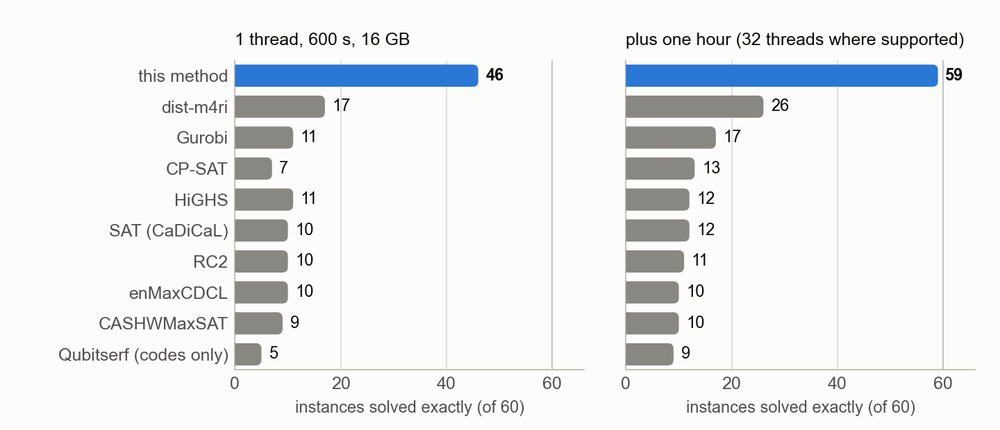

# Certified circuit distances of quantum memory circuits

The circuit distance of a quantum memory is the smallest number of faults that no detector sees and
that flips a logical observable. This repository computes it exactly, as an interval that closes: a
lower bound proved by excluding every lighter fault set, and an upper bound given by an explicit
fault set replayed in Stim. The same engine computes code distances.

**Start with [docs/note.md](docs/note.md)**: five pages on the method and the numerical results.



## What is here

- **A method.** Reduce the circuit's fault model to the detectors of one memory basis (exact), merge
  each check's detectors over time (a certified lower bound that no longer depends on the number of
  rounds), search by weight with a meet-in-the-middle table and the code's symmetry, and lift the
  relaxed solutions back to real fault sets.
- **A benchmark** against other exact solvers (connected-cluster enumeration, integer programming
  including Gurobi, SAT, MaxSAT) on 60 instances. It solves 46 with one thread in 600 s and 59 with
  32 threads in an hour; all other methods together solve 17 and 28, and none solves an
  instance it does not.
- **The instances of the prior benchmark** (Webster, Jacob, Higgott, arXiv:2603.22532), from its own
  files: of its 126 CSS codes and circuits it solves 86 with one thread in 600 s and 96 with 32
  threads in an hour; its five exact methods together solved 73, with eight hours each.
- **Results for published circuits and codes**: bivariate bicycle codes up to [[288,12,18]]
  (circuit distance 16), circuits from 17 papers, and 15 code distances that arXiv:2610.03682 could
  only bracket, for codes of up to 31,200 qubits.

## Quick start

Requirements: Python 3.9 or later, a C compiler available as `cc` (the search kernel is compiled on
first use; OpenMP is used where the compiler supports it).

```sh
python -m venv .venv
.venv/bin/pip install -r requirements.txt

# circuit distance of the [[72,12,6]] bivariate bicycle memory circuit: 6, in about a second
.venv/bin/python run_bb.py circuits/bb72_r6_Z.stim out.json

# a rebuilt modular surface-code circuit of arXiv:2610.03682: 8
.venv/bin/python papers/run_parallel.py hypsurf q6_L5_NZ_fb Z out.json 5 3 12

# code distance of a [[128,12,8]] hyperbolic color code
.venv/bin/python papers/hyperbolic_run.py out.json lins444_40_L2 20 60

# tests of the kernel against brute force
.venv/bin/python tests/test_search.py
```

All commands in this repository are meant to be run from its root. Every result file records the
certified bounds, the search log per weight threshold, and the fault set with its replay.

## Layout

| path | content |
|---|---|
| `cdist/` | the library: problem construction and reductions, the search kernel (C), lifting, replay in Stim, the dense dynamic program |
| `run_bb.py` | one-file driver: a Stim memory circuit in, certified bounds out |
| `scripts/` | further drivers and the generators of the report tables; `scripts/server/` holds the launchers used on our machine |
| `papers/` | builders and drivers for published circuits and codes; `papers/new/` has the reading notes per paper |
| `bench/` | the benchmark: instance registry, adapters for each solver, harness, table generators |
| `phase4/` | experiments on bounds inside the search (covering bound) |
| `tests/` | tests of the kernel and of every builder |
| `circuits/` | the stored bivariate bicycle memory circuits |
| `results/` | the result records behind every table |
| `docs/` | the note, the reports, the figures |

## Documentation

| document | content |
|---|---|
| [docs/note.md](docs/note.md) | method and results in five pages, with figures |
| [docs/BENCHMARK.md](docs/BENCHMARK.md) | the comparison with other exact methods: protocol, every table, limits |
| [docs/PAPERS.md](docs/PAPERS.md) | published circuits and codes, in four batches, with how each number was obtained |
| [docs/BB_CIRCUITS.md](docs/BB_CIRCUITS.md) | the first study, bivariate bicycle codes from [[72,12,6]] to [[288,12,18]]: method in detail, evidence |
| [docs/PHASE4.md](docs/PHASE4.md) | bounds inside the search: what was tried, what helps |
| [docs/SUMMARY.md](docs/SUMMARY.md) | one page of representative cases (4 October) |
| [docs/RESULTS.md](docs/RESULTS.md), [docs/PAPERS_RESULTS.md](docs/PAPERS_RESULTS.md) | generated tables of the first study and of the first batch of papers |
| [docs/next_step.md](docs/next_step.md) | what is parked |
| [bench/METHODS.md](bench/METHODS.md), [bench/INSTANCES.md](bench/INSTANCES.md) | survey of distance-finding methods (its "catalog" links point to a separate literature catalogue that is not part of this repository); the benchmark instances |

The tables in the reports are generated from `results/` and never typed by hand:
`scripts/summarize*.py` fill `docs/RESULTS.md`, `docs/PAPERS_RESULTS.md` and the marked blocks of
`docs/PAPERS.md`; `bench/make_benchmark_md.py` fills `docs/BENCHMARK.md`; `docs/make_figures.py`
draws the figures.

## External material that is not included

Third-party data and software are not redistributed here. The parts of the code that need them say
so; everything else runs without them.

| needed for | what | where it goes |
|---|---|---|
| mitten circuits (`papers/mitten_circuit.py`) | `processor_codes/mitten` of github.com/a7b/yarn, commit `1b58edd`; file list with checksums in `papers/mitten/manifest.json` | `papers/mitten/mitten/` |
| amplified-code circuits (`papers/amplified_circuit.py`) | github.com/zijian-liang/dp_certificates_github, commit `0772a00` | `papers/amplified/repo/` |
| cross-check of the Cornucopia circuits (`papers/cornucopia_crosscheck.py`) | github.com/ZhideLu/Cornucopia_code, commit `fc12c97` | `papers/downloads/cornucopia_repo/` |
| Kasai's codes (`papers/kasai_codes.py`) | the `.npz` files of kasai.ict.eng.isct.ac.jp/pair_partition_cpm_css_codes_20260714.html | `papers/downloads/kasai/` |
| benchmark competitors (`bench/adapters/`) | dist-m4ri 0.9.0, CASHWMaxSAT-CorePlus, enMaxCDCL, Qubitserf 0.1.0, OR-Tools; Gurobi (licence needed; `gurobipy`, or `gurobi_cl` from `$GUROBI_HOME/bin`) | `bench/external/`, or pass `binary=` to the adapter |
| comparison with arXiv:2603.22532 (`bench/export_wjh.py`, `bench/wjh_compare.py`) | github.com/m-webster/codeDistancePYPI, commit `a4afe9c` (MIT licence): their circuits, code constructions and result sheets | `papers/downloads/codedistance/` |
| new hyperbolic tilings (`papers/hyperbolic_lins.g`) | GAP 4.15 with the LINS package; the lists used for the reported results are in `results/papers4/hyperbolic/` | |

Also withheld: the full text of arXiv:2610.03682 used while rebuilding its codes, and the reading
note `papers/new/2608.02773.md`, which quotes its paper at length.

Not included because they are regenerated on demand: the exported benchmark matrices
(`python bench/export_all.py` and `python bench/export_wjh.py`; only each instance's `meta.json` is
kept), the circuits of
`circuits/papers/`, compiled kernels, and run logs.

## Status and caveats

- Research code. The pipeline expects a CSS memory experiment whose detectors carry coordinates
  (check, 0, round, type), or a small builder module per code as in `papers/`; symmetries are
  supplied by the builder. See "Limits" in docs/note.md and docs/BENCHMARK.md.
- "Circuit distance" always refers to the circuit as built here from a published description and
  the stated fault model. Where a paper's circuit files are not public, the choices made in
  rebuilding it are listed in the notes of `papers/new/`.
- Result records were produced on our server and contain its absolute paths.
