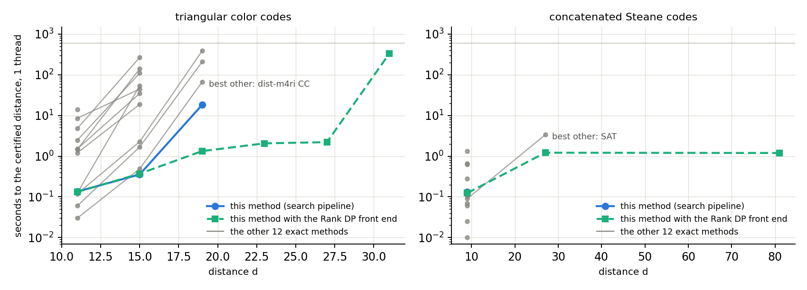

# Benchmark: exact distance solvers on circuit and code problems

Status, 19 October 2026: all passes are complete, including Gurobi (added on 15 October), the instances
of the prior benchmark arXiv:2603.22532, dist-m4ri 0.14.7 (rerun on 18 October; the first runs used 0.9.0,
whose records are kept) and the integer-programming and SAT tools on a sparse logical basis of the code
instances (19 October; the first runs are kept). Tables are filled by `bench/make_benchmark_md.py` from the
records in `results/bench/`, `results/bench_tierB/`, `results/bench_ablation/`, `results/bench_wjh/`,
`results/bench_wjh_8h/` and `results/bench_wjh_tierB/`.

## Question

Is the method of this project, the tropical partition function method (certified relaxations plus a
weight-bounded sparse search, see [BB_CIRCUITS.md](BB_CIRCUITS.md)), the best available way to compute the circuit distance exactly? The test:
every method gets the same problem, the same machine and the same limits, and every answer is
checked.

## Answer

On these 60 instances, yes, with the qualifications given below. A tool is credited with an instance if
any of its configurations solves it: dist-m4ri 0.14.7 in either mode and from either input, the
integer-programming and SAT tools with either logical basis of a code.

- **Coverage.** Ours solves 47 instances exactly with one thread in 600 s and 59 with 32 threads in
  an hour. The other exact methods together solve 30 and 38, and dist-m4ri 0.14.7 alone
  accounts for all of them. No instance is solved by another method and not by ours; 21 are solved by
  ours only. The one instance ours leaves open, the mitten [[300,60,14]] circuit, is open for every method
  (ours certifies at least 11).
- **Circuits** (44): ours 34 in the first tier, 43 over both; all others together 21 and 27. Where
  another method needs the second tier (dist-m4ri on six circuits, 7 to 60 minutes on 32 threads), ours
  solves the circuit with one thread in 0.3 to 376 s. The gross-code circuit with the best depth-7
  schedule, BB288, Cornucopia from n = 900, the routing circuits from n = 140, the mitten circuit of
  n = 200, the weight-8 and the self-dual BB circuits of n = 144 and 120, the left-right gross circuit and
  the surface code from d = 15 are solved by ours only.
- **Codes** (16): ours 12 and 16; all others together 9 and 11. The strongest other tool is
  dist-m4ri 0.14.7: the BB288 code in 115 s with one thread (ours 3 s), the Kasai [[372,130,16]] code in
  30 minutes on 32 threads (ours 104 s on one). Solved by ours only: the bivariate bicycle code
  [[360,12,24]], the balanced-product codes [[390,78,16]] and [[625,125,20]], and the Kasai codes
  [[444,154,18]] and [[492,170,20]].
- **Raw detector error model.** Without the sector reduction ours solves the same 19 of the 27 qLDPC
  circuits as on the sector problem. dist-m4ri 0.14.7 solves 4 of them from our matrices and 11 when it
  reads Stim's detector error model, on which it applies its own exact reduction (it drops the detectors
  of the other basis when that is exact, much as our sector reduction does).
- **MaxSAT as it is used in the literature** (Stim's own WCNF export of the whole circuit, then a
  MaxSAT solver; the recipe behind the published exact values for the BB72 and [[90,8,10]]
  circuits): none of the three solvers proves the distance of any qLDPC circuit, in 600 s or in an
  hour. The best certified lower bound after an hour is 3 (RC2) on circuits of distance 5 to 11. It
  solves the surface code up to d = 5 and the color-code circuits up to d = 7.
- **Where another tool is faster.** dist-m4ri 0.14.7 is faster than ours on 17 instances. On 14 of them
  both need less than two seconds (it takes 0.01 to 0.4 s, ours 0.1 to 1.6 s, which is mostly the start
  of Python). The other three are Stim's color-code circuits of d = 9 and 11, where none of our
  reductions applies (0.4 s against 33 s, 28 s against 240 s), and the shift circuit (24 s against 37 s;
  its relaxation is loose, 2 against 8, and our plain search without it takes 1.4 s).
  On the other eight instances that take both tools more than a second, ours is 19 to 88 times faster.
- **dist-m4ri versions.** The benchmark first ran dist-m4ri 0.9.0 (18 September); its version of 15
  October, 0.14.7, solves 30 and 38 instances where 0.9.0 solved 17 and 26. Both are compared in a
  section of their own.
- **Gurobi** (added on 15 October, same protocol): 11 instances in the first tier and 19 over
  both, each of them also solved by another method. Of the circuits it solves the surface code up to
  d = 9, the color code up to d = 7 and the three smallest qLDPC circuits ([[72,12,6]], routing 54,
  STAR 42) in 3 to 9 minutes on 32 threads, where ours needs about a second on one thread.
- **Logical basis of the codes.** On a sparse basis of the same logical space the integer-programming
  and SAT tools solve no further code of this suite, and Gurobi loses two codes on it, [[288,12,18]] and
  [[324,12,18]]. On
  codes with many logical qubits it helps: Gurobi solves 33 of the 42 hyperbolic codes of the prior
  benchmark in 600 s, against 30 on the first basis. See the section on the basis.
- **The prior benchmark's own instances** (126 CSS codes and circuits of arXiv:2603.22532, section
  below): under that paper's own limits (one core, 8 GB, eight hours per run) ours solves 95; its five
  exact methods together solved 73, and their values agree with ours. With one thread and 600 s ours
  solves 86 and dist-m4ri 0.14.7 76; with the 32-thread hour added, 96 and 80.
- **Correctness.** No record of any method contradicts the ground truth or another method's bounds.

Qualifications:

1. Two things carry the result, and the tables separate them. The time-collapsed relaxation helps
   every solver: on the collapsed problems dist-m4ri 0.14.7 solves 26 of 39 and HiGHS 20, against
   16 and 3 of the same 39 circuits on the sector problem (first tier). Our search is then still
   ahead on identical input (33 of 39).
2. Without the reductions, on Stim's color-code circuits, dist-m4ri 0.14.7 is the faster method at every
   distance tested (d = 11: 28 s against 240 s).
3. The surface-code family is graph-like: a shortest-path computation solves it at any size, and is
   how its ground truth was obtained here. It is in the benchmark because the prior exact-solver
   benchmark uses it, not because it is hard in principle.
4. Competing tools change: dist-m4ri gained a large factor between September and October. The
   comparison is with the versions named in the methods table.

## Problem and instances

A problem is a pair of binary matrices (H, L): find the smallest set of columns whose H-columns sum
to zero and whose L-columns do not. For a circuit, columns are the mechanisms of the undecomposed
detector error model, rows of H are detectors and rows of L are logical observables; the optimum is
the circuit distance. For a code, H is one check matrix and L a basis of the logical operators of
the other type; the optimum is the code distance.

Each circuit instance is given in three forms:

| variant | what it is | status |
|---|---|---|
| `full` | the raw detector error model | the problem as a user poses it |
| `sector` | detectors of the memory basis only | exact reduction, checked at export |
| `collapsed` | detectors of one check merged over time | relaxation: a lower bound, with its own optimum |

Solvers other than ours cannot be expected to find the sector reduction themselves, so the main
comparison is on `sector`, which gives them their best case; `full` shows what happens without it.

Instance families ([bench/INSTANCES.md](../bench/INSTANCES.md) lists all 61):

- circuits of bivariate bicycle codes: the standard depth-7 circuits of [[72,12,6]] to [[288,12,18]],
  the best depth-7 schedules found here, the left-right gross circuit, weight-8 and self-dual codes;
- circuits from papers: Cornucopia, mitten, routing, shift, STAR, Walking Cat;
- rotated surface-code memory circuits from Stim's generator, d = 3 to 25, rounds = d. The closest
  prior benchmark (Webster, Jacob, Higgott, arXiv:2603.22532) uses this family with SI1000 noise;
  its own files (24485 mechanisms at d = 11, against 24483 here) are run in the section on its
  instances below;
- Stim's color-code memory circuits (`color_code:memory_xyz`), d = 3 to 11: not a CSS memory
  experiment, so there is no sector or collapsed form and our reductions do not apply;
- code distance of 16 CSS codes with n = 72 to 1044.

Ground truth comes from this project's earlier certified results, from a shortest-path computation
for the surface code (its sector problem is graph-like), or, where marked †, from the runs of the
table itself when their bounds close.

## Methods

| name in the tables | method | implementation | threads |
|---|---|---|---|
| ours | collapsed relaxation, lifting, windows, symmetry, covering bound, weight-bounded search | this project (`bench/adapters/ours_pipeline.py`); plain search on codes and on circuits without CSS sectors | OpenMP |
| ours, plain | the weight-bounded search alone on the problem as given | `bench/adapters/ours.py` | OpenMP |
| dist-m4ri CC | connected-cluster enumeration | dist-m4ri 0.14.7 (commit bed621e, 15 Oct 2026), m4ri 20260122; first runs with 0.9.0, see the section on the two builds | yes |
| dist-m4ri CC+RW | the same with random-window upper bounds | same binary, `mode=bracket` | yes |
| … DEM input | the same programs reading Stim's detector error model, so that their own exact reductions (merging equal columns, dropping detectors) apply | same binary, `input=dem` (raw circuits only) | yes |
| HiGHS | integer linear program | HiGHS as bundled with SciPy 1.16.3 | no gain |
| CP-SAT | integer program by lazy clause generation | OR-Tools 9.15.6755 | yes |
| Gurobi | integer linear program, the same model as HiGHS | Gurobi 13.0.3, academic licence, run as `gurobi_cl` on an LP file written by the adapter | yes |
| SAT | incremental SAT with a cardinality bound | PySAT 1.8 with CaDiCaL 1.5.3 | 1 |
| RC2 | core-guided MaxSAT | PySAT RC2 on CaDiCaL 1.5.3 | 1 |
| CASHWMaxSAT | MaxSAT | CASHWMaxSAT-CorePlus (MaxSAT Evaluation 2023) | 1 |
| enMaxCDCL | branch-and-bound MaxSAT | enMaxCDCL (authors' binary, CP 2026) | 1 |
| … (Stim WCNF) | the three MaxSAT solvers on Stim's own WCNF export of the whole circuit | `stim.Circuit.shortest_error_sat_problem`, the recipe used in the literature | 1 |
| Qubitserf CC / BZ / MITM | connected clusters, Brouwer-Zimmermann, meet in the middle; CSS codes only | Qubitserf 0.1.0 (commit ab96b9c) | yes |
| BP+OSD | decoding random logical constraints; upper bounds only | ldpc 2.4.1, min-sum, 100 iterations, OSD-CS order 2 | 1 |
| ISD | randomised information-set search; upper bounds only | this project | 1 |
| Stim search | `search_for_undetectable_logical_errors`; upper bounds only | Stim 1.15.0 | 1 |
| dist-m4ri RW | random window; upper bounds only | dist-m4ri 0.14.7 | yes |

Gurobi was added on 15 October 2026, when a licence became available, with the same protocol; its
records sit next to the others. Not tested: height-bound decision-tree decoding and the
tesseract-based route (no public distance tool found). The instances and published results of the
prior benchmark (arXiv:2603.22532) are compared in a section of their own below. The survey behind
this list is [bench/METHODS.md](../bench/METHODS.md).

## Protocol

- Machine: one socket of an AMD EPYC 9654 server (96 cores), each run pinned to its own cores.
- First tier: 1 thread, 600 s, 16 GB, every method on every instance.
- Second tier: only the instances a method did not solve in the first tier. Tools that use threads
  get 32 threads, 90 GB and 3600 s; single-thread tools get 1 thread, 16 GB and 3600 s.
- Give-up rule: within a family, instances are run in order of size; after two unsolved instances in
  a row (one in the second tier) the larger ones of that family are skipped for that method.
- An answer counts as exact only if the method certifies a lower bound equal to its upper bound and
  the harness verifies the fault set against the matrices. Qubitserf returns a number and no
  codeword; its values are marked with * and compared with the ground truth instead.
- No per-instance tuning for any method, ours included.
- Memory: from 16 October 2026 every record carries `harness.peak_group_rss_mb`, the peak resident
  memory of the run's whole process group (workers and external solvers included), sampled every
  0.1 s. Earlier records only have the adapter's own figure (`peak_rss_mb`), which misses worker
  processes.

Reading a cell: a time means solved exactly; `>=7` a certified lower bound only; `7..12` both
bounds; `<=12` an upper bound only (`ok` if it equals the distance); `t/o` nothing certified;
`mem` out of memory; `skip` not run because of the give-up rule; `-` not applicable.

## Results at a glance

Main problem of each instance (sector problem of a CSS circuit, raw model of a color-code circuit,
the code itself); time of the fastest exact run. Tier 1: 1 thread, 600 s, 16 GB. Tier 2: one hour,
with 32 threads and 90 GB for tools that use threads.

<!-- TABLE:overall:BEGIN -->
| instance | n | columns | distance | ours, tier 1 | ours, tier 2 | best other, tier 1 | best other, tier 2 |
|---|---:|---:|---:|---:|---:|---|---|
| bb108_best_r6 | 108 | 3348 | 10 | 16.7 s |  |  | 3600 s (dist-m4ri CC+RW, 32 threads) |
| gross_best_r6 | 144 | 4464 | 11 | 114 s |  |  |  |
| bb72_r6 | 72 | 2232 | 6 | 0.4 s |  | 0.1 s (dist-m4ri CC) | 534 s (Gurobi, 32 threads) |
| bb90_r10 | 90 | 4590 | 8 | 0.4 s |  | 59.8 s (dist-m4ri CC) |  |
| bb108_r10 | 108 | 5508 | 8 | 0.5 s |  | 57.4 s (dist-m4ri CC) |  |
| bb144_r12 | 144 | 8784 | 10 | 1.4 s |  |  | 532 s (dist-m4ri CC+RW, 32 threads) |
| bb288_r18 | 288 | 26208 | 16 |  | 242 s |  |  |
| w8bb_72 | 72 | 3096 | 8 | 4.4 s |  | 205 s (dist-m4ri CC) |  |
| w8bb_144_16 | 144 | 6192 | 10 | 163 s |  |  |  |
| cornucopia_252 | 252 | 8568 | 5 | 1.6 s |  | 0.4 s (dist-m4ri CC) |  |
| cornucopia_576 | 576 | 19584 | 8 | 376 s |  |  | 1263 s (dist-m4ri CC+RW, 32 threads) |
| cornucopia_900 | 900 | 30600 | 9 |  | 485 s |  |  |
| cornucopia_1044 | 1044 | 35496 | 10 |  | 881 s |  |  |
| lrgross | 144 | 4464 | 11 | 19.8 s |  |  |  |
| mitten_150 | 150 | 9750 | 8 | 130 s |  |  | 1485 s (dist-m4ri CC+RW, 32 threads) |
| mitten_300 | 300 | 11820 | >=12 |  |  |  |  |
| mitten_200 | 200 | 15560 | 9 |  | 148 s |  |  |
| routing_54 | 54 | 1998 | 6 | 0.9 s |  | 0.1 s (dist-m4ri CC) | 206 s (Gurobi, 32 threads) |
| routing_90 | 90 | 3330 | 9 | 5.4 s |  | 477 s (dist-m4ri CC) |  |
| routing_110 | 110 | 4070 | 10 | 35.3 s |  |  | 408 s (dist-m4ri CC+RW, 32 threads) |
| routing_140_13 | 140 | 5180 | 12 |  | 103 s |  |  |
| routing_200_24 | 200 | 11700 | 10 |  | 477 s |  |  |
| sdbb_64 | 64 | 2752 | 8 | 3.7 s |  | 121 s (dist-m4ri CC) |  |
| sdbb_120 | 120 | 5160 | 12 |  | 1117 s |  |  |
| shift_120d | 120 | 3720 | 8 | 37.1 s |  | 24.2 s (dist-m4ri CC) |  |
| star_42 | 42 | 1806 | 6 | 0.8 s |  | 0.2 s (dist-m4ri CC) | 389 s (Gurobi, 32 threads) |
| color_d3 | 7 | 72 | 2† | 0.1 s |  | 0.0 s (dist-m4ri CC) |  |
| color_d5 | 19 | 1104 | 3† | 0.2 s |  | 0.0 s (dist-m4ri CC) |  |
| color_d7 | 37 | 3651 | 4† | 1.6 s |  | 0.0 s (dist-m4ri CC) | 379 s (CP-SAT, 32 threads) |
| color_d9 | 61 | 7683 | 5† | 33.3 s |  | 0.4 s (dist-m4ri CC) |  |
| color_d11 | 91 | 16422 | 6† | 240 s |  | 27.9 s (dist-m4ri CC, DEM input) |  |
| surface_d3 | 9 | 55 | 3 | 0.1 s |  | 0.0 s (dist-m4ri CC) |  |
| surface_d5 | 25 | 301 | 5 | 0.1 s |  | 0.0 s (dist-m4ri CC) |  |
| surface_d7 | 49 | 883 | 7 | 0.1 s |  | 0.0 s (dist-m4ri CC) | 82.5 s (CP-SAT, 32 threads) |
| surface_d9 | 81 | 1945 | 9 | 0.1 s |  | 1.8 s (dist-m4ri CC) | 815 s (Gurobi, 32 threads) |
| surface_d11 | 121 | 3631 | 11 | 0.2 s |  | 244 s (dist-m4ri CC) |  |
| surface_d13 | 169 | 6085 | 13 | 0.3 s |  |  | 1287 s (dist-m4ri CC+RW, 32 threads) |
| surface_d15 | 225 | 9451 | 15 | 0.7 s |  |  |  |
| surface_d17 | 289 | 13873 | 17 | 2.0 s |  |  |  |
| surface_d19 | 361 | 19495 | 19 | 12.3 s |  |  |  |
| surface_d21 | 441 | 26461 | 21 | 65.2 s |  |  |  |
| surface_d23 | 529 | 34915 | 23 | 552 s | 23.7 s |  |  |
| surface_d25 | 625 | 45001 | 25 |  | 196 s |  |  |
| walkingcat_54 | 54 | 2322 | 8 | 6.7 s |  | 129 s (dist-m4ri CC) |  |
| code_bb72 | 72 | 72 | 6 | 0.2 s |  | 0.0 s (dist-m4ri CC) |  |
| code_bb90 | 90 | 90 | 10 | 0.2 s |  | 0.0 s (dist-m4ri CC) |  |
| code_bb108 | 108 | 108 | 10 | 0.3 s |  | 0.0 s (dist-m4ri CC) |  |
| code_bb144 | 144 | 144 | 12 | 0.2 s |  | 0.1 s (dist-m4ri CC) | 59.5 s (CP-SAT, 32 threads) |
| code_bb288 | 288 | 288 | 18 | 3.1 s |  | 115 s (dist-m4ri CC) | 2006 s (Gurobi, 32 threads) |
| code_cornucopia_1044 | 1044 | 1044 | 12† | 1.7 s |  | 133 s (dist-m4ri CC) | 1633 s (Qubitserf CC, 32 threads) |
| code_w8bb_144_6 | 144 | 144 | 15 | 1.2 s |  | 86.5 s (dist-m4ri CC) | 419 s (Gurobi, sparse L, 32 threads) |
| code_mm_324 | 324 | 324 | 18 | 2.6 s |  |  | 216 s (dist-m4ri CC+RW, 32 threads) |
| code_llmbb_360 | 360 | 360 | 24 |  | 54.9 s |  |  |
| code_balanced_390 | 390 | 390 | 16 | 39.0 s |  |  |  |
| code_balanced_625 | 625 | 625 | 20 |  | 47.2 s |  |  |
| code_gala_132 | 132 | 132 | 12 | 1.2 s |  | 30.5 s (dist-m4ri CC) | 191 s (Gurobi, sparse L, 32 threads) |
| code_kasai_372 | 372 | 372 | 16 | 104 s |  |  | 1817 s (dist-m4ri CC+RW, 32 threads) |
| code_kasai_444 | 444 | 444 | 18 |  | 57.5 s |  |  |
| code_kasai_492 | 492 | 492 | 20 |  | 776 s |  |  |
| code_sdbb_200 | 200 | 200 | 12 | 0.2 s |  | 1.2 s (dist-m4ri CC) | 1204 s (CP-SAT, 32 threads) |

Of 60 instances: ours solves 47 in the first tier and 59 over both tiers; some other exact method solves 30 in the first tier and 38 over both. 21 are solved by ours only; 0 are solved by another method and not by ours.
<!-- TABLE:overall:END -->

## Results, first tier (1 thread, 600 s, 16 GB)

<!-- TABLE:A-check:BEGIN -->
All first-tier records are mutually consistent and consistent with the ground truth.
<!-- TABLE:A-check:END -->

### Circuits, sector problem

<!-- TABLE:A-circuit-sector:BEGIN -->
| instance | n | columns | distance | ours | ours + DP | ours, plain | dist-m4ri CC | dist-m4ri CC+RW | HiGHS | CP-SAT | Gurobi | SAT | RC2 | CASHWMaxSAT | enMaxCDCL | Qubitserf CC | Qubitserf BZ | Qubitserf MITM | BP+OSD | ISD | Stim search | dist-m4ri RW |
|---|---:|---:|---:|---:|---:|---:|---:|---:|---:|---:|---:|---:|---:|---:|---:|---:|---:|---:|---:|---:|---:|---:|
| bb108_best_r6 | 108 | 3348 | 10 | 16.7 s | 12.9 s | 12.2 s | >=9 | 9..10 | 1..12 | <=11 | 3..12 | >=5 | >=5 | >=1 | >=1 | - | - | - | <=10 ok | <=10 ok | mem | <=10 ok |
| gross_best_r6 | 144 | 4464 | 11 | 114 s | 74.2 s | 99.4 s | >=9 | 9..11 | 1..31 | t/o | 3..12 | >=3 | >=4 | >=1 | >=1 | - | - | - | <=11 ok | <=11 ok | mem | <=11 ok |
| bb72_r6 | 72 | 2232 | 6 | 0.4 s | 0.2 s | 0.3 s | 0.1 s | 1.5 s | 1..6 | <=6 ok | 3..6 | >=4 | >=5 | >=1 | >=1 | - | - | - | <=6 ok | <=6 ok | <=6 ok | <=6 ok |
| bb90_r10 | 90 | 4590 | 8 | 0.4 s | 0.4 s | 1.3 s | 59.8 s | 473 s | 1..27 | <=13 | 3..9 | >=4 | >=4 | >=1 | >=1 | - | - | - | <=8 ok | <=8 ok | mem | <=8 ok |
| bb108_r10 | 108 | 5508 | 8 | 0.5 s | 0.6 s | 1.6 s | 57.4 s | 567 s | skip | skip | skip | skip | skip | skip | skip | skip | skip | skip | <=8 ok | <=8 ok | mem | <=8 ok |
| bb144_r12 | 144 | 8784 | 10 | 1.4 s | 1.4 s | 46.0 s | >=8 | 8..10 | skip | skip | skip | skip | skip | skip | skip | skip | skip | skip | <=12 | <=11 | mem | <=10 ok |
| bb288_r18 | 288 | 26208 | 16 | >=14 | >=14 | >=11 | >=8 | 8..18 | skip | skip | skip | skip | skip | skip | skip | skip | skip | skip | <=26 | <=35 | mem | <=18 |
| w8bb_72 | 72 | 3096 | 8 | 4.4 s | 4.5 s | 5.6 s | 205 s | 296 s | 1..8 | <=8 ok | 3..8 | >=4 | >=4 | >=1 | >=1 | - | - | - | <=8 ok | <=8 ok | <=8 ok | <=8 ok |
| w8bb_144_16 | 144 | 6192 | 10 | 163 s | 163 s | 178 s | >=8 | 8..10 | t/o | t/o | 2..10 | >=4 | >=4 | >=1 | >=1 | - | - | - | <=10 ok | <=10 ok | mem | <=10 ok |
| cornucopia_252 | 252 | 8568 | 5 | 1.6 s | 2.2 s | 7.7 s | 0.4 s | 12.5 s | t/o | t/o | 2..6 | >=3 | >=3 | >=1 | >=1 | - | - | - | <=5 ok | <=5 ok | mem | <=5 ok |
| cornucopia_576 | 576 | 19584 | 8 | 376 s | 389 s | >=7 | >=7 | >=7 | t/o | t/o | 1..33 | >=2 | >=1 | >=1 | >=1 | - | - | - | <=8 ok | <=8 ok | mem | t/o |
| cornucopia_900 | 900 | 30600 | 9 | >=9 | >=9 | >=7 | >=6 | >=6 | skip | skip | skip | skip | skip | skip | skip | skip | skip | skip | <=18 | t/o | mem | t/o |
| cornucopia_1044 | 1044 | 35496 | 10 | >=9 | >=9 | skip | skip | skip | skip | skip | skip | skip | skip | skip | skip | skip | skip | skip | t/o | t/o | mem | t/o |
| lrgross | 144 | 4464 | 11 | 19.8 s | 20.7 s | >=10 | >=8 | 8..11 | t/o | t/o | 3..11 | >=3 | >=4 | >=1 | >=1 | - | - | - | <=11 ok | <=11 ok | mem | <=11 ok |
| mitten_150 | 150 | 9750 | 8 | 130 s | 135 s | t/o | >=7 | 7..8 | 1..10 | t/o | 2..10 | >=3 | >=3 | >=1 | >=1 | - | - | - | <=9 | <=8 ok | mem | <=8 ok |
| mitten_300 | 300 | 11820 | >=12 | >=9 | >=9 | >=7 | >=6 | 6..14 | t/o | t/o | 2..16 | >=3 | >=2 | >=1 | >=1 | - | - | - | <=14 | <=28 | mem | <=13 |
| mitten_200 | 200 | 15560 | 9 | >=8 | >=8 | skip | skip | skip | skip | skip | skip | skip | skip | skip | skip | skip | skip | skip | <=12 | <=16 | mem | <=9 ok |
| routing_54 | 54 | 1998 | 6 | 0.9 s | 0.9 s | 0.4 s | 0.1 s | 1.9 s | 2..6 | <=6 ok | 4..6 | >=4 | >=5 | >=1 | >=1 | - | - | - | <=6 ok | <=6 ok | <=6 ok | <=6 ok |
| routing_90 | 90 | 3330 | 9 | 5.4 s | 5.4 s | 5.8 s | 477 s | 507 s | 2..26 | t/o | 4..9 | >=4 | >=5 | >=1 | >=1 | - | - | - | <=9 ok | <=9 ok | mem | <=9 ok |
| routing_110 | 110 | 4070 | 10 | 35.3 s | 36.8 s | 33.3 s | >=9 | 9..10 | skip | skip | skip | skip | skip | skip | skip | skip | skip | skip | <=10 ok | <=10 ok | mem | <=10 ok |
| routing_140_13 | 140 | 5180 | 12 | 11..13 | 11..13 | >=11 | >=9 | 9..12 | skip | skip | skip | skip | skip | skip | skip | skip | skip | skip | <=12 ok | <=12 ok | mem | <=12 ok |
| routing_200_24 | 200 | 11700 | 10 | 9..10 | 9..10 | >=9 | skip | skip | skip | skip | skip | skip | skip | skip | skip | skip | skip | skip | <=18 | <=11 | t/o | <=10 ok |
| sdbb_64 | 64 | 2752 | 8 | 3.7 s | 3.9 s | 4.0 s | 121 s | 202 s | 1..8 | <=12 | 3..8 | >=4 | >=5 | >=1 | >=1 | - | - | - | <=8 ok | <=8 ok | mem | <=8 ok |
| sdbb_120 | 120 | 5160 | 12 | 11..12 | 11..12 | >=10 | >=8 | 8..12 | t/o | t/o | 2..12 | >=3 | >=4 | >=1 | >=1 | - | - | - | <=13 | <=13 | mem | <=12 ok |
| shift_120d | 120 | 3720 | 8 | 37.1 s | 11.5 s | 1.4 s | 24.2 s | 423 s | t/o | <=12 | 3..8 | >=4 | >=5 | >=1 | >=1 | - | - | - | <=8 ok | <=8 ok | mem | <=8 ok |
| star_42 | 42 | 1806 | 6 | 0.8 s | 0.7 s | 0.5 s | 0.2 s | 4.8 s | 3..6 | <=6 ok | 4..6 | >=4 | >=5 | >=1 | >=1 | - | - | - | <=6 ok | <=6 ok | <=6 ok | <=6 ok |
| walkingcat_54 | 54 | 2322 | 8 | 6.7 s | 6.8 s | 6.2 s | 129 s | 188 s | 2..11 | <=9 | 4..9 | >=4 | >=4 | >=1 | >=1 | - | - | - | <=8 ok | <=8 ok | mem | <=8 ok |
| **solved exactly** (of 27) | | | | **19** | **19** | **16** | **11** | **11** | **0** | **0** | **0** | **0** | **0** | **0** | **0** | **0** | **0** | **0** |  |  |  |  |
<!-- TABLE:A-circuit-sector:END -->

### Circuits, raw detector error model

<!-- TABLE:A-circuit-full:BEGIN -->
| instance | n | columns | distance | ours | ours + DP | ours, plain | dist-m4ri CC | dist-m4ri CC+RW | dist-m4ri CC, DEM input | dist-m4ri CC+RW, DEM input | HiGHS | CP-SAT | Gurobi | SAT | RC2 | CASHWMaxSAT | enMaxCDCL | RC2 (Stim WCNF) | CASHWMaxSAT (Stim WCNF) | enMaxCDCL (Stim WCNF) | Qubitserf CC | Qubitserf BZ | Qubitserf MITM | BP+OSD | ISD | Stim search | dist-m4ri RW |
|---|---:|---:|---:|---:|---:|---:|---:|---:|---:|---:|---:|---:|---:|---:|---:|---:|---:|---:|---:|---:|---:|---:|---:|---:|---:|---:|---:|
| bb108_best_r6 | 108 | 24246 | 10 | 12.7 s | 12.6 s | >=7 | >=6 | 6..10 | >=9 | 9..10 | t/o | t/o | 2..10 | >=3 | >=2 | >=1 | >=1 | >=2 | >=1 | >=1 | - | - | - | <=12 | <=16 | mem | <=10 ok |
| gross_best_r6 | 144 | 32328 | 11 | 120 s | 74.2 s | >=7 | >=6 | 6..11 | >=9 | 9..11 | t/o | t/o | 2..12 | >=2 | >=2 | >=1 | >=1 | >=2 | >=1 | >=1 | - | - | - | <=14 | <=111 | mem | <=11 ok |
| bb72_r6 | 72 | 16164 | 6 | 0.3 s | 0.3 s | 29.8 s | 94.3 s | 162 s | 0.8 s | 1.7 s | t/o | t/o | 2..6 | >=3 | >=3 | >=1 | >=1 | >=2 | >=1 | >=1 | - | - | - | <=6 ok | <=6 ok | <=6 ok | <=6 ok |
| bb90_r10 | 90 | 34965 | 8 | 0.6 s | 0.6 s | mem | >=6 | 6..8 | 42.4 s | 353 s | t/o | t/o | 2..8 | >=2 | >=2 | >=1 | >=1 | >=2 | >=1 | >=1 | - | - | - | <=11 | <=11 | mem | <=8 ok |
| bb108_r10 | 108 | 41958 | 8 | 0.7 s | 0.8 s | mem | >=6 | 6..8 | 50.7 s | 419 s | skip | skip | skip | skip | skip | skip | skip | skip | skip | skip | skip | skip | skip | <=11 | <=53 | mem | <=8 ok |
| bb144_r12 | 144 | 67752 | 10 | 1.9 s | 1.8 s | skip | skip | skip | >=9 | >=9 | skip | skip | skip | skip | skip | skip | skip | skip | skip | skip | skip | skip | skip | <=16 | <=31 | mem | <=10 ok |
| bb288_r18 | 288 | 206352 | 16 | >=14 | >=14 | skip | skip | skip | >=8 | >=8 | skip | skip | skip | skip | skip | skip | skip | skip | skip | skip | skip | skip | skip | mem | t/o | mem | t/o |
| w8bb_72 | 72 | 23904 | 8 | 4.5 s | 4.6 s | >=6 | >=5 | 5..8 | 140 s | 218 s | t/o | t/o | 2..8 | >=2 | >=2 | >=1 | >=1 | >=2 | >=1 | >=1 | - | - | - | <=10 | <=10 | <=8 ok | <=8 ok |
| w8bb_144_16 | 144 | 47808 | 10 | 165 s | 164 s | mem | >=5 | >=5 | >=8 | 8..10 | t/o | t/o | 1..13 | >=2 | >=1 | >=1 | >=1 | >=1 | >=1 | >=1 | - | - | - | <=14 | t/o | mem | t/o |
| cornucopia_252 | 252 | 65450 | 5 | 2.4 s | 3.1 s | mem | 64.0 s | >=5 | 6.5 s | 9.5 s | t/o | t/o | 1..8 | >=1 | mem | >=1 | >=1 | >=1 | >=1 | >=1 | - | - | - | <=6 | <=7 | mem | t/o |
| cornucopia_576 | 576 | 149760 | 8 | 382 s | 393 s | mem | >=5 | >=5 | >=7 | >=7 | skip | skip | skip | skip | skip | skip | skip | mem | >=1 | >=1 | skip | skip | skip | mem | t/o | mem | t/o |
| cornucopia_900 | 900 | 234000 | 9 | >=9 | >=9 | skip | >=5 | skip | >=6 | >=6 | skip | skip | skip | skip | skip | skip | skip | skip | skip | skip | skip | skip | skip | mem | t/o | mem | t/o |
| cornucopia_1044 | 1044 | 271440 | 10 | >=9 | >=9 | skip | skip | skip | skip | skip | skip | skip | skip | skip | skip | skip | skip | skip | skip | skip | skip | skip | skip | mem | t/o | mem | t/o |
| lrgross | 144 | 31488 | 11 | 19.8 s | 20.6 s | >=7 | >=6 | 6..11 | >=8 | >=8 | t/o | t/o | 2..12 | >=2 | >=2 | >=1 | >=1 | >=2 | >=1 | >=1 | - | - | - | <=11 ok | <=12 | mem | <=11 ok |
| mitten_150 | 150 | 76395 | 8 | 135 s | 135 s | mem | >=5 | >=5 | >=7 | >=7 | t/o | t/o | 2..10 | >=2 | >=1 | >=1 | >=1 | >=1 | >=1 | >=1 | - | - | - | <=10 | <=67 | mem | t/o |
| mitten_300 | 300 | 87780 | >=12 | >=9 | >=9 | mem | >=5 | >=5 | >=7 | >=7 | t/o | t/o | 1..16 | >=1 | >=1 | >=1 | >=1 | >=1 | >=1 | >=1 | - | - | - | <=15 | t/o | mem | t/o |
| mitten_200 | 200 | 123792 | 9 | >=8 | >=8 | skip | skip | skip | skip | skip | skip | skip | skip | skip | skip | skip | skip | skip | skip | skip | skip | skip | skip | mem | t/o | mem | t/o |
| routing_54 | 54 | 14958 | 6 | 0.9 s | 0.9 s | 83.7 s | 189 s | 343 s | 0.5 s | 2.0 s | t/o | t/o | 3..6 | >=3 | >=3 | >=1 | >=1 | >=2 | >=1 | >=1 | - | - | - | <=6 ok | <=6 ok | <=6 ok | <=6 ok |
| routing_90 | 90 | 25020 | 9 | 5.5 s | 5.6 s | >=7 | >=6 | 6..9 | 398 s | 479 s | t/o | t/o | 2..9 | >=3 | >=2 | >=1 | >=1 | >=2 | >=1 | >=1 | - | - | - | <=9 ok | <=38 | mem | <=9 ok |
| routing_110 | 110 | 30580 | 10 | 35.5 s | 36.5 s | >=7 | >=6 | 6..10 | >=9 | 9..10 | skip | skip | skip | skip | skip | skip | skip | skip | skip | skip | skip | skip | skip | <=11 | <=92 | mem | <=10 ok |
| routing_140_13 | 140 | 38920 | 12 | 11..13 | 11..13 | skip | skip | skip | >=9 | >=9 | skip | skip | skip | skip | skip | skip | skip | skip | skip | skip | skip | skip | skip | <=12 ok | t/o | mem | <=13 |
| routing_200_24 | 200 | 95200 | 10 | 9..10 | 9..10 | skip | skip | skip | skip | skip | skip | skip | skip | skip | skip | skip | skip | skip | skip | skip | skip | skip | skip | mem | t/o | t/o | t/o |
| sdbb_64 | 64 | 21248 | 8 | 3.9 s | 4.0 s | t/o | >=6 | 6..8 | 68.6 s | 131 s | t/o | t/o | 2..8 | >=3 | >=2 | >=1 | >=1 | >=2 | >=1 | >=1 | - | - | - | <=8 ok | <=8 ok | mem | <=8 ok |
| sdbb_120 | 120 | 39840 | 12 | 11..12 | 11..12 | mem | >=5 | 5..15 | >=8 | 8..12 | t/o | t/o | 2..12 | >=2 | >=2 | >=1 | >=1 | >=2 | >=1 | >=1 | - | - | - | <=19 | <=116 | mem | <=12 ok |
| shift_120d | 120 | 27000 | 8 | 46.7 s | 11.8 s | >=7 | >=6 | 6..9 | 15.3 s | 244 s | t/o | t/o | 2..14 | >=2 | >=2 | >=1 | >=1 | >=2 | >=1 | >=1 | - | - | - | <=11 | <=18 | mem | <=8 ok |
| star_42 | 42 | 13902 | 6 | 0.9 s | 0.8 s | 289 s | 383 s | 600 s | 0.5 s | 3.4 s | t/o | t/o | 2..6 | >=3 | >=3 | >=1 | >=1 | >=3 | >=1 | >=1 | - | - | - | <=6 ok | <=6 ok | <=6 ok | <=6 ok |
| walkingcat_54 | 54 | 17820 | 8 | 6.8 s | 6.9 s | >=6 | >=6 | 6..8 | 67.9 s | 117 s | t/o | <=68 | 3..9 | >=3 | >=3 | >=1 | >=1 | >=2 | >=1 | >=1 | - | - | - | <=8 ok | <=14 | mem | <=8 ok |
| **solved exactly** (of 27) | | | | **19** | **19** | **3** | **4** | **3** | **11** | **11** | **0** | **0** | **0** | **0** | **0** | **0** | **0** | **0** | **0** | **0** | **0** | **0** | **0** |  |  |  |  |
<!-- TABLE:A-circuit-full:END -->

### Codes

<!-- TABLE:A-code:BEGIN -->
| instance | n | columns | distance | ours | ours + DP | ours, plain | dist-m4ri CC | dist-m4ri CC+RW | HiGHS | CP-SAT | Gurobi | SAT | RC2 | CASHWMaxSAT | enMaxCDCL | Qubitserf CC | Qubitserf BZ | Qubitserf MITM | BP+OSD | ISD | dist-m4ri RW |
|---|---:|---:|---:|---:|---:|---:|---:|---:|---:|---:|---:|---:|---:|---:|---:|---:|---:|---:|---:|---:|---:|
| code_bb72 | 72 | 72 | 6 | 0.2 s | 0.1 s | 0.0 s | 0.0 s | 0.0 s | 0.7 s | 0.3 s | 0.7 s | 0.2 s | 0.2 s | 0.3 s | 0.1 s | 0.1 s* | 0.1 s* | 0.6 s* | <=6 ok | <=6 ok | <=6 ok |
| code_bb90 | 90 | 90 | 10 | 0.2 s | 0.1 s | 0.0 s | 0.0 s | 0.1 s | 16.5 s | 49.0 s | 2.5 s | 17.6 s | 16.5 s | 27.4 s | 0.7 s | 0.1 s* | 3.9 s* | mem | <=10 ok | <=10 ok | <=10 ok |
| code_bb108 | 108 | 108 | 10 | 0.3 s | 0.2 s | 0.0 s | 0.0 s | 0.1 s | 24.5 s | 36.6 s | 3.7 s | 21.1 s | 17.0 s | 37.0 s | 2.0 s | 0.1 s* | 16.8 s* | mem | <=10 ok | <=10 ok | <=10 ok |
| code_bb144 | 144 | 144 | 12 | 0.2 s | 0.2 s | 0.1 s | 0.1 s | 0.3 s | 183 s | <=12 ok | 43.8 s | 168 s | 196 s | 462 s | 28.7 s | 0.9 s* | t/o | skip | <=12 ok | <=12 ok | <=12 ok |
| code_bb288 | 288 | 288 | 18 | 3.1 s | 1.7 s | 2.5 s | 115 s | 501 s | 5..20 | <=18 ok | 10..18 | >=10 | >=11 | >=1 | >=1 | t/o | t/o | skip | <=18 ok | <=18 ok | <=18 ok |
| code_cornucopia_1044 | 1044 | 1044 | 12† | 1.7 s | 2.7 s | 1.1 s | 133 s | 600 s | t/o | <=20 | 2..16 | >=5 | >=5 | >=1 | >=1 | t/o | t/o | mem | <=12 ok | <=12 ok | <=12 ok |
| code_w8bb_144_6 | 144 | 144 | 15 | 1.2 s | 1.2 s | 1.1 s | 86.5 s | 409 s | 9..15 | <=15 ok | 11..15 | >=10 | >=10 | >=1 | >=1 | t/o | t/o | mem | <=15 ok | <=15 ok | <=15 ok |
| code_mm_324 | 324 | 324 | 18 | 2.6 s | 2.7 s | 2.4 s | >=17 | 17..18 | 7..23 | <=20 | 9..24 | >=10 | >=10 | >=1 | >=1 | t/o | t/o | mem | <=20 | <=18 ok | <=18 ok |
| code_llmbb_360 | 360 | 360 | 24 | >=23 | >=23 | >=23 | >=18 | 18..24 | skip | skip | skip | skip | skip | skip | skip | skip | skip | skip | <=24 ok | <=24 ok | <=24 ok |
| code_balanced_390 | 390 | 390 | 16 | 39.0 s | 39.1 s | 38.8 s | skip | skip | skip | skip | skip | skip | skip | skip | skip | skip | skip | skip | <=16 ok | <=16 ok | <=16 ok |
| code_balanced_625 | 625 | 625 | 20 | >=19 | >=19 | >=19 | skip | skip | skip | skip | skip | skip | skip | skip | skip | skip | skip | skip | <=20 ok | <=20 ok | <=20 ok |
| code_gala_132 | 132 | 132 | 12 | 1.2 s | 1.2 s | 1.1 s | 30.5 s | 341 s | 7..12 | <=12 ok | 8..12 | >=7 | >=8 | >=1 | >=1 | t/o | t/o | mem | <=12 ok | <=12 ok | <=12 ok |
| code_kasai_372 | 372 | 372 | 16 | 104 s | 107 s | 103 s | >=13 | 13..16 | 3..62 | <=30 | 8..62 | >=6 | >=7 | >=1 | >=1 | t/o | t/o | mem | <=16 ok | <=16 ok | <=16 ok |
| code_kasai_444 | 444 | 444 | 18 | >=17 | >=17 | >=17 | >=13 | 13..18 | 2..74 | <=52 | 7..64 | >=6 | >=1 | >=1 | >=1 | t/o | t/o | mem | <=20 | <=18 ok | <=18 ok |
| code_kasai_492 | 492 | 492 | 20 | >=17 | >=17 | >=17 | skip | skip | skip | skip | skip | skip | skip | skip | skip | skip | skip | skip | <=22 | <=20 ok | <=20 ok |
| code_sdbb_200 | 200 | 200 | 12 | 0.2 s | 0.3 s | 0.1 s | 1.2 s | 5.1 s | 307 s | <=12 ok | 163 s | >=9 | >=10 | >=1 | 248 s | 30.2 s* | t/o | mem | <=12 ok | <=12 ok | <=12 ok |
| **solved exactly** (of 16) | | | | **12** | **12** | **12** | **9** | **9** | **5** | **3** | **5** | **4** | **4** | **4** | **5** | **5** | **3** | **1** |  |  |  |
<!-- TABLE:A-code:END -->

### Stim surface-code circuits, sector problem

<!-- TABLE:A-stim-sector:BEGIN -->
| instance | n | columns | distance | ours | ours + DP | ours, plain | dist-m4ri CC | dist-m4ri CC+RW | HiGHS | CP-SAT | Gurobi | SAT | RC2 | CASHWMaxSAT | enMaxCDCL | Qubitserf CC | Qubitserf BZ | Qubitserf MITM | BP+OSD | ISD | Stim search | dist-m4ri RW |
|---|---:|---:|---:|---:|---:|---:|---:|---:|---:|---:|---:|---:|---:|---:|---:|---:|---:|---:|---:|---:|---:|---:|
| surface_d3 | 9 | 55 | 3 | 0.1 s | 0.1 s | 0.0 s | 0.0 s | 0.0 s | 0.3 s | 0.3 s | 0.3 s | 0.1 s | 0.1 s | 0.2 s | 0.1 s | - | - | - | <=3 ok | <=3 ok | <=3 ok | <=3 ok |
| surface_d5 | 25 | 301 | 5 | 0.1 s | 0.2 s | 0.0 s | 0.0 s | 0.0 s | 0.7 s | 21.5 s | 0.5 s | 0.3 s | 0.4 s | 1.4 s | 0.2 s | - | - | - | <=5 ok | <=5 ok | <=5 ok | <=5 ok |
| surface_d7 | 49 | 883 | 7 | 0.1 s | 0.2 s | 0.1 s | 0.0 s | 0.3 s | 168 s | 4..7 | 29.0 s | 31.1 s | 62.4 s | >=1 | 131 s | skip | skip | skip | <=7 ok | <=7 ok | mem | <=7 ok |
| surface_d9 | 81 | 1945 | 9 | 0.1 s | 0.2 s | 0.9 s | 1.8 s | 17.2 s | 5..9 | 3..9 | 6..9 | >=6 | >=7 | >=1 | >=1 | skip | skip | skip | <=9 ok | <=9 ok | mem | <=9 ok |
| surface_d11 | 121 | 3631 | 11 | 0.2 s | 0.2 s | 36.3 s | 244 s | 509 s | 3..11 | skip | 5..11 | >=6 | >=7 | skip | >=1 | skip | skip | skip | <=11 ok | <=11 ok | err | <=11 ok |
| surface_d13 | 169 | 6085 | 13 | 0.3 s | 0.3 s | >=12 | >=11 | 11..13 | skip | skip | skip | skip | skip | skip | skip | skip | skip | skip | <=13 ok | <=13 ok | mem | <=13 ok |
| surface_d15 | 225 | 9451 | 15 | 0.7 s | 0.6 s | >=11 | >=10 | 10..15 | skip | skip | skip | skip | skip | skip | skip | skip | skip | skip | <=15 ok | <=15 ok | mem | <=15 ok |
| surface_d17 | 289 | 13873 | 17 | 2.0 s | 1.7 s | skip | skip | skip | skip | skip | skip | skip | skip | skip | skip | skip | skip | skip | <=17 ok | <=17 ok | mem | <=17 ok |
| surface_d19 | 361 | 19495 | 19 | 12.3 s | 2.4 s | skip | skip | skip | skip | skip | skip | skip | skip | skip | skip | skip | skip | skip | <=19 ok | <=19 ok | err | <=19 ok |
| surface_d21 | 441 | 26461 | 21 | 65.2 s | 1.8 s | skip | skip | skip | skip | skip | skip | skip | skip | skip | skip | skip | skip | skip | <=21 ok | <=23 | mem | <=21 ok |
| surface_d23 | 529 | 34915 | 23 | 552 s | 2.6 s | skip | skip | skip | skip | skip | skip | skip | skip | skip | skip | skip | skip | skip | <=23 ok | <=27 | mem | <=23 ok |
| surface_d25 | 625 | 45001 | 25 | >=22 | 7.2 s | skip | skip | skip | skip | skip | skip | skip | skip | skip | skip | skip | skip | skip | <=25 ok | t/o | err | <=25 ok |
| **solved exactly** (of 12) | | | | **11** | **12** | **5** | **5** | **5** | **3** | **2** | **3** | **3** | **3** | **2** | **3** | **0** | **0** | **0** |  |  |  |  |
<!-- TABLE:A-stim-sector:END -->

### Stim surface- and color-code circuits, raw detector error model

<!-- TABLE:A-stim-full:BEGIN -->
| instance | n | columns | distance | ours | ours + DP | ours, plain | dist-m4ri CC | dist-m4ri CC+RW | dist-m4ri CC, DEM input | dist-m4ri CC+RW, DEM input | HiGHS | CP-SAT | Gurobi | SAT | RC2 | CASHWMaxSAT | enMaxCDCL | RC2 (Stim WCNF) | CASHWMaxSAT (Stim WCNF) | enMaxCDCL (Stim WCNF) | Qubitserf CC | Qubitserf BZ | Qubitserf MITM | BP+OSD | ISD | Stim search | dist-m4ri RW |
|---|---:|---:|---:|---:|---:|---:|---:|---:|---:|---:|---:|---:|---:|---:|---:|---:|---:|---:|---:|---:|---:|---:|---:|---:|---:|---:|---:|
| color_d3 | 7 | 72 | 2† | 0.1 s | 0.1 s | 0.0 s | 0.0 s | 0.0 s | 0.1 s | 0.1 s | 0.3 s | 0.3 s | 0.3 s | 0.1 s | 0.1 s | 0.1 s | 0.1 s | 0.1 s | 0.1 s | 0.1 s | - | - | - | <=2 ok | <=2 ok | <=2 ok | <=2 ok |
| color_d5 | 19 | 1104 | 3† | 0.2 s | 0.9 s | 0.1 s | 0.0 s | 0.0 s | 0.1 s | 0.1 s | 1.9 s | 35.1 s | 0.3 s | 1.0 s | 1.0 s | 5.8 s | 2.3 s | 0.9 s | 5.0 s | 2.1 s | - | - | - | <=3 ok | <=3 ok | <=3 ok | <=3 ok |
| color_d7 | 37 | 3651 | 4† | 1.6 s | 1.7 s | 1.5 s | 0.0 s | 0.2 s | 0.1 s | 0.3 s | 47.8 s | 2..4 | 6.9 s | 37.4 s | 45.0 s | 63.6 s | >=1 | 49.5 s | 198 s | >=1 | skip | skip | skip | <=4 ok | <=4 ok | <=4 ok | <=4 ok |
| color_d9 | 61 | 7683 | 5† | 33.3 s | 33.8 s | 33.4 s | 0.4 s | 11.2 s | 0.5 s | 4.6 s | 2..5 | 2..5 | 4..5 | >=4 | >=4 | >=1 | >=1 | >=4 | >=1 | >=1 | skip | skip | skip | <=5 ok | <=5 ok | <=5 ok | <=5 ok |
| color_d11 | 91 | 16422 | 6† | 240 s | 236 s | t/o | 38.3 s | 600 s | 27.9 s | 522 s | 1..6 | skip | 3..6 | >=4 | >=3 | >=1 | skip | >=3 | >=1 | skip | skip | skip | skip | <=6 ok | <=6 ok | err | <=6 ok |
| surface_d3 | 9 | 219 | 3 | 0.1 s | 0.1 s | 0.0 s | 0.0 s | 0.0 s | 0.1 s | 0.1 s | 0.3 s | 0.4 s | 0.3 s | 0.1 s | 0.1 s | 0.3 s | 0.1 s | 0.1 s | 0.3 s | 0.1 s | - | - | - | <=3 ok | <=3 ok | <=3 ok | <=3 ok |
| surface_d5 | 25 | 1677 | 5 | 0.1 s | 0.1 s | 0.4 s | 0.0 s | 0.4 s | 0.1 s | 0.1 s | 16.9 s | 3..5 | 7.5 s | 30.8 s | 75.0 s | >=1 | >=1 | 48.0 s | >=1 | >=1 | - | - | - | <=5 ok | <=5 ok | <=5 ok | <=5 ok |
| surface_d7 | 49 | 5471 | 7 | 0.2 s | 0.2 s | 122 s | 28.2 s | 7..7 | 0.2 s | 0.5 s | 3..7 | 2..7 | 4..7 | >=5 | >=5 | >=1 | >=1 | >=5 | >=1 | >=1 | skip | skip | skip | <=7 ok | <=7 ok | mem | <=7 ok |
| surface_d9 | 81 | 12705 | 9 | 0.2 s | 0.2 s | t/o | >=7 | 7..9 | 1.8 s | 16.3 s | 3..9 | skip | 4..9 | >=4 | >=4 | skip | skip | >=4 | skip | skip | skip | skip | skip | <=9 ok | <=9 ok | mem | <=9 ok |
| surface_d11 | 121 | 24483 | 11 | 0.3 s | 0.3 s | >=6 | >=7 | skip | 221 s | 480 s | skip | skip | skip | skip | skip | skip | skip | skip | skip | skip | skip | skip | skip | <=11 ok | <=11 ok | err | <=11 ok |
| surface_d13 | 169 | 41909 | 13 | 0.4 s | 0.5 s | skip | skip | skip | >=11 | >=11 | skip | skip | skip | skip | skip | skip | skip | skip | skip | skip | skip | skip | skip | <=13 ok | <=13 ok | mem | <=13 ok |
| surface_d15 | 225 | 66087 | 15 | 1.1 s | 1.0 s | skip | skip | skip | >=10 | >=10 | skip | skip | skip | skip | skip | skip | skip | skip | skip | skip | skip | skip | skip | <=15 ok | <=20 | mem | <=15 ok |
| surface_d17 | 289 | 98121 | 17 | 3.0 s | 2.7 s | skip | skip | skip | skip | skip | skip | skip | skip | skip | skip | skip | skip | skip | skip | skip | skip | skip | skip | mem | t/o | mem | <=17 ok |
| surface_d19 | 361 | 139115 | 19 | 13.9 s | 3.9 s | skip | skip | skip | skip | skip | skip | skip | skip | skip | skip | skip | skip | skip | skip | skip | skip | skip | skip | mem | t/o | err | <=24 |
| surface_d21 | 441 | 190173 | 21 | 67.5 s | 5.2 s | skip | skip | skip | skip | skip | skip | skip | skip | skip | skip | skip | skip | skip | skip | skip | skip | skip | skip | mem | t/o | mem | t/o |
| surface_d23 | 529 | 252399 | 23 | 573 s | 8.9 s | skip | skip | skip | skip | skip | skip | skip | skip | skip | skip | skip | skip | skip | skip | skip | skip | skip | skip | mem | t/o | mem | t/o |
| surface_d25 | 625 | 326897 | 25 | >=22 | 18.1 s | skip | skip | skip | skip | skip | skip | skip | skip | skip | skip | skip | skip | skip | skip | skip | skip | skip | skip | mem | t/o | err | t/o |
| **solved exactly** (of 17) | | | | **16** | **17** | **7** | **8** | **7** | **10** | **10** | **5** | **3** | **5** | **5** | **5** | **4** | **3** | **5** | **4** | **3** | **0** | **0** | **0** |  |  |  |  |
<!-- TABLE:A-stim-full:END -->

### Time-collapsed relaxation

The optimum here is a lower bound on the circuit distance, not the distance. The pipeline is not
defined on this input; "ours, plain" is our search on the same matrices as the others.

<!-- TABLE:A-collapsed:BEGIN -->
| instance | n | columns | distance | ours, plain | dist-m4ri CC | dist-m4ri CC+RW | HiGHS | CP-SAT | Gurobi | SAT | RC2 | CASHWMaxSAT | enMaxCDCL |
|---|---:|---:|---:|---:|---:|---:|---:|---:|---:|---:|---:|---:|---:|
| bb108_best_r6 | 108 | 270 | 8 | 0.1 s | 1.0 s | 8.7 s | 5..8 | <=8 ok | 6..8 | >=6 | >=7 | >=1 | >=1 |
| gross_best_r6 | 144 | 360 | 9 | 0.1 s | 9.4 s | 124 s | 4..9 | <=9 ok | 5..9 | >=6 | >=6 | >=1 | >=1 |
| bb72_r6 | 72 | 180 | 5 | 0.0 s | 0.0 s | 0.0 s | 4.3 s | 10.2 s | 2.7 s | 1.9 s | 1.9 s | 7.1 s | 2.6 s |
| bb90_r10 | 90 | 225 | 7 | 0.0 s | 0.1 s | 1.1 s | 114 s | <=7 ok | 37.7 s | 175 s | 177 s | >=1 | 123 s |
| bb108_r10 | 108 | 270 | 7 | 0.0 s | 0.1 s | 1.0 s | 162 s | <=7 ok | 152 s | 237 s | 275 s | >=1 | 183 s |
| bb144_r12 | 144 | 360 | 9 | 0.1 s | 16.4 s | 166 s | 3..9 | skip | 5..9 | >=6 | >=6 | skip | >=1 |
| bb288_r18 | 288 | 720 | 15 | >=14 | >=10 | 10..15 | 2..18 | skip | 4..18 | >=5 | >=6 | skip | >=1 |
| w8bb_72 | 72 | 252 | 4† | 0.0 s | 0.0 s | 0.1 s | 5.2 s | 2.4 s | 1.7 s | 1.6 s | 1.2 s | 6.7 s | 5.3 s |
| w8bb_144_16 | 144 | 504 | 6† | 0.2 s | 0.2 s | 1.5 s | 553 s | <=6 ok | 497 s | 242 s | 311 s | >=1 | >=1 |
| cornucopia_252 | 252 | 819 | 5 | 0.5 s | 0.1 s | 1.1 s | 2..5 | <=5 ok | 4..5 | >=3 | >=4 | >=1 | >=1 |
| cornucopia_576 | 576 | 1872 | 8 | 369 s | >=7 | 7..8 | t/o | <=12 | 2..617 | >=3 | >=4 | >=1 | >=1 |
| cornucopia_900 | 900 | 2925 | 9 | t/o | >=7 | 7..9 | skip | skip | skip | skip | skip | skip | skip |
| cornucopia_1044 | 1044 | 3393 | 9 | >=9 | skip | skip | skip | skip | skip | skip | skip | skip | skip |
| lrgross | 144 | 360 | 11 | 36.1 s | >=9 | 9..11 | 3..11 | <=11 ok | 5..11 | >=6 | >=7 | >=1 | >=1 |
| mitten_150 | 150 | 510 | 8 | 243 s | >=8 | 7..8 | 2..10 | <=10 | 5..9 | >=5 | >=6 | >=1 | >=1 |
| mitten_200 | 200 | 680 | 9 | >=8 | >=7 | 7..11 | 2..12 | <=12 | 5..12 | >=5 | >=6 | >=1 | >=1 |
| mitten_300 | 300 | 1020 | >=12 | >=9 | skip | skip | skip | skip | skip | skip | skip | skip | skip |
| routing_54 | 54 | 162 | 4 | 0.0 s | 0.0 s | 0.1 s | 1.5 s | 1.0 s | 0.8 s | 0.3 s | 0.4 s | 1.2 s | 1.0 s |
| routing_90 | 90 | 270 | 7 | 0.1 s | 0.1 s | 1.2 s | 257 s | <=7 ok | 268 s | 104 s | 204 s | >=1 | >=1 |
| routing_110 | 110 | 330 | 7 | 0.1 s | 0.1 s | 1.3 s | 292 s | <=7 ok | 235 s | 277 s | 349 s | >=1 | >=1 |
| routing_140_13 | 140 | 420 | 10 | 1.0 s | 214 s | 215 s | 3..10 | skip | 6..10 | >=6 | >=7 | skip | skip |
| routing_200_24 | 200 | 900 | 8 | 21.4 s | >=8 | 526 s | 2..18 | skip | 3..17 | >=4 | >=2 | skip | skip |
| sdbb_64 | 64 | 224 | 4† | 0.0 s | 0.0 s | 0.1 s | 3.4 s | 2.0 s | 0.6 s | 0.9 s | 1.1 s | 2.4 s | 3.8 s |
| sdbb_120 | 120 | 420 | 10 | 36.3 s | >=8 | 8..10 | 3..10 | <=10 ok | 5..10 | >=5 | >=6 | >=1 | >=1 |
| shift_120d | 120 | 1633 | 2 | 0.2 s | 0.0 s | 0.0 s | 36.3 s | 1.0 s | 0.5 s | 0.4 s | 0.6 s | 3.0 s | 1.7 s |
| star_42 | 42 | 147 | 4 | 0.0 s | 0.0 s | 0.0 s | 1.4 s | 1.2 s | 0.6 s | 0.8 s | 0.7 s | 1.5 s | 1.9 s |
| surface_d3 | 9 | 9 | 3 | 0.0 s | 0.0 s | 0.0 s | 0.3 s | 0.3 s | 0.3 s | 0.1 s | 0.1 s | 0.1 s | 0.1 s |
| surface_d5 | 25 | 29 | 5 | 0.0 s | 0.0 s | 0.0 s | 0.3 s | 0.3 s | 0.3 s | 0.1 s | 0.1 s | 0.1 s | 0.1 s |
| surface_d7 | 49 | 61 | 7 | 0.0 s | 0.0 s | 0.0 s | 0.3 s | 0.4 s | 0.3 s | 0.1 s | 0.1 s | 0.6 s | 0.1 s |
| surface_d9 | 81 | 105 | 9 | 0.0 s | 0.0 s | 0.0 s | 1.1 s | 2.0 s | 0.9 s | 1.1 s | 0.5 s | 13.9 s | 1.0 s |
| surface_d11 | 121 | 161 | 11 | 0.0 s | 0.0 s | 0.2 s | 10.6 s | 25.8 s | 15.3 s | 22.9 s | 5.8 s | 157 s | 35.1 s |
| surface_d13 | 169 | 229 | 13 | 0.0 s | 0.7 s | 2.7 s | 54.4 s | 54.6 s | 394 s | 464 s | 208 s | >=1 | >=1 |
| surface_d15 | 225 | 309 | 15 | 0.1 s | 16.4 s | 57.7 s | 84.9 s | 297 s | 10..15 | >=11 | >=13 | >=1 | >=1 |
| surface_d17 | 289 | 401 | 17 | 0.5 s | 321 s | 344 s | 86.3 s | 13..17 | 10..17 | >=11 | >=12 | skip | skip |
| surface_d19 | 361 | 505 | 19 | 4.0 s | >=17 | 17..19 | 13..19 | 12..19 | skip | skip | skip | skip | skip |
| surface_d21 | 441 | 621 | 21 | 33.4 s | >=17 | 16..21 | 13..21 | skip | skip | skip | skip | skip | skip |
| surface_d23 | 529 | 749 | 23 | 292 s | skip | skip | skip | skip | skip | skip | skip | skip | skip |
| surface_d25 | 625 | 889 | 25 | >=23 | skip | skip | skip | skip | skip | skip | skip | skip | skip |
| walkingcat_54 | 54 | 189 | 6 | 0.0 s | 0.0 s | 0.4 s | 54.1 s | 249 s | 21.2 s | 49.4 s | 69.2 s | 228 s | 98.5 s |
| **solved exactly** (of 39) | | | | **33** | **25** | **26** | **20** | **14** | **18** | **18** | **18** | **12** | **14** |
<!-- TABLE:A-collapsed:END -->

## Results, second tier

<!-- TABLE:B-check:BEGIN -->
All second-tier records are mutually consistent and consistent with the ground truth.
<!-- TABLE:B-check:END -->

### 32 threads, 90 GB, 3600 s: circuits, sector problem

<!-- TABLE:B32-circuit-sector:BEGIN -->
| instance | n | columns | distance | ours | dist-m4ri CC | dist-m4ri CC+RW | CP-SAT | Gurobi | Qubitserf CC | Qubitserf BZ | Qubitserf MITM |
|---|---:|---:|---:|---:|---:|---:|---:|---:|---:|---:|---:|
| bb108_best_r6 | 108 | 3348 | 10 |  |  | 3600 s | 3..10 | 5..10 |  |  |  |
| gross_best_r6 | 144 | 4464 | 11 |  |  | 10..11 | skip | skip |  |  |  |
| bb72_r6 | 72 | 2232 | 6 |  |  |  | 2732 s | 534 s |  |  |  |
| bb90_r10 | 90 | 4590 | 8 |  |  |  | 4..8 | 4..8 |  |  |  |
| bb108_r10 | 108 | 5508 | 8 |  |  |  | skip | skip | - | - | - |
| bb144_r12 | 144 | 8784 | 10 |  |  | 532 s | skip | skip | skip | skip | skip |
| bb288_r18 | 288 | 26208 | 16 | 242 s | >=10 | 10..18 | skip | skip | skip | skip | skip |
| w8bb_72 | 72 | 3096 | 8 |  |  |  | 5..8 | 4..8 |  |  |  |
| w8bb_144_16 | 144 | 6192 | 10 |  |  | 9..10 | skip | skip |  |  |  |
| cornucopia_252 | 252 | 8568 | 5 |  |  |  | 3..5 | 2..5 |  |  |  |
| cornucopia_576 | 576 | 19584 | 8 |  |  | 1263 s | skip | skip |  |  |  |
| cornucopia_900 | 900 | 30600 | 9 | 485 s | >=8 | 8..9 | skip | skip | - | - | - |
| cornucopia_1044 | 1044 | 35496 | 10 | 881 s |  | skip | skip | skip | skip | skip | skip |
| lrgross | 144 | 4464 | 11 |  | >=10 | 10..11 | 5..11 | 4..11 |  |  |  |
| mitten_150 | 150 | 9750 | 8 |  |  | 1485 s | 3..9 | 4..9 |  |  |  |
| mitten_300 | 300 | 11820 | >=12 | >=11 | >=8 | 8..14 | skip | skip |  |  |  |
| mitten_200 | 200 | 15560 | 9 | 148 s |  | skip | skip | skip | - | - | - |
| routing_54 | 54 | 1998 | 6 |  |  |  | 2457 s | 206 s |  |  |  |
| routing_90 | 90 | 3330 | 9 |  |  |  | 1..9 | 5..9 |  |  |  |
| routing_110 | 110 | 4070 | 10 |  |  | 408 s | skip | skip | - | - | - |
| routing_140_13 | 140 | 5180 | 12 | 103 s | >=10 | 10..12 | skip | skip | skip | skip | skip |
| routing_200_24 | 200 | 11700 | 10 | 477 s |  | skip | skip | skip | skip | skip | skip |
| sdbb_64 | 64 | 2752 | 8 |  |  |  | 5..8 | 5..8 |  |  |  |
| sdbb_120 | 120 | 5160 | 12 | 1117 s |  | 9..12 | skip | skip |  |  |  |
| shift_120d | 120 | 3720 | 8 |  |  |  | 3..8 | 4..8 |  |  |  |
| star_42 | 42 | 1806 | 6 |  |  |  | 2..6 | 389 s |  |  |  |
| surface_d7 | 49 | 883 | 7 |  |  |  | 82.5 s |  | - | - | - |
| surface_d9 | 81 | 1945 | 9 |  |  |  | 1..9 | 815 s | skip | skip | skip |
| surface_d11 | 121 | 3631 | 11 |  |  |  | skip | mem | skip | skip | skip |
| surface_d13 | 169 | 6085 | 13 |  |  | 1287 s | skip | skip | skip | skip | skip |
| surface_d15 | 225 | 9451 | 15 |  | >=13 | 13..15 | skip | skip | skip | skip | skip |
| surface_d17 | 289 | 13873 | 17 |  |  | skip | skip | skip | skip | skip | skip |
| surface_d19 | 361 | 19495 | 19 |  |  | skip | skip | skip | skip | skip | skip |
| surface_d21 | 441 | 26461 | 21 |  |  | skip | skip | skip | skip | skip | skip |
| surface_d23 | 529 | 34915 | 23 | 23.7 s |  | skip | skip | skip | skip | skip | skip |
| surface_d25 | 625 | 45001 | 25 | 196 s |  | skip | skip | skip | skip | skip | skip |
| walkingcat_54 | 54 | 2322 | 8 |  |  |  | 5..8 | 5..8 |  |  |  |
| **solved exactly** (of 37) | | | | **9** | **0** | **6** | **3** | **4** | **0** | **0** | **0** |
<!-- TABLE:B32-circuit-sector:END -->

### 32 threads: Stim color-code circuits, raw detector error model

<!-- TABLE:B32-circuit-full:BEGIN -->
| instance | n | columns | distance | CP-SAT |
|---|---:|---:|---:|---:|
| color_d7 | 37 | 3651 | 4† | 379 s |
| color_d9 | 61 | 7683 | 5† | 2..5 |
| color_d11 | 91 | 16422 | 6† | skip |
| **solved exactly** (of 3) | | | | **1** |
<!-- TABLE:B32-circuit-full:END -->

### 32 threads: codes

<!-- TABLE:B32-code-full:BEGIN -->
| instance | n | columns | distance | ours | dist-m4ri CC | dist-m4ri CC+RW | CP-SAT | Gurobi | Qubitserf CC | Qubitserf BZ | Qubitserf MITM |
|---|---:|---:|---:|---:|---:|---:|---:|---:|---:|---:|---:|
| code_bb90 | 90 | 90 | 10 |  |  |  |  |  |  |  | mem |
| code_bb108 | 108 | 108 | 10 |  |  |  |  |  |  |  | skip |
| code_bb144 | 144 | 144 | 12 |  |  |  | 59.5 s |  |  | 443 s* | skip |
| code_bb288 | 288 | 288 | 18 |  |  |  | 1..18 | 2006 s | 2026 s* | t/o | skip |
| code_cornucopia_1044 | 1044 | 1044 | 12† |  |  |  | 6..12 | 7..12 | 1633 s* | t/o | mem |
| code_w8bb_144_6 | 144 | 144 | 15 |  |  |  | 14..15 | 483 s | 1075 s* | 456 s* | mem |
| code_mm_324 | 324 | 324 | 18 |  |  | 216 s | skip | 817 s | t/o | t/o | skip |
| code_llmbb_360 | 360 | 360 | 24 | 54.9 s |  | 22..24 | skip | mem | skip | skip | skip |
| code_balanced_390 | 390 | 390 | 16 |  |  | skip | skip | skip | skip | skip | skip |
| code_balanced_625 | 625 | 625 | 20 | 47.2 s |  | skip | skip | skip | skip | skip | skip |
| code_gala_132 | 132 | 132 | 12 |  |  |  | 11..12 | 212 s | 236 s* | 682 s* | mem |
| code_kasai_372 | 372 | 372 | 16 |  |  | 1817 s | 10..16 | 12..32 | t/o | t/o | mem |
| code_kasai_444 | 444 | 444 | 18 | 57.5 s | >=16 | 16..18 | skip | skip | skip | skip | skip |
| code_kasai_492 | 492 | 492 | 20 | 776 s |  | skip | skip | skip | skip | skip | skip |
| code_sdbb_200 | 200 | 200 | 12 |  |  |  | 1204 s |  |  | t/o | mem |
| **solved exactly** (of 15) | | | | **4** | **0** | **2** | **2** | **4** | **4** | **3** | **0** |
<!-- TABLE:B32-code-full:END -->

### 1 thread, 16 GB, 3600 s: circuits, sector problem

<!-- TABLE:B1-circuit-sector:BEGIN -->
| instance | n | columns | distance | HiGHS | SAT | RC2 | CASHWMaxSAT | enMaxCDCL |
|---|---:|---:|---:|---:|---:|---:|---:|---:|
| bb108_best_r6 | 108 | 3348 | 10 | 2..10 | >=6 | >=5 | >=1 | >=1 |
| gross_best_r6 | 144 | 4464 | 11 | skip | skip | skip | skip | skip |
| bb72_r6 | 72 | 2232 | 6 | 3..6 | 1406 s | 3168 s | >=1 | >=1 |
| bb90_r10 | 90 | 4590 | 8 | skip | >=5 | >=5 | skip | skip |
| bb108_r10 | 108 | 5508 | 8 | skip | skip | skip | skip | skip |
| bb144_r12 | 144 | 8784 | 10 | skip | skip | skip | skip | skip |
| bb288_r18 | 288 | 26208 | 16 | skip | skip | skip | skip | skip |
| w8bb_72 | 72 | 3096 | 8 | 2..8 | >=4 | >=5 | >=1 | >=1 |
| w8bb_144_16 | 144 | 6192 | 10 | skip | skip | skip | skip | skip |
| cornucopia_252 | 252 | 8568 | 5 | t/o | >=3 | >=3 | >=1 | >=1 |
| cornucopia_576 | 576 | 19584 | 8 | skip | skip | skip | skip | skip |
| cornucopia_900 | 900 | 30600 | 9 | skip | skip | skip | skip | skip |
| cornucopia_1044 | 1044 | 35496 | 10 | skip | skip | skip | skip | skip |
| lrgross | 144 | 4464 | 11 | 1..12 | >=5 | >=5 | >=1 | >=1 |
| mitten_150 | 150 | 9750 | 8 | 1..10 | >=4 | >=4 | >=1 | >=1 |
| mitten_300 | 300 | 11820 | >=12 | skip | skip | skip | skip | skip |
| mitten_200 | 200 | 15560 | 9 | skip | skip | skip | skip | skip |
| routing_54 | 54 | 1998 | 6 | 4..6 | 1458 s | >=5 | >=1 | >=1 |
| routing_90 | 90 | 3330 | 9 | skip | >=5 | skip | skip | skip |
| routing_110 | 110 | 4070 | 10 | skip | skip | skip | skip | skip |
| routing_140_13 | 140 | 5180 | 12 | skip | skip | skip | skip | skip |
| routing_200_24 | 200 | 11700 | 10 | skip | skip | skip | skip | skip |
| sdbb_64 | 64 | 2752 | 8 | 2..8 | >=4 | >=5 | >=1 | >=1 |
| sdbb_120 | 120 | 5160 | 12 | skip | skip | skip | skip | skip |
| shift_120d | 120 | 3720 | 8 | 2..13 | >=5 | >=5 | >=1 | >=1 |
| star_42 | 42 | 1806 | 6 | 5..6 | >=4 | >=5 | >=1 | >=1 |
| surface_d7 | 49 | 883 | 7 |  |  |  | 2165 s |  |
| surface_d9 | 81 | 1945 | 9 | 6..9 | >=7 | >=7 | >=1 | >=1 |
| surface_d11 | 121 | 3631 | 11 | skip | skip | skip | skip | skip |
| surface_d13 | 169 | 6085 | 13 | skip | skip | skip | skip | skip |
| surface_d15 | 225 | 9451 | 15 | skip | skip | skip | skip | skip |
| surface_d17 | 289 | 13873 | 17 | skip | skip | skip | skip | skip |
| surface_d19 | 361 | 19495 | 19 | skip | skip | skip | skip | skip |
| surface_d21 | 441 | 26461 | 21 | skip | skip | skip | skip | skip |
| surface_d23 | 529 | 34915 | 23 | skip | skip | skip | skip | skip |
| surface_d25 | 625 | 45001 | 25 | skip | skip | skip | skip | skip |
| walkingcat_54 | 54 | 2322 | 8 | 3..9 | >=4 | >=5 | >=1 | >=1 |
| **solved exactly** (of 37) | | | | **0** | **2** | **1** | **1** | **0** |
<!-- TABLE:B1-circuit-sector:END -->

### 1 thread, 3600 s: circuits, raw detector error model

<!-- TABLE:B1-circuit-full:BEGIN -->
| instance | n | columns | distance | RC2 (Stim WCNF) | CASHWMaxSAT (Stim WCNF) | enMaxCDCL (Stim WCNF) |
|---|---:|---:|---:|---:|---:|---:|
| bb108_best_r6 | 108 | 24246 | 10 | >=3 | >=1 | >=1 |
| gross_best_r6 | 144 | 32328 | 11 | skip | skip | skip |
| bb72_r6 | 72 | 16164 | 6 | >=3 | >=1 | >=1 |
| bb90_r10 | 90 | 34965 | 8 | skip | skip | skip |
| bb108_r10 | 108 | 41958 | 8 | skip | skip | skip |
| bb144_r12 | 144 | 67752 | 10 | skip | skip | skip |
| bb288_r18 | 288 | 206352 | 16 | skip | skip | skip |
| w8bb_72 | 72 | 23904 | 8 | >=3 | >=1 | >=1 |
| w8bb_144_16 | 144 | 47808 | 10 | skip | skip | skip |
| cornucopia_252 | 252 | 65450 | 5 | >=2 | >=1 | >=1 |
| cornucopia_576 | 576 | 149760 | 8 | skip | skip | skip |
| cornucopia_900 | 900 | 234000 | 9 | skip | skip | skip |
| cornucopia_1044 | 1044 | 271440 | 10 | skip | skip | skip |
| lrgross | 144 | 31488 | 11 | >=2 | >=1 | >=1 |
| mitten_150 | 150 | 76395 | 8 | >=2 | >=1 | >=1 |
| mitten_300 | 300 | 87780 | >=12 | skip | skip | skip |
| mitten_200 | 200 | 123792 | 9 | skip | skip | skip |
| routing_54 | 54 | 14958 | 6 | >=3 | >=1 | >=1 |
| routing_90 | 90 | 25020 | 9 | skip | skip | skip |
| routing_110 | 110 | 30580 | 10 | skip | skip | skip |
| routing_140_13 | 140 | 38920 | 12 | skip | skip | skip |
| routing_200_24 | 200 | 95200 | 10 | skip | skip | skip |
| sdbb_64 | 64 | 21248 | 8 | >=3 | >=1 | >=1 |
| sdbb_120 | 120 | 39840 | 12 | skip | skip | skip |
| shift_120d | 120 | 27000 | 8 | >=3 | >=1 | >=1 |
| star_42 | 42 | 13902 | 6 | >=3 | >=1 | >=1 |
| color_d7 | 37 | 3651 | 4† |  |  | 1010 s |
| color_d9 | 61 | 7683 | ? | >=4 | >=1 | >=1 |
| color_d11 | 91 | 16422 | ? | skip | skip | skip |
| surface_d5 | 25 | 1677 | 5 |  | >=1 | 1516 s |
| surface_d7 | 49 | 5471 | 7 | >=5 | skip | >=1 |
| surface_d9 | 81 | 12705 | 9 | skip | skip | skip |
| surface_d11 | 121 | 24483 | 11 | skip | skip | skip |
| surface_d13 | 169 | 41909 | 13 | skip | skip | skip |
| surface_d15 | 225 | 66087 | 15 | skip | skip | skip |
| surface_d17 | 289 | 98121 | 17 | skip | skip | skip |
| surface_d19 | 361 | 139115 | 19 | skip | skip | skip |
| surface_d21 | 441 | 190173 | 21 | skip | skip | skip |
| surface_d23 | 529 | 252399 | 23 | skip | skip | skip |
| surface_d25 | 625 | 326897 | 25 | skip | skip | skip |
| walkingcat_54 | 54 | 17820 | 8 | >=3 | >=1 | >=1 |
| **solved exactly** (of 41) | | | | **0** | **0** | **2** |
<!-- TABLE:B1-circuit-full:END -->

### 1 thread, 3600 s: codes

<!-- TABLE:B1-code-full:BEGIN -->
| instance | n | columns | distance | HiGHS | SAT | RC2 | CASHWMaxSAT | enMaxCDCL |
|---|---:|---:|---:|---:|---:|---:|---:|---:|
| code_bb144 | 144 | 144 | 12 |  |  |  |  |  |
| code_bb288 | 288 | 288 | 18 | 9..18 | >=11 | >=13 | >=1 | >=1 |
| code_cornucopia_1044 | 1044 | 1044 | >=12 | t/o | >=5 | >=6 | >=1 | >=1 |
| code_w8bb_144_6 | 144 | 144 | 15 | 12..15 | >=10 | >=11 | >=1 | >=1 |
| code_mm_324 | 324 | 324 | 18 | skip | skip | skip | skip | skip |
| code_llmbb_360 | 360 | 360 | 24 | skip | skip | skip | skip | skip |
| code_balanced_390 | 390 | 390 | 16 | skip | skip | skip | skip | skip |
| code_balanced_625 | 625 | 625 | 20 | skip | skip | skip | skip | skip |
| code_gala_132 | 132 | 132 | 12 | 3118 s | >=7 | >=8 | >=1 | >=1 |
| code_kasai_372 | 372 | 372 | 16 | 7..44 | >=6 | >=7 | >=1 | >=1 |
| code_kasai_444 | 444 | 444 | 18 | skip | skip | skip | skip | skip |
| code_kasai_492 | 492 | 492 | 20 | skip | skip | skip | skip | skip |
| code_sdbb_200 | 200 | 200 | 12 |  | >=10 | >=11 | >=1 |  |
| **solved exactly** (of 13) | | | | **1** | **0** | **0** | **0** | **0** |
<!-- TABLE:B1-code-full:END -->

## Logical basis of the code instances

The logical matrices of the code instances were first computed by a generic construction (a basis of
the kernel, the stabilisers quotiented out, then X and Z logicals paired by symplectic Gram-Schmidt).
On codes with many logical qubits its rows are up to 5 times denser than the standard form of a CSS code
that the prior benchmark uses (1.5 times on the Kasai codes, about 4.5 on the hyperbolic surface codes). Every logical row becomes a parity constraint in the integer programs and
in the SAT encodings, so on 19 October these tools were run again on a sparse basis of the same logical
space, written next to the first one by `bench/standard_logicals.py`: the sparser of the standard form
and the first basis, then reduced greedily (a check row or another logical row is added to a row while
that lowers its weight). Each basis is verified to span the same space with the checks, so the problem,
its solutions and its distance are unchanged. For example the BB288 code goes from 878 to 300
nonzeros, Cornucopia [[1044,526]] from 137,372 to 40,200, the [[816,204]] hyperbolic color code of the
prior benchmark from 37,882 to 4,082. Our search and dist-m4ri use L only to test a finished candidate;
they were not rerun.

The sparse basis is not uniformly better. On the codes with many logical qubits of the prior benchmark it
helps: with 600 s Gurobi solves 17 of the 21 hyperbolic surface codes and 16 of the 21 color codes, against
15 and 15 on the first basis (that paper's Gurobi, with eight hours: 21 and 20). On the 16 codes of this
suite it gains no tool a code, in either tier, and it costs some: Gurobi solves the bivariate bicycle
code [[288,12,18]] and the multivariate multicycle code [[324,12,18]] only on the first basis (2006 s and
817 s on 32 threads; on the sparse basis it ends the hour at 15..18 and 11..18), CASHWMaxSAT needs the second tier for the [[144,12,12]] code, and on the small bivariate bicycle codes
most of these tools are slower on it (Gurobi on [[72,12,6]]: 7.0 s against 0.7 s). The tables below show
both bases; everywhere else a tool is credited with an instance it solves on either.

### First tier, codes, both bases

<!-- TABLE:L-code:BEGIN -->
| instance | n | columns | distance | HiGHS | HiGHS, sparse L | CP-SAT | CP-SAT, sparse L | Gurobi | Gurobi, sparse L | SAT | SAT, sparse L | RC2 | RC2, sparse L | CASHWMaxSAT | CASHWMaxSAT, sparse L | enMaxCDCL | enMaxCDCL, sparse L |
|---|---:|---:|---:|---:|---:|---:|---:|---:|---:|---:|---:|---:|---:|---:|---:|---:|---:|
| code_bb72 | 72 | 72 | 6 | 0.7 s | 2.5 s | 0.3 s | 3.8 s | 0.7 s | 7.0 s | 0.2 s | 0.9 s | 0.2 s | 1.0 s | 0.3 s | 1.3 s | 0.1 s | 0.4 s |
| code_bb90 | 90 | 90 | 10 | 16.5 s | 18.6 s | 49.0 s | 42.5 s | 2.5 s | 6.6 s | 17.6 s | 20.1 s | 16.5 s | 14.7 s | 27.4 s | 54.0 s | 0.7 s | 0.9 s |
| code_bb108 | 108 | 108 | 10 | 24.5 s | 19.4 s | 36.6 s | 59.2 s | 3.7 s | 6.4 s | 21.1 s | 15.2 s | 17.0 s | 28.2 s | 37.0 s | 51.6 s | 2.0 s | 1.5 s |
| code_bb144 | 144 | 144 | 12 | 183 s | 176 s | <=12 ok | <=12 ok | 43.8 s | 76.3 s | 168 s | 192 s | 196 s | 196 s | 462 s | >=1 | 28.7 s | 31.5 s |
| code_bb288 | 288 | 288 | 18 | 5..20 | 6..18 | <=18 ok | <=18 ok | 10..18 | 9..18 | >=10 | >=10 | >=11 | >=11 | >=1 | >=1 | >=1 | >=1 |
| code_cornucopia_1044 | 1044 | 1044 | 12† | t/o | 1..20 | <=20 | <=16 | 2..16 | 2..16 | >=5 | >=4 | >=5 | >=5 | >=1 | >=1 | >=1 | >=1 |
| code_w8bb_144_6 | 144 | 144 | 15 | 9..15 | 7..15 | <=15 ok | <=15 ok | 11..15 | 10..15 | >=10 | >=9 | >=10 | >=10 | >=1 | >=1 | >=1 | >=1 |
| code_mm_324 | 324 | 324 | 18 | 7..23 | 4..64 | <=20 | <=20 | 9..24 | 9..28 | >=10 | >=9 | >=10 | >=10 | >=1 | >=1 | >=1 | >=1 |
| code_llmbb_360 | 360 | 360 | 24 | skip | skip | skip | skip | skip | skip | skip | skip | skip | skip | skip | skip | skip | skip |
| code_balanced_390 | 390 | 390 | 16 | skip | skip | skip | skip | skip | skip | skip | skip | skip | skip | skip | skip | skip | skip |
| code_balanced_625 | 625 | 625 | 20 | skip | skip | skip | skip | skip | skip | skip | skip | skip | skip | skip | skip | skip | skip |
| code_gala_132 | 132 | 132 | 12 | 7..12 | 5..14 | <=12 ok | <=12 ok | 8..12 | 8..12 | >=7 | >=7 | >=8 | >=8 | >=1 | >=1 | >=1 | >=1 |
| code_kasai_372 | 372 | 372 | 16 | 3..62 | t/o | <=30 | <=26 | 8..62 | 7..62 | >=6 | >=6 | >=7 | >=7 | >=1 | >=1 | >=1 | >=1 |
| code_kasai_444 | 444 | 444 | 18 | 2..74 | t/o | <=52 | <=46 | 7..64 | 7..74 | >=6 | >=5 | >=1 | >=6 | >=1 | >=1 | >=1 | >=1 |
| code_kasai_492 | 492 | 492 | 20 | skip | skip | skip | skip | skip | skip | skip | skip | skip | skip | skip | skip | skip | skip |
| code_sdbb_200 | 200 | 200 | 12 | 307 s | 579 s | <=12 ok | <=12 ok | 163 s | 263 s | >=9 | >=9 | >=10 | >=10 | >=1 | >=1 | 248 s | 425 s |
| **solved exactly** (of 16) | | | | **5** | **5** | **3** | **3** | **5** | **5** | **4** | **4** | **4** | **4** | **4** | **3** | **5** | **5** |
<!-- TABLE:L-code:END -->

### Second tier, codes, both bases (32 threads for CP-SAT and Gurobi)

<!-- TABLE:L-B32-code:BEGIN -->
| instance | n | columns | distance | CP-SAT | CP-SAT, sparse L | Gurobi | Gurobi, sparse L |
|---|---:|---:|---:|---:|---:|---:|---:|
| code_bb90 | 90 | 90 | 10 |  |  |  |  |
| code_bb108 | 108 | 108 | 10 |  |  |  |  |
| code_bb144 | 144 | 144 | 12 | 59.5 s | 66.5 s |  |  |
| code_bb288 | 288 | 288 | 18 | 1..18 | 13..18 | 2006 s | 15..18 |
| code_cornucopia_1044 | 1044 | 1044 | 12† | 6..12 | 6..12 | 7..12 | 6..12 |
| code_w8bb_144_6 | 144 | 144 | 15 | 14..15 | 13..15 | 483 s | 419 s |
| code_mm_324 | 324 | 324 | 18 | skip | skip | 817 s | 11..18 |
| code_llmbb_360 | 360 | 360 | 24 | skip | skip | mem | skip |
| code_balanced_390 | 390 | 390 | 16 | skip | skip | skip | skip |
| code_balanced_625 | 625 | 625 | 20 | skip | skip | skip | skip |
| code_gala_132 | 132 | 132 | 12 | 11..12 | 11..12 | 212 s | 191 s |
| code_kasai_372 | 372 | 372 | 16 | 10..16 | 10..16 | 12..32 | 12..36 |
| code_kasai_444 | 444 | 444 | 18 | skip | skip | skip | skip |
| code_kasai_492 | 492 | 492 | 20 | skip | skip | skip | skip |
| code_sdbb_200 | 200 | 200 | 12 | 1204 s | 1238 s |  |  |
| **solved exactly** (of 15) | | | | **2** | **2** | **4** | **2** |
<!-- TABLE:L-B32-code:END -->

### Second tier, codes, both bases (1 thread for the others)

<!-- TABLE:L-B1-code:BEGIN -->
| instance | n | columns | distance | HiGHS | HiGHS, sparse L | SAT | SAT, sparse L | RC2 | RC2, sparse L | CASHWMaxSAT | CASHWMaxSAT, sparse L | enMaxCDCL | enMaxCDCL, sparse L |
|---|---:|---:|---:|---:|---:|---:|---:|---:|---:|---:|---:|---:|---:|
| code_bb144 | 144 | 144 | 12 |  |  |  |  |  |  |  | 679 s |  |  |
| code_bb288 | 288 | 288 | 18 | 9..18 | 7..18 | >=11 | >=11 | >=13 | >=12 | >=1 | >=1 | >=1 | >=1 |
| code_cornucopia_1044 | 1044 | 1044 | >=12 | t/o | 2..20 | >=5 | >=5 | >=6 | >=6 | >=1 | >=1 | >=1 | >=1 |
| code_w8bb_144_6 | 144 | 144 | 15 | 12..15 | 11..15 | >=10 | >=10 | >=11 | >=11 | >=1 | >=1 | >=1 | >=1 |
| code_mm_324 | 324 | 324 | 18 | skip | skip | skip | skip | skip | skip | skip | skip | skip | skip |
| code_llmbb_360 | 360 | 360 | 24 | skip | skip | skip | skip | skip | skip | skip | skip | skip | skip |
| code_balanced_390 | 390 | 390 | 16 | skip | skip | skip | skip | skip | skip | skip | skip | skip | skip |
| code_balanced_625 | 625 | 625 | 20 | skip | skip | skip | skip | skip | skip | skip | skip | skip | skip |
| code_gala_132 | 132 | 132 | 12 | 3118 s | 2717 s | >=7 | >=8 | >=8 | >=8 | >=1 | >=1 | >=1 | >=1 |
| code_kasai_372 | 372 | 372 | 16 | 7..44 | 6..54 | >=6 | >=7 | >=7 | >=7 | >=1 | >=1 | >=1 | >=1 |
| code_kasai_444 | 444 | 444 | 18 | skip | skip | skip | skip | skip | skip | skip | skip | skip | skip |
| code_kasai_492 | 492 | 492 | 20 | skip | skip | skip | skip | skip | skip | skip | skip | skip | skip |
| code_sdbb_200 | 200 | 200 | 12 |  |  | >=10 | >=10 | >=11 | >=11 | >=1 | >=1 |  |  |
| **solved exactly** (of 13) | | | | **1** | **1** | **0** | **0** | **0** | **0** | **0** | **1** | **0** | **0** |
<!-- TABLE:L-B1-code:END -->

## dist-m4ri: the September and October builds

The benchmark first ran dist-m4ri 0.9.0 (commit 1f46277, 18 September 2026). Between 7 and 15 October
its authors published 49 further commits; version 0.14.7 (commit bed621e) has a faster connected-cluster
search, reads Stim's detector error model and reduces it exactly (equal columns merged, the detectors of
the other basis dropped when that is verified to be exact), and in its pure cluster mode no longer skips a
round that is predicted to overrun. All dist-m4ri passes were repeated with 0.14.7 on 18 October; the 0.9.0
records are kept and shown here next to the new ones. Labels without a version are 0.14.7.

Two settings were corrected at the same time.

- 0.9.0 stops a run when it predicts that the next cluster round will not finish in the time left. 47 of
  its first-tier runs ended this way before the limit (39 here, 8 on the prior benchmark's instances); on
  one of them, the quantum Tanner code [[108,2,12]] of the prior benchmark, this cost a solution that the
  program finds 3 s after the point where it had stopped. Its first tier was therefore run again with a
  native time-out far beyond the budget, so that only the harness deadline stops it ("0.9.0 CC, no
  cutoff").
- 0.14.7 keeps that rule in its bracketing mode (CC+RW). Its second-tier runs that stopped early this way
  (11 of them, 7 on this suite and 4 on the prior benchmark's instances) were repeated in pure cluster
  mode with the same limits ("dist-m4ri CC" in the second-tier tables). None of them completed a further
  round within the hour: each ended at the lower bound where the bracketing run had stopped, so the
  prediction was right every time.

| main problems of the 60 instances | first tier | both tiers |
|---|---:|---:|
| dist-m4ri 0.9.0, as first run | 17 | 26 |
| dist-m4ri 0.9.0, CC without the predictive cutoff | 17 | – |
| dist-m4ri 0.14.7 | 30 | 38 |
| ours | 46 | 59 |

On the 126 instances of the prior benchmark, with one thread and 600 s, 0.9.0 solves 68 and 0.14.7 76
(ours 86); with the 32-thread hour 0.14.7 reaches 80 (ours 96). 0.14.7 also gains more from the time
collapse: 26 of the 39 collapsed problems against 16 sector problems (0.9.0: 21 and 8). Reading
Stim's detector error model, its own exact reduction solves 11 of the 27 raw qLDPC circuits, against 4
from our matrices of the raw model.

### First tier, circuits, sector problem

<!-- TABLE:DM-sector:BEGIN -->
| instance | n | columns | distance | dist-m4ri 0.9.0 CC | dist-m4ri 0.9.0 CC, no cutoff | dist-m4ri CC | dist-m4ri CC+RW |
|---|---:|---:|---:|---:|---:|---:|---:|
| bb108_best_r6 | 108 | 3348 | 10 | >=7 | >=7 | >=9 | 9..10 |
| gross_best_r6 | 144 | 4464 | 11 | >=7 | >=7 | >=9 | 9..11 |
| bb72_r6 | 72 | 2232 | 6 | 5.0 s | 4.9 s | 0.1 s | 1.5 s |
| bb90_r10 | 90 | 4590 | 8 | >=7 | >=7 | 59.8 s | 473 s |
| bb108_r10 | 108 | 5508 | 8 | >=7 | >=7 | 57.4 s | 567 s |
| bb144_r12 | 144 | 8784 | 10 | skip | skip | >=8 | 8..10 |
| bb288_r18 | 288 | 26208 | 16 | skip | skip | >=8 | 8..18 |
| w8bb_72 | 72 | 3096 | 8 | >=6 | >=6 | 205 s | 296 s |
| w8bb_144_16 | 144 | 6192 | 10 | >=6 | >=6 | >=8 | 8..10 |
| cornucopia_252 | 252 | 8568 | 5 | 47.3 s | 88.8 s | 0.4 s | 12.5 s |
| cornucopia_576 | 576 | 19584 | 8 | >=5 | >=5 | >=7 | >=7 |
| cornucopia_900 | 900 | 30600 | 9 | >=5 | >=4 | >=6 | >=6 |
| cornucopia_1044 | 1044 | 35496 | 10 | skip | skip | skip | skip |
| lrgross | 144 | 4464 | 11 | >=6 | >=6 | >=8 | 8..11 |
| mitten_150 | 150 | 9750 | 8 | >=5 | >=5 | >=7 | 7..8 |
| mitten_300 | 300 | 11820 | >=12 | >=5 | >=5 | >=6 | 6..14 |
| mitten_200 | 200 | 15560 | 9 | skip | skip | skip | skip |
| routing_54 | 54 | 1998 | 6 | 9.3 s | 14.6 s | 0.1 s | 1.9 s |
| routing_90 | 90 | 3330 | 9 | >=7 | >=7 | 477 s | 507 s |
| routing_110 | 110 | 4070 | 10 | >=7 | >=6 | >=9 | 9..10 |
| routing_140_13 | 140 | 5180 | 12 | skip | skip | >=9 | 9..12 |
| routing_200_24 | 200 | 11700 | 10 | skip | skip | skip | skip |
| sdbb_64 | 64 | 2752 | 8 | >=6 | >=6 | 121 s | 202 s |
| sdbb_120 | 120 | 5160 | 12 | >=6 | >=6 | >=8 | 8..12 |
| shift_120d | 120 | 3720 | 8 | >=7 | >=7 | 24.2 s | 423 s |
| star_42 | 42 | 1806 | 6 | 42.6 s | 57.3 s | 0.2 s | 4.8 s |
| surface_d3 | 9 | 55 | 3 | 0.0 s | 0.1 s | 0.0 s | 0.0 s |
| surface_d5 | 25 | 301 | 5 | 0.0 s | 0.0 s | 0.0 s | 0.0 s |
| surface_d7 | 49 | 883 | 7 | 0.1 s | 0.2 s | 0.0 s | 0.3 s |
| surface_d9 | 81 | 1945 | 9 | 20.0 s | 26.9 s | 1.8 s | 17.2 s |
| surface_d11 | 121 | 3631 | 11 | >=10 | >=10 | 244 s | 509 s |
| surface_d13 | 169 | 6085 | 13 | >=9 | >=9 | >=11 | 11..13 |
| surface_d15 | 225 | 9451 | 15 | skip | skip | >=10 | 10..15 |
| surface_d17 | 289 | 13873 | 17 | skip | skip | skip | skip |
| surface_d19 | 361 | 19495 | 19 | skip | skip | skip | skip |
| surface_d21 | 441 | 26461 | 21 | skip | skip | skip | skip |
| surface_d23 | 529 | 34915 | 23 | skip | skip | skip | skip |
| surface_d25 | 625 | 45001 | 25 | skip | skip | skip | skip |
| walkingcat_54 | 54 | 2322 | 8 | >=6 | >=6 | 129 s | 188 s |
| **solved exactly** (of 39) | | | | **8** | **8** | **16** | **16** |
<!-- TABLE:DM-sector:END -->

### First tier, codes

<!-- TABLE:DM-code:BEGIN -->
| instance | n | columns | distance | dist-m4ri 0.9.0 CC | dist-m4ri 0.9.0 CC, no cutoff | dist-m4ri CC | dist-m4ri CC+RW |
|---|---:|---:|---:|---:|---:|---:|---:|
| code_bb72 | 72 | 72 | 6 | 0.0 s | 0.0 s | 0.0 s | 0.0 s |
| code_bb90 | 90 | 90 | 10 | 0.2 s | 0.4 s | 0.0 s | 0.1 s |
| code_bb108 | 108 | 108 | 10 | 0.4 s | 0.3 s | 0.0 s | 0.1 s |
| code_bb144 | 144 | 144 | 12 | 7.5 s | 5.1 s | 0.1 s | 0.3 s |
| code_bb288 | 288 | 288 | 18 | >=14 | >=14 | 115 s | 501 s |
| code_cornucopia_1044 | 1044 | 1044 | 12† | >=9 | >=9 | 133 s | 600 s |
| code_w8bb_144_6 | 144 | 144 | 15 | >=12 | >=12 | 86.5 s | 409 s |
| code_mm_324 | 324 | 324 | 18 | >=11 | >=11 | >=17 | 17..18 |
| code_llmbb_360 | 360 | 360 | 24 | skip | skip | >=18 | 18..24 |
| code_balanced_390 | 390 | 390 | 16 | skip | skip | skip | skip |
| code_balanced_625 | 625 | 625 | 20 | skip | skip | skip | skip |
| code_gala_132 | 132 | 132 | 12 | >=10 | >=10 | 30.5 s | 341 s |
| code_kasai_372 | 372 | 372 | 16 | >=10 | >=9 | >=13 | 13..16 |
| code_kasai_444 | 444 | 444 | 18 | >=9 | >=9 | >=13 | 13..18 |
| code_kasai_492 | 492 | 492 | 20 | skip | skip | skip | skip |
| code_sdbb_200 | 200 | 200 | 12 | >=12 | 213 s | 1.2 s | 5.1 s |
| **solved exactly** (of 16) | | | | **4** | **5** | **9** | **9** |
<!-- TABLE:DM-code:END -->

### First tier, circuits, raw detector error model

<!-- TABLE:DM-full:BEGIN -->
| instance | n | columns | distance | dist-m4ri 0.9.0 CC | dist-m4ri 0.9.0 CC, no cutoff | dist-m4ri CC | dist-m4ri CC+RW | dist-m4ri CC, DEM input | dist-m4ri CC+RW, DEM input |
|---|---:|---:|---:|---:|---:|---:|---:|---:|---:|
| bb108_best_r6 | 108 | 24246 | 10 | >=5 | >=5 | >=6 | 6..10 | >=9 | 9..10 |
| gross_best_r6 | 144 | 32328 | 11 | >=4 | >=4 | >=6 | 6..11 | >=9 | 9..11 |
| bb72_r6 | 72 | 16164 | 6 | >=5 | >=5 | 94.3 s | 162 s | 0.8 s | 1.7 s |
| bb90_r10 | 90 | 34965 | 8 | >=5 | >=4 | >=6 | 6..8 | 42.4 s | 353 s |
| bb108_r10 | 108 | 41958 | 8 | skip | skip | >=6 | 6..8 | 50.7 s | 419 s |
| bb144_r12 | 144 | 67752 | 10 | skip | skip | skip | skip | >=9 | >=9 |
| bb288_r18 | 288 | 206352 | 16 | skip | skip | skip | skip | >=8 | >=8 |
| w8bb_72 | 72 | 23904 | 8 | >=4 | >=4 | >=5 | 5..8 | 140 s | 218 s |
| w8bb_144_16 | 144 | 47808 | 10 | >=4 | >=4 | >=5 | >=5 | >=8 | 8..10 |
| cornucopia_252 | 252 | 65450 | 5 | >=4 | >=4 | 64.0 s | >=5 | 6.5 s | 9.5 s |
| cornucopia_576 | 576 | 149760 | 8 | skip | skip | >=5 | >=5 | >=7 | >=7 |
| cornucopia_900 | 900 | 234000 | 9 | skip | skip | >=5 | skip | >=6 | >=6 |
| cornucopia_1044 | 1044 | 271440 | 10 | skip | skip | skip | skip | skip | skip |
| lrgross | 144 | 31488 | 11 | >=5 | >=5 | >=6 | 6..11 | >=8 | >=8 |
| mitten_150 | 150 | 76395 | 8 | >=4 | >=4 | >=5 | >=5 | >=7 | >=7 |
| mitten_300 | 300 | 87780 | >=12 | >=4 | >=4 | >=5 | >=5 | >=7 | >=7 |
| mitten_200 | 200 | 123792 | 9 | skip | skip | skip | skip | skip | skip |
| routing_54 | 54 | 14958 | 6 | >=4 | >=4 | 189 s | 343 s | 0.5 s | 2.0 s |
| routing_90 | 90 | 25020 | 9 | >=4 | >=4 | >=6 | 6..9 | 398 s | 479 s |
| routing_110 | 110 | 30580 | 10 | skip | skip | >=6 | 6..10 | >=9 | 9..10 |
| routing_140_13 | 140 | 38920 | 12 | skip | skip | skip | skip | >=9 | >=9 |
| routing_200_24 | 200 | 95200 | 10 | skip | skip | skip | skip | skip | skip |
| sdbb_64 | 64 | 21248 | 8 | >=4 | >=4 | >=6 | 6..8 | 68.6 s | 131 s |
| sdbb_120 | 120 | 39840 | 12 | >=4 | >=4 | >=5 | 5..15 | >=8 | 8..12 |
| shift_120d | 120 | 27000 | 8 | >=5 | >=5 | >=6 | 6..9 | 15.3 s | 244 s |
| star_42 | 42 | 13902 | 6 | >=4 | >=4 | 383 s | 600 s | 0.5 s | 3.4 s |
| color_d3 | 7 | 72 | 2† | 0.0 s | 0.0 s | 0.0 s | 0.0 s | 0.1 s | 0.1 s |
| color_d5 | 19 | 1104 | 3† | 0.0 s | 0.0 s | 0.0 s | 0.0 s | 0.1 s | 0.1 s |
| color_d7 | 37 | 3651 | 4† | 0.6 s | 0.9 s | 0.0 s | 0.2 s | 0.1 s | 0.3 s |
| color_d9 | 61 | 7683 | 5† | 142 s | 202 s | 0.4 s | 11.2 s | 0.5 s | 4.6 s |
| color_d11 | 91 | 16422 | 6† | >=5 | >=5 | 38.3 s | 600 s | 27.9 s | 522 s |
| surface_d3 | 9 | 219 | 3 | 0.0 s | 0.0 s | 0.0 s | 0.0 s | 0.1 s | 0.1 s |
| surface_d5 | 25 | 1677 | 5 | 0.3 s | 0.5 s | 0.0 s | 0.4 s | 0.1 s | 0.1 s |
| surface_d7 | 49 | 5471 | 7 | >=6 | >=6 | 28.2 s | 7..7 | 0.2 s | 0.5 s |
| surface_d9 | 81 | 12705 | 9 | >=6 | >=6 | >=7 | 7..9 | 1.8 s | 16.3 s |
| surface_d11 | 121 | 24483 | 11 | skip | skip | >=7 | skip | 221 s | 480 s |
| surface_d13 | 169 | 41909 | 13 | skip | skip | skip | skip | >=11 | >=11 |
| surface_d15 | 225 | 66087 | 15 | skip | skip | skip | skip | >=10 | >=10 |
| surface_d17 | 289 | 98121 | 17 | skip | skip | skip | skip | skip | skip |
| surface_d19 | 361 | 139115 | 19 | skip | skip | skip | skip | skip | skip |
| surface_d21 | 441 | 190173 | 21 | skip | skip | skip | skip | skip | skip |
| surface_d23 | 529 | 252399 | 23 | skip | skip | skip | skip | skip | skip |
| surface_d25 | 625 | 326897 | 25 | skip | skip | skip | skip | skip | skip |
| walkingcat_54 | 54 | 17820 | 8 | >=4 | >=4 | >=6 | 6..8 | 67.9 s | 117 s |
| **solved exactly** (of 44) | | | | **6** | **6** | **12** | **10** | **21** | **21** |
<!-- TABLE:DM-full:END -->

### First tier, time-collapsed relaxation

<!-- TABLE:DM-collapsed:BEGIN -->
| instance | n | columns | distance | dist-m4ri 0.9.0 CC | dist-m4ri 0.9.0 CC, no cutoff | dist-m4ri CC | dist-m4ri CC+RW |
|---|---:|---:|---:|---:|---:|---:|---:|
| bb108_best_r6 | 108 | 270 | 8 | >=8 | 180 s | 1.0 s | 8.7 s |
| gross_best_r6 | 144 | 360 | 9 | >=8 | >=8 | 9.4 s | 124 s |
| bb72_r6 | 72 | 180 | 5 | 0.0 s | 0.1 s | 0.0 s | 0.0 s |
| bb90_r10 | 90 | 225 | 7 | 11.0 s | 18.8 s | 0.1 s | 1.1 s |
| bb108_r10 | 108 | 270 | 7 | 9.3 s | 12.7 s | 0.1 s | 1.0 s |
| bb144_r12 | 144 | 360 | 9 | >=8 | >=8 | 16.4 s | 166 s |
| bb288_r18 | 288 | 720 | 15 | >=8 | >=8 | >=10 | 10..15 |
| w8bb_72 | 72 | 252 | 4† | 0.0 s | 0.1 s | 0.0 s | 0.1 s |
| w8bb_144_16 | 144 | 504 | 6† | 74.7 s | 109 s | 0.2 s | 1.5 s |
| cornucopia_252 | 252 | 819 | 5 | 35.3 s | 53.0 s | 0.1 s | 1.1 s |
| cornucopia_576 | 576 | 1872 | 8 | >=5 | >=5 | >=7 | 7..8 |
| cornucopia_900 | 900 | 2925 | 9 | >=5 | >=5 | >=7 | 7..9 |
| cornucopia_1044 | 1044 | 3393 | 9 | skip | skip | skip | skip |
| lrgross | 144 | 360 | 11 | >=7 | >=7 | >=9 | 9..11 |
| mitten_150 | 150 | 510 | 8 | >=6 | >=6 | >=8 | 7..8 |
| mitten_200 | 200 | 680 | 9 | >=6 | >=6 | >=7 | 7..11 |
| mitten_300 | 300 | 1020 | >=12 | skip | skip | skip | skip |
| routing_54 | 54 | 162 | 4 | 0.0 s | 0.0 s | 0.0 s | 0.1 s |
| routing_90 | 90 | 270 | 7 | 22.5 s | 29.0 s | 0.1 s | 1.2 s |
| routing_110 | 110 | 330 | 7 | 30.4 s | 39.7 s | 0.1 s | 1.3 s |
| routing_140_13 | 140 | 420 | 10 | >=8 | >=8 | 214 s | 215 s |
| routing_200_24 | 200 | 900 | 8 | >=6 | >=6 | >=8 | 526 s |
| sdbb_64 | 64 | 224 | 4† | 0.0 s | 0.1 s | 0.0 s | 0.1 s |
| sdbb_120 | 120 | 420 | 10 | >=7 | >=6 | >=8 | 8..10 |
| shift_120d | 120 | 1633 | 2 | 0.0 s | 0.0 s | 0.0 s | 0.0 s |
| star_42 | 42 | 147 | 4 | 0.0 s | 0.0 s | 0.0 s | 0.0 s |
| surface_d3 | 9 | 9 | 3 | 0.0 s | 0.0 s | 0.0 s | 0.0 s |
| surface_d5 | 25 | 29 | 5 | 0.0 s | 0.0 s | 0.0 s | 0.0 s |
| surface_d7 | 49 | 61 | 7 | 0.0 s | 0.0 s | 0.0 s | 0.0 s |
| surface_d9 | 81 | 105 | 9 | 0.0 s | 0.0 s | 0.0 s | 0.0 s |
| surface_d11 | 121 | 161 | 11 | 0.2 s | 0.3 s | 0.0 s | 0.2 s |
| surface_d13 | 169 | 229 | 13 | 4.0 s | 5.5 s | 0.7 s | 2.7 s |
| surface_d15 | 225 | 309 | 15 | 96.1 s | 136 s | 16.4 s | 57.7 s |
| surface_d17 | 289 | 401 | 17 | >=16 | >=15 | 321 s | 344 s |
| surface_d19 | 361 | 505 | 19 | >=15 | >=15 | >=17 | 17..19 |
| surface_d21 | 441 | 621 | 21 | skip | skip | >=17 | 16..21 |
| surface_d23 | 529 | 749 | 23 | skip | skip | skip | skip |
| surface_d25 | 625 | 889 | 25 | skip | skip | skip | skip |
| walkingcat_54 | 54 | 189 | 6 | 4.2 s | 6.4 s | 0.0 s | 0.4 s |
| **solved exactly** (of 39) | | | | **20** | **21** | **25** | **26** |
<!-- TABLE:DM-collapsed:END -->

### Second tier (32 threads, 90 GB, 3600 s), circuits, sector problem

<!-- TABLE:DM-B32-circuit:BEGIN -->
| instance | n | columns | distance | dist-m4ri 0.9.0 CC+RW | dist-m4ri CC+RW | dist-m4ri CC |
|---|---:|---:|---:|---:|---:|---:|
| bb108_best_r6 | 108 | 3348 | 10 | 9..11 | 3600 s |  |
| gross_best_r6 | 144 | 4464 | 11 | skip | 10..11 |  |
| bb72_r6 | 72 | 2232 | 6 |  |  |  |
| bb90_r10 | 90 | 4590 | 8 | 2203 s |  |  |
| bb108_r10 | 108 | 5508 | 8 | 2483 s |  |  |
| bb144_r12 | 144 | 8784 | 10 | 8..13 | 532 s |  |
| bb288_r18 | 288 | 26208 | 16 | skip | 10..18 | >=10 |
| w8bb_72 | 72 | 3096 | 8 | 2659 s |  |  |
| w8bb_144_16 | 144 | 6192 | 10 | 7..12 | 9..10 |  |
| cornucopia_252 | 252 | 8568 | 5 |  |  |  |
| cornucopia_576 | 576 | 19584 | 8 | >=6 | 1263 s |  |
| cornucopia_900 | 900 | 30600 | 9 | skip | 8..9 | >=8 |
| cornucopia_1044 | 1044 | 35496 | 10 | skip | skip |  |
| lrgross | 144 | 4464 | 11 | 8..12 | 10..11 | >=10 |
| mitten_150 | 150 | 9750 | 8 | 6..9 | 1485 s |  |
| mitten_300 | 300 | 11820 | >=12 | skip | 8..14 | >=8 |
| mitten_200 | 200 | 15560 | 9 | skip | skip |  |
| routing_54 | 54 | 1998 | 6 |  |  |  |
| routing_90 | 90 | 3330 | 9 | 8..11 |  |  |
| routing_110 | 110 | 4070 | 10 | skip | 408 s |  |
| routing_140_13 | 140 | 5180 | 12 | skip | 10..12 | >=10 |
| routing_200_24 | 200 | 11700 | 10 | skip | skip |  |
| sdbb_64 | 64 | 2752 | 8 | 788 s |  |  |
| sdbb_120 | 120 | 5160 | 12 | 7..27 | 9..12 |  |
| shift_120d | 120 | 3720 | 8 | 1640 s |  |  |
| star_42 | 42 | 1806 | 6 |  |  |  |
| surface_d7 | 49 | 883 | 7 |  |  |  |
| surface_d9 | 81 | 1945 | 9 |  |  |  |
| surface_d11 | 121 | 3631 | 11 | 136 s |  |  |
| surface_d13 | 169 | 6085 | 13 | 12..13 | 1287 s |  |
| surface_d15 | 225 | 9451 | 15 | skip | 13..15 | >=13 |
| surface_d17 | 289 | 13873 | 17 | skip | skip |  |
| surface_d19 | 361 | 19495 | 19 | skip | skip |  |
| surface_d21 | 441 | 26461 | 21 | skip | skip |  |
| surface_d23 | 529 | 34915 | 23 | skip | skip |  |
| surface_d25 | 625 | 45001 | 25 | skip | skip |  |
| walkingcat_54 | 54 | 2322 | 8 | 8..10 |  |  |
| **solved exactly** (of 37) | | | | **6** | **6** | **0** |
<!-- TABLE:DM-B32-circuit:END -->

### Second tier, codes

<!-- TABLE:DM-B32-code:BEGIN -->
| instance | n | columns | distance | dist-m4ri 0.9.0 CC+RW | dist-m4ri CC+RW | dist-m4ri CC |
|---|---:|---:|---:|---:|---:|---:|
| code_bb90 | 90 | 90 | 10 |  |  |  |
| code_bb108 | 108 | 108 | 10 |  |  |  |
| code_bb144 | 144 | 144 | 12 |  |  |  |
| code_bb288 | 288 | 288 | 18 | 17..18 |  |  |
| code_cornucopia_1044 | 1044 | 1044 | 12† | 3394 s |  |  |
| code_w8bb_144_6 | 144 | 144 | 15 | 14..15 |  |  |
| code_mm_324 | 324 | 324 | 18 | skip | 216 s |  |
| code_llmbb_360 | 360 | 360 | 24 | skip | 22..24 |  |
| code_balanced_390 | 390 | 390 | 16 | skip | skip |  |
| code_balanced_625 | 625 | 625 | 20 | skip | skip |  |
| code_gala_132 | 132 | 132 | 12 | 1843 s |  |  |
| code_kasai_372 | 372 | 372 | 16 | 12..24 | 1817 s |  |
| code_kasai_444 | 444 | 444 | 18 | skip | 16..18 | >=16 |
| code_kasai_492 | 492 | 492 | 20 | skip | skip |  |
| code_sdbb_200 | 200 | 200 | 12 |  |  |  |
| **solved exactly** (of 15) | | | | **2** | **2** | **0** |
<!-- TABLE:DM-B32-code:END -->

## Ablation of our pipeline (1 thread, 600 s, sector problem)

One component switched off per column; the full pipeline is the column "ours" of the first tier.

<!-- TABLE:ablation:BEGIN -->
| instance | n | columns | distance | ours, collapse off | ours, collapse off lift off window off | ours, cover off | ours, lift off | ours, symmetry off | ours, symmetry off cover off collapse off lift off window off | ours, window off |
|---|---:|---:|---:|---:|---:|---:|---:|---:|---:|---:|
| bb108_best_r6 | 108 | 3348 | 10 | 12.3 s | 12.9 s | 7.5 s | 12.9 s | 424 s | 440 s | 12.5 s |
| gross_best_r6 | 144 | 4464 | 11 | 72.0 s | 81.5 s | 55.6 s | 80.3 s | 10..11 | >=10 | 74.1 s |
| bb72_r6 | 72 | 2232 | 6 | 0.2 s | 0.3 s | 0.2 s | 0.4 s | 0.5 s | 0.6 s | 0.4 s |
| bb90_r10 | 90 | 4590 | 8 | 0.4 s | 1.5 s | 0.4 s | 1.2 s | 1.5 s | 13.0 s | 1.4 s |
| bb108_r10 | 108 | 5508 | 8 | 0.5 s | 1.8 s | 0.5 s | 1.6 s | 1.4 s | 16.7 s | 1.8 s |
| bb144_r12 | 144 | 8784 | 10 | 1.4 s | 56.7 s | 1.3 s | 28.0 s | 11.9 s | >=9 | 17.6 s |
| bb288_r18 | 288 | 26208 | 16 | >=1 | >=11 | >=13 | >=14 | >=12 | >=8 | >=14 |
| w8bb_72 | 72 | 3096 | 8 | 4.3 s | 6.4 s | 3.1 s | 4.1 s | 48.0 s | 24.5 s | 6.7 s |
| w8bb_144_16 | 144 | 6192 | 10 | 154 s | 182 s | 124 s | 161 s | 8..10 | >=8 | 192 s |
| cornucopia_252 | 252 | 8568 | 5 | 4.3 s | 4.0 s | 1.6 s | 1.6 s | 2.5 s | 3.6 s | 1.8 s |
| cornucopia_576 | 576 | 19584 | 8 | 6..8 | >=7 | 378 s | 374 s | >=8 | >=7 | >=8 |
| cornucopia_900 | 900 | 30600 | 9 | >=1 | >=7 | >=8 | >=9 | >=7 | >=6 | >=9 |
| cornucopia_1044 | 1044 | 35496 | 10 | skip | skip | >=8 | >=9 | skip | skip | skip |
| lrgross | 144 | 4464 | 11 | 10..11 | >=10 | 7.3 s | 20.6 s | 274 s | >=9 | 19.8 s |
| mitten_150 | 150 | 9750 | 8 | 6..8 | >=6 | 108 s | 335 s | 434 s | >=7 | 130 s |
| mitten_300 | 300 | 11820 | >=12 | >=1 | >=7 | >=9 | >=9 | >=8 | >=7 | >=9 |
| mitten_200 | 200 | 15560 | 9 | skip | skip | >=9 | >=8 | >=8 | skip | >=8 |
| routing_54 | 54 | 1998 | 6 | 0.8 s | 0.8 s | 0.8 s | 0.8 s | 0.7 s | 0.6 s | 0.8 s |
| routing_90 | 90 | 3330 | 9 | 5.2 s | 6.5 s | 3.6 s | 5.4 s | 117 s | 94.6 s | 6.7 s |
| routing_110 | 110 | 4070 | 10 | 35.1 s | 34.8 s | 20.7 s | 35.1 s | 9..11 | >=9 | 35.0 s |
| routing_140_13 | 140 | 5180 | 12 | 11..13 | >=11 | 11..13 | 11..13 | >=10 | >=9 | >=11 |
| routing_200_24 | 200 | 11700 | 10 | 9..10 | >=8 | 9..10 | 8..10 | skip | skip | >=9 |
| sdbb_64 | 64 | 2752 | 8 | 3.7 s | 4.7 s | 2.8 s | 3.8 s | 59.0 s | 34.3 s | 4.8 s |
| sdbb_120 | 120 | 5160 | 12 | 11..12 | >=10 | 11..12 | 10..12 | >=10 | >=8 | >=11 |
| shift_120d | 120 | 3720 | 8 | 25.3 s | 2.3 s | 32.7 s | 2.6 s | 36.5 s | 6.3 s | 32.8 s |
| star_42 | 42 | 1806 | 6 | 0.7 s | 0.7 s | 0.7 s | 0.7 s | 2.0 s | 1.2 s | 0.8 s |
| surface_d3 | 9 | 55 | 3 | 0.1 s | 0.1 s | 0.1 s | 0.1 s | 0.1 s | 0.1 s | 0.1 s |
| surface_d5 | 25 | 301 | 5 | 0.1 s | 0.1 s | 0.1 s | 0.1 s | 0.1 s | 0.1 s | 0.1 s |
| surface_d7 | 49 | 883 | 7 | 0.2 s | 0.2 s | 0.1 s | 0.1 s | 0.1 s | 0.2 s | 0.1 s |
| surface_d9 | 81 | 1945 | 9 | 0.9 s | 0.9 s | 0.1 s | 0.1 s | 0.1 s | 0.9 s | 0.1 s |
| surface_d11 | 121 | 3631 | 11 | 35.8 s | 35.6 s | 0.2 s | 0.1 s | 0.2 s | 35.5 s | 0.2 s |
| surface_d13 | 169 | 6085 | 13 | 12..13 | >=12 | 0.3 s | 0.2 s | 0.3 s | >=12 | 0.2 s |
| surface_d15 | 225 | 9451 | 15 | 12..15 | >=12 | 0.7 s | 0.5 s | 0.7 s | >=12 | 0.7 s |
| surface_d17 | 289 | 13873 | 17 | skip | skip | 2.0 s | 1.9 s | 2.0 s | skip | 2.0 s |
| surface_d19 | 361 | 19495 | 19 | skip | skip | 12.6 s | 12.2 s | 12.1 s | skip | 12.2 s |
| surface_d21 | 441 | 26461 | 21 | skip | skip | 64.1 s | 62.4 s | 63.1 s | skip | 62.9 s |
| surface_d23 | 529 | 34915 | 23 | skip | skip | 556 s | 549 s | 551 s | skip | 552 s |
| surface_d25 | 625 | 45001 | 25 | skip | skip | >=22 | >=22 | >=22 | skip | >=22 |
| walkingcat_54 | 54 | 2322 | 8 | 7.0 s | 6.5 s | 2.4 s | 6.3 s | 107 s | 23.7 s | 6.6 s |
| **solved exactly** (of 39) | | | | **21** | **21** | **30** | **30** | **26** | **17** | **29** |
<!-- TABLE:ablation:END -->

## The instances of the prior benchmark (arXiv:2603.22532)

Webster, Jacob and Higgott benchmark exact and heuristic distance methods on classical codes,
quantum codes and circuits, and publish their instances and per-method results in their codeDistance
package (github.com/m-webster/codeDistancePYPI, commit a4afe9c, MIT licence). Here are all of its CSS
instances: 103 codes (hyperbolic surface and colour codes, lifted-product, bivariate bicycle and
quantum Tanner codes) and 23 circuits (rotated surface code, colour code with the midout and the
superdense cycle, bivariate bicycle codes). Their classical and non-CSS codes are left out. The two
long-range-noise variants of their bivariate bicycle circuits are not separate problems: they have
the same mechanisms as the plain circuits, only other probabilities.

- **Same problems.** Circuits are their own `.stim` files. Their problem is the detector error model
  filtered to the detectors of the observable's basis; for every circuit this is exactly our sector
  problem, column for column (checked by `bench/export_wjh.py`). Codes are built by their own
  functions (`papers/codedistance_export.py`), and their (n, k) agree with their tables in order.
  For a CSS code they compute one distance, that of the Z-type logical operators (H = HX, L = LX);
  so do we here.
- **Their protocol.** Five exact methods (Gurobi, MIP with SCIP, the MaxSAT solver CLISAT,
  dist-m4ri connected clusters, Magma's Brouwer-Zimmermann), each run once per instance with one
  CPU core, 8 GB and an 8-hour limit (one single-CPU Slurm task per run, on a 40-core node of
  their cluster; their code sets one thread for Gurobi and SCIP), on every instance, without a
  give-up rule. A run of theirs counts as exact when it returned a distance before the limit; read
  this way, their sheets give exactly the counts of their own summary sheets.
- **Ours.** The first tier as above for our pipeline, Gurobi (on both logical bases of a code) and
  dist-m4ri CC (0.9.0 without its predictive cutoff, and 0.14.7) (`results/bench_wjh/`); then, on every
  instance the first tier left, our pipeline under their own limits (one thread, 8 GB, eight hours, no
  give-up rule; `results/bench_wjh_8h/`), and the second tier (32 threads, 90 GB, one hour) for our
  pipeline and for dist-m4ri 0.14.7 (`results/bench_wjh_tierB/`). Gurobi was not given a second tier
  here: the paper ran it itself for eight hours on every instance, and those runs are in the last
  columns.
  Symmetries are used where the structure gives them directly: lattice translations of the
  bivariate bicycle codes and circuits, the cyclic shift of the quasi-cyclic lifted-product codes.
  Hyperbolic and quantum Tanner codes get the plain search.

<!-- TABLE:wjh:BEGIN -->
| family | instances | ours, 1 thread, 600 s | ours, 1 thread, 8 h, 8 GB | ours, 600 s + 32 threads, 1 h | Gurobi, 1 thread, 600 s | Gurobi, sparse L, 1 thread, 600 s | dist-m4ri 0.9.0 CC, 1 thread, 600 s | dist-m4ri 0.14.7 CC, 1 thread, 600 s | dist-m4ri 0.14.7, 600 s + 32 threads, 1 h | theirs, 1 core, 8 h, 8 GB: Gurobi / MIP-SCIP / CLISAT / m4riCC / Magma | any of theirs |
|---|---:|---:|---:|---:|---:|---:|---:|---:|---:|---|---:|
| surface-code circuits | 5 | 5 | 5 | 5 | 3 | – | 4 | 5 | 5 | 3 / 3 / 2 / 4 / 2 | 4 |
| colour-code circuits, midout | 5 | 5 | 5 | 5 | 5 | – | 5 | 5 | 5 | 5 / 4 / 5 / 5 / 4 | 5 |
| colour-code circuits, superdense | 6 | 5 | 5 | 5 | 3 | – | 4 | 5 | 5 | 4 / 4 / 4 / 4 / 3 | 5 |
| bivariate bicycle circuits | 7 | 4 | 5 | 5 | 0 | – | 1 | 3 | 4 | 1 / 0 / 0 / 1 / 0 | 1 |
| hyperbolic surface codes | 21 | 21 | 21 | 21 | 15 | 17 | 21 | 21 | 21 | 21 / 21 / 21 / 21 / 14 | 21 |
| hyperbolic colour codes | 21 | 21 | 21 | 21 | 15 | 16 | 20 | 21 | 21 | 20 / 17 / 20 / 21 / 9 | 21 |
| lifted-product codes | 19 | 14 | 19 | 19 | 5 | 5 | 5 | 6 | 8 | 6 / 6 / 6 / 6 / 3 | 6 |
| bivariate bicycle codes | 20 | 6 | 8 | 8 | 5 | 5 | 5 | 6 | 6 | 5 / 5 / 5 / 5 / 1 | 5 |
| quantum Tanner codes | 22 | 5 | 6 | 7 | 4 | 4 | 3 | 4 | 5 | 5 / 4 / 4 / 4 / 3 | 5 |
| **all** | 126 | **86** | **95** | **96** | 55 | 47 (codes) | 68 | 76 | 80 | 70 / 64 / 67 / 71 / 39 | 73 |

- Our exact values agree with all 73 values certified by their exact methods.
- Below their best known value: wjh_bb288_circuit: 16 (their best 24)
- ‡ Distance established outside these runs, and not counted in the tables: wjh_superdense_d11 = 11 (weight-truncated sparse Rank DP, results/sparse_dp/wjh_superdense_d11.json).

<details><summary>Surface-code circuits (5 instances)</summary>

| instance | n | k | columns | distance | their best | ours t1 | ours 1 thread, 8 h | ours t2 | Gurobi t1 | Gurobi, sparse L, t1 | dist-m4ri 0.9.0 t1 | dist-m4ri 0.14.7 t1 | dist-m4ri 0.14.7 t2 | their fastest exact (8 h) |
|---|---:|---:|---:|---:|---:|---:|---:|---:|---:|---:|---:|---:|---:|---|
| wjh_surface_d3 | 9 | 1 | 55 | 3 | 3 | 0.2 s |  |  | 0.3 s |  | 0.0 s | 0.0 s |  | MIP-SCIP, 0.0 s |
| wjh_surface_d5 | 25 | 1 | 301 | 5 | 5 | 0.1 s |  |  | 0.5 s |  | 0.0 s | 0.0 s |  | m4riCC, 0.1 s |
| wjh_surface_d7 | 49 | 1 | 883 | 7 | 7 | 0.1 s |  |  | 29.5 s |  | 0.2 s | 0.1 s |  | m4riCC, 0.9 s |
| wjh_surface_d9 | 81 | 1 | 1945 | 9 | 9 | 0.1 s |  |  | 6..9 |  | 27.7 s | 2.1 s |  | m4riCC, 253 s |
| wjh_surface_d11 | 121 | 1 | 3631 | 11 | 11 | 0.2 s |  |  | 5..11 |  | >=10 | 285 s |  | none |

</details>

<details><summary>Colour-code circuits, midout (5 instances)</summary>

| instance | n | k | columns | distance | their best | ours t1 | ours 1 thread, 8 h | ours t2 | Gurobi t1 | Gurobi, sparse L, t1 | dist-m4ri 0.9.0 t1 | dist-m4ri 0.14.7 t1 | dist-m4ri 0.14.7 t2 | their fastest exact (8 h) |
|---|---:|---:|---:|---:|---:|---:|---:|---:|---:|---:|---:|---:|---:|---|
| wjh_midout_d3 | 7 | 1 | 33 | 2 | 2 | 0.2 s |  |  | 0.3 s |  | 0.0 s | 0.0 s |  | CLISAT, 0.0 s |
| wjh_midout_d5 | 19 | 1 | 171 | 3 | 3 | 0.1 s |  |  | 0.3 s |  | 0.0 s | 0.0 s |  | m4riCC, 0.0 s |
| wjh_midout_d7 | 37 | 1 | 475 | 4 | 4 | 0.1 s |  |  | 0.5 s |  | 0.0 s | 0.0 s |  | m4riCC, 0.1 s |
| wjh_midout_d9 | 61 | 1 | 1041 | 5 | 5 | 0.2 s |  |  | 6.3 s |  | 0.0 s | 0.0 s |  | m4riCC, 0.3 s |
| wjh_midout_d11 | 91 | 1 | 1907 | 6 | 6 | 0.2 s |  |  | 288 s |  | 0.6 s | 0.1 s |  | m4riCC, 2.2 s |

</details>

<details><summary>Colour-code circuits, superdense (6 instances)</summary>

| instance | n | k | columns | distance | their best | ours t1 | ours 1 thread, 8 h | ours t2 | Gurobi t1 | Gurobi, sparse L, t1 | dist-m4ri 0.9.0 t1 | dist-m4ri 0.14.7 t1 | dist-m4ri 0.14.7 t2 | their fastest exact (8 h) |
|---|---:|---:|---:|---:|---:|---:|---:|---:|---:|---:|---:|---:|---:|---|
| wjh_superdense_d3 | 7 | 1 | 70 | 3 | 3 | 0.1 s |  |  | 0.3 s |  | 0.0 s | 0.0 s |  | m4riCC, 0.0 s |
| wjh_superdense_d5 | 19 | 1 | 414 | 5 | 5 | 0.2 s |  |  | 1.1 s |  | 0.0 s | 0.0 s |  | m4riCC, 0.1 s |
| wjh_superdense_d7 | 37 | 1 | 1248 | 7 | 7 | 2.0 s |  |  | 6..7 |  | 24.1 s | 0.5 s |  | m4riCC, 46.2 s |
| wjh_superdense_d9 | 61 | 1 | 2788 | 9 | 9 | 391 s |  |  | 5..9 |  | >=7 | 374 s |  | Magma, 28764 s |
| wjh_superdense_d11 | 91 | 1 | 5250 | 11‡ | 11 | 8..11 | 10..11 | 10..11 | skip |  | >=7 | >=8 | 10..11 | none |
| wjh_superdense_mpp_d15 | 169 | 1 | 169 | 15 | 15 | 0.3 s |  |  | 45.1 s |  | 6.4 s | 0.6 s |  | m4riCC, 6.4 s |

</details>

<details><summary>Bivariate bicycle circuits (7 instances)</summary>

| instance | n | k | columns | distance | their best | ours t1 | ours 1 thread, 8 h | ours t2 | Gurobi t1 | Gurobi, sparse L, t1 | dist-m4ri 0.9.0 t1 | dist-m4ri 0.14.7 t1 | dist-m4ri 0.14.7 t2 | their fastest exact (8 h) |
|---|---:|---:|---:|---:|---:|---:|---:|---:|---:|---:|---:|---:|---:|---|
| wjh_bb72_circuit | 72 | 12 | 2232 | 6 | 6 | 0.2 s |  |  | 4..6 |  | 4.5 s | 0.1 s |  | m4riCC, 11.0 s |
| wjh_bb90_circuit | 90 | 8 | 4590 | 8 | 8 | 0.4 s |  |  | 3..9 |  | >=7 | 46.8 s |  | none |
| wjh_bb108_circuit | 108 | 8 | 5508 | 8 | 8 | 0.5 s |  |  | skip |  | >=7 | 64.3 s |  | none |
| wjh_bb144_circuit | 144 | 12 | 8784 | 10 | 10 | 1.4 s |  |  | skip |  | skip | >=8 | 538 s | none |
| wjh_bb288_circuit | 288 | 12 | 26208 | 16 | 24 | >=14 | 8306 s | 196 s | skip |  | skip | >=8 | 10..18 | none |
| wjh_bb360_circuit | 360 | 12 | 43560 | >=17 | 88 | >=14 | >=16 | >=17 | skip |  | skip | skip | skip | none |
| wjh_bb756_circuit | 756 | 16 | 129276 | >=17 | 56 | skip | >=17 | skip | skip |  | skip | skip | skip | none |

</details>

<details><summary>Hyperbolic surface codes (21 instances)</summary>

| instance | n | k | columns | distance | their best | ours t1 | ours 1 thread, 8 h | ours t2 | Gurobi t1 | Gurobi, sparse L, t1 | dist-m4ri 0.9.0 t1 | dist-m4ri 0.14.7 t1 | dist-m4ri 0.14.7 t2 | their fastest exact (8 h) |
|---|---:|---:|---:|---:|---:|---:|---:|---:|---:|---:|---:|---:|---:|---|
| wjh_hsc_00_n6 | 6 | 1 | 6 | 2 | 2 | 0.1 s |  |  | 0.3 s | 6.8 s | 0.0 s | 0.0 s |  | MIP-SCIP, 0.0 s |
| wjh_hsc_01_n24 | 24 | 4 | 24 | 2 | 2 | 0.1 s |  |  | 0.3 s | 0.4 s | 0.0 s | 0.0 s |  | m4riCC, 0.0 s |
| wjh_hsc_02_n48 | 48 | 6 | 48 | 3 | 3 | 0.1 s |  |  | 0.3 s | 0.3 s | 0.0 s | 0.0 s |  | m4riCC, 0.0 s |
| wjh_hsc_03_n84 | 84 | 9 | 84 | 4 | 4 | 0.1 s |  |  | 0.3 s | 0.3 s | 0.0 s | 0.0 s |  | m4riCC, 0.0 s |
| wjh_hsc_04_n84 | 84 | 9 | 84 | 3 | 3 | 0.1 s |  |  | 0.3 s | 0.3 s | 0.0 s | 0.0 s |  | m4riCC, 0.1 s |
| wjh_hsc_05_n96 | 96 | 10 | 96 | 4 | 4 | 0.1 s |  |  | 0.3 s | 0.4 s | 0.0 s | 0.0 s |  | m4riCC, 0.1 s |
| wjh_hsc_06_n168 | 168 | 16 | 168 | 4 | 4 | 0.1 s |  |  | 0.3 s | 0.6 s | 0.0 s | 0.0 s |  | m4riCC, 0.1 s |
| wjh_hsc_07_n168 | 168 | 16 | 168 | 4 | 4 | 0.1 s |  |  | 0.5 s | 0.6 s | 0.0 s | 0.0 s |  | m4riCC, 0.1 s |
| wjh_hsc_08_n180 | 180 | 17 | 180 | 5 | 5 | 0.1 s |  |  | 1.5 s | 1.6 s | 0.0 s | 0.0 s |  | m4riCC, 0.0 s |
| wjh_hsc_09_n252 | 252 | 23 | 252 | 4 | 4 | 0.1 s |  |  | 0.7 s | 0.8 s | 0.0 s | 0.0 s |  | m4riCC, 0.0 s |
| wjh_hsc_10_n360 | 360 | 32 | 360 | 5 | 5 | 0.1 s |  |  | 2.5 s | 3.2 s | 0.0 s | 0.0 s |  | m4riCC, 0.0 s |
| wjh_hsc_11_n384 | 384 | 34 | 384 | 4 | 4 | 0.1 s |  |  | 0.5 s | 1.0 s | 0.0 s | 0.0 s |  | m4riCC, 0.0 s |
| wjh_hsc_12_n504 | 504 | 44 | 504 | 6 | 6 | 0.1 s |  |  | 329 s | 171 s | 0.1 s | 0.0 s |  | m4riCC, 0.0 s |
| wjh_hsc_13_n504 | 504 | 44 | 504 | 6 | 6 | 0.1 s |  |  | 278 s | 120 s | 0.1 s | 0.0 s |  | m4riCC, 0.0 s |
| wjh_hsc_14_n540 | 540 | 47 | 540 | 5 | 5 | 0.1 s |  |  | 45.2 s | 9.2 s | 0.0 s | 0.0 s |  | m4riCC, 0.0 s |
| wjh_hsc_15_n768 | 768 | 66 | 768 | 6 | 6 | 0.2 s |  |  | 4..6 | 250 s | 0.1 s | 0.0 s |  | m4riCC, 0.1 s |
| wjh_hsc_16_n1008 | 1008 | 86 | 1008 | 6 | 6 | 0.2 s |  |  | 3..6 | 4..6 | 0.2 s | 0.1 s |  | m4riCC, 0.1 s |
| wjh_hsc_17_n1080 | 1080 | 92 | 1080 | 6 | 6 | 0.2 s |  |  | skip | 4..6 | 0.2 s | 0.0 s |  | m4riCC, 0.1 s |
| wjh_hsc_18_n1080 | 1080 | 92 | 1080 | 5 | 5 | 0.2 s |  |  | skip | 58.2 s | 0.1 s | 0.0 s |  | m4riCC, 0.1 s |
| wjh_hsc_19_n1224 | 1224 | 104 | 1224 | 6 | 6 | 0.2 s |  |  | skip | 4..6 | 0.3 s | 0.0 s |  | m4riCC, 0.1 s |
| wjh_hsc_20_n1224 | 1224 | 104 | 1224 | 6 | 6 | 0.2 s |  |  | skip | 4..6 | 0.3 s | 0.1 s |  | m4riCC, 0.1 s |

</details>

<details><summary>Hyperbolic colour codes (21 instances)</summary>

| instance | n | k | columns | distance | their best | ours t1 | ours 1 thread, 8 h | ours t2 | Gurobi t1 | Gurobi, sparse L, t1 | dist-m4ri 0.9.0 t1 | dist-m4ri 0.14.7 t1 | dist-m4ri 0.14.7 t2 | their fastest exact (8 h) |
|---|---:|---:|---:|---:|---:|---:|---:|---:|---:|---:|---:|---:|---:|---|
| wjh_hcc_00_n4 | 4 | 2 | 4 | 2 | 2 | 0.1 s |  |  | 0.3 s | 6.8 s | 0.0 s | 0.0 s |  | MIP-SCIP, 0.0 s |
| wjh_hcc_01_n16 | 16 | 8 | 16 | 2 | 2 | 0.1 s |  |  | 0.3 s | 0.4 s | 0.0 s | 0.0 s |  | CLISAT, 0.0 s |
| wjh_hcc_02_n32 | 32 | 12 | 32 | 4 | 4 | 0.1 s |  |  | 0.3 s | 0.4 s | 0.0 s | 0.0 s |  | m4riCC, 0.0 s |
| wjh_hcc_03_n56 | 56 | 14 | 56 | 6 | 6 | 0.1 s |  |  | 0.3 s | 0.6 s | 0.0 s | 0.0 s |  | m4riCC, 0.0 s |
| wjh_hcc_04_n56 | 56 | 14 | 56 | 4 | 4 | 0.1 s |  |  | 0.3 s | 0.4 s | 0.0 s | 0.0 s |  | m4riCC, 0.0 s |
| wjh_hcc_05_n64 | 64 | 20 | 64 | 4 | 4 | 0.1 s |  |  | 0.3 s | 0.4 s | 0.0 s | 0.0 s |  | m4riCC, 0.0 s |
| wjh_hcc_06_n112 | 112 | 28 | 112 | 6 | 6 | 0.1 s |  |  | 1.1 s | 1.2 s | 0.0 s | 0.0 s |  | m4riCC, 0.0 s |
| wjh_hcc_07_n112 | 112 | 28 | 112 | 8 | 8 | 0.1 s |  |  | 4.3 s | 5.0 s | 0.2 s | 0.0 s |  | m4riCC, 0.2 s |
| wjh_hcc_08_n120 | 120 | 30 | 120 | 8 | 8 | 0.1 s |  |  | 9.1 s | 6.4 s | 0.3 s | 0.0 s |  | m4riCC, 0.2 s |
| wjh_hcc_09_n168 | 168 | 46 | 168 | 6 | 6 | 0.1 s |  |  | 2.1 s | 1.2 s | 0.0 s | 0.0 s |  | m4riCC, 0.0 s |
| wjh_hcc_10_n240 | 240 | 60 | 240 | 8 | 8 | 0.2 s |  |  | 59.0 s | 48.3 s | 0.5 s | 0.0 s |  | m4riCC, 0.4 s |
| wjh_hcc_11_n256 | 256 | 68 | 256 | 8 | 8 | 0.1 s |  |  | 46.0 s | 8.6 s | 0.4 s | 0.0 s |  | m4riCC, 0.4 s |
| wjh_hcc_12_n336 | 336 | 88 | 336 | 6 | 6 | 0.1 s |  |  | 13.7 s | 14.0 s | 0.0 s | 0.0 s |  | m4riCC, 0.1 s |
| wjh_hcc_13_n336 | 336 | 88 | 336 | 8 | 8 | 0.2 s |  |  | 122 s | 48.1 s | 0.5 s | 0.0 s |  | m4riCC, 0.4 s |
| wjh_hcc_14_n360 | 360 | 90 | 360 | 8 | 8 | 0.2 s |  |  | 313 s | 108 s | 0.7 s | 0.1 s |  | m4riCC, 0.6 s |
| wjh_hcc_15_n512 | 512 | 132 | 512 | 8 | 8 | 0.2 s |  |  | 4..8 | 140 s | 0.9 s | 0.1 s |  | m4riCC, 0.7 s |
| wjh_hcc_16_n672 | 672 | 172 | 672 | 10 | 10 | 0.5 s |  |  | 2..10 | 5..10 | 26.4 s | 0.6 s |  | m4riCC, 22.5 s |
| wjh_hcc_17_n720 | 720 | 184 | 720 | 8 | 8 | 0.2 s |  |  | skip | 5..8 | 0.8 s | 0.1 s |  | m4riCC, 0.8 s |
| wjh_hcc_18_n720 | 720 | 180 | 720 | 10 | 10 | 0.5 s |  |  | skip | 4..10 | 27.8 s | 0.7 s |  | m4riCC, 30.5 s |
| wjh_hcc_19_n816 | 816 | 204 | 816 | 12 | 12 | 5.9 s |  |  | skip | skip | >=11 | 11.4 s |  | m4riCC, 1149 s |
| wjh_hcc_20_n816 | 816 | 204 | 816 | 6 | 6 | 0.2 s |  |  | skip | skip | 0.1 s | 0.1 s |  | m4riCC, 0.1 s |

</details>

<details><summary>Lifted-product codes (19 instances)</summary>

| instance | n | k | columns | distance | their best | ours t1 | ours 1 thread, 8 h | ours t2 | Gurobi t1 | Gurobi, sparse L, t1 | dist-m4ri 0.9.0 t1 | dist-m4ri 0.14.7 t1 | dist-m4ri 0.14.7 t2 | their fastest exact (8 h) |
|---|---:|---:|---:|---:|---:|---:|---:|---:|---:|---:|---:|---:|---:|---|
| wjh_lp_aj01 | 34 | 20 | 34 | 2 | 2 | 0.1 s |  |  | 0.3 s | 6.8 s | 0.0 s | 0.0 s |  | CLISAT, 0.0 s |
| wjh_lp_aj04 | 136 | 32 | 136 | 4 | 4 | 0.1 s |  |  | 0.3 s | 0.4 s | 0.0 s | 0.0 s |  | m4riCC, 0.0 s |
| wjh_lp_aj07 | 238 | 44 | 238 | 6 | 6 | 0.1 s |  |  | 3.1 s | 1.4 s | 0.0 s | 0.0 s |  | m4riCC, 0.0 s |
| wjh_lp_aj10 | 340 | 56 | 340 | 8 | 8 | 0.1 s |  |  | 29.3 s | 12.4 s | 0.6 s | 0.0 s |  | m4riCC, 0.4 s |
| wjh_lp_aj13 | 442 | 68 | 442 | 10 | 10 | 0.1 s |  |  | 496 s | 513 s | 27.4 s | 0.4 s |  | m4riCC, 20.4 s |
| wjh_lp_xu16 | 544 | 80 | 544 | 12 | 12 | 0.2 s |  |  | 6..12 | 8..12 | >=11 | 4.4 s |  | m4riCC, 984 s |
| wjh_lp_xu21 | 714 | 100 | 714 | 16 | 16 | 1.5 s |  |  | 3..16 | 5..16 | >=11 | >=15 | 328 s | none |
| wjh_lp_xu30 | 1020 | 136 | 1020 | 16 | 16 | 1.2 s |  |  | skip | skip | skip | >=15 | 428 s | none |
| wjh_lp_pk31 | 1054 | 140 | 1054 | 20 | 20 | 58.6 s |  |  | skip | skip | skip | skip | 18..20 | none |
| wjh_lp_xu42 | 1428 | 184 | 1428 | 24 | 24 | >=22 | 4435 s | 133 s | skip | skip | skip | skip | skip | none |
| wjh_lp_aj52 | 1768 | 224 | 1768 | 22 | 22 | 473 s |  |  | skip | skip | skip | skip | skip | none |
| wjh_lp_aj58 | 1972 | 248 | 1972 | 20 | 20 | 53.4 s |  |  | skip | skip | skip | skip | skip | none |
| wjh_lp_aj60 | 2040 | 256 | 2040 | 20 | 20 | 66.5 s |  |  | skip | skip | skip | skip | skip | none |
| wjh_lp_aj61 | 2074 | 260 | 2074 | 24 | 24 | >=22 | 3548 s | 93.5 s | skip | skip | skip | skip | skip | none |
| wjh_lp_aj67 | 2278 | 284 | 2278 | 22 | 22 | 396 s |  |  | skip | skip | skip | skip | skip | none |
| wjh_lp_aj73 | 2482 | 308 | 2482 | 24 | 24 | >=22 | 2937 s | 70.5 s | skip | skip | skip | skip | skip | none |
| wjh_lp_aj80 | 2720 | 336 | 2720 | 22 | 22 | 286 s |  |  | skip | skip | skip | skip | skip | none |
| wjh_lp_aj85 | 2890 | 356 | 2890 | 24 | 24 | >=22 | 2764 s | 68.6 s | skip | skip | skip | skip | skip | none |
| wjh_lp_aj95 | 3230 | 396 | 3230 | 24 | 24 | >=23 | 2637 s | 62.8 s | skip | skip | skip | skip | skip | none |

</details>

<details><summary>Bivariate bicycle codes (20 instances)</summary>

| instance | n | k | columns | distance | their best | ours t1 | ours 1 thread, 8 h | ours t2 | Gurobi t1 | Gurobi, sparse L, t1 | dist-m4ri 0.9.0 t1 | dist-m4ri 0.14.7 t1 | dist-m4ri 0.14.7 t2 | their fastest exact (8 h) |
|---|---:|---:|---:|---:|---:|---:|---:|---:|---:|---:|---:|---:|---:|---|
| wjh_bb_n72 | 72 | 12 | 72 | 6 | 6 | 0.1 s |  |  | 0.3 s | 6.8 s | 0.0 s | 0.0 s |  | m4riCC, 0.0 s |
| wjh_bb_n90 | 90 | 8 | 90 | 10 | 10 | 0.1 s |  |  | 3.3 s | 8.2 s | 0.3 s | 0.0 s |  | m4riCC, 0.3 s |
| wjh_bb_n108 | 108 | 8 | 108 | 10 | 10 | 0.1 s |  |  | 4.9 s | 4.6 s | 0.3 s | 0.0 s |  | m4riCC, 0.4 s |
| wjh_bb_n144 | 144 | 12 | 144 | 12 | 12 | 0.1 s |  |  | 52.7 s | 69.1 s | 5.0 s | 0.1 s |  | m4riCC, 5.7 s |
| wjh_bb_n288 | 288 | 12 | 288 | 18 | 18 | 1.6 s |  |  | 9..18 | 7..18 | >=14 | 142 s |  | none |
| wjh_bb_n360 | 360 | 12 | 360 | 24 | 24 | >=23 | 2001 s | 76.1 s | 7..26 | 7..26 | >=14 | >=18 | 23..24 | none |
| wjh_bb_n756 | 756 | 16 | 756 | >=28 | 34 | skip | >=28 | skip | skip | skip | skip | skip | skip | none |
| wjh_bb_n216 | 216 | 8 | 216 | 10 | 10 | 0.1 s |  |  | 4.3 s | 6.6 s | 0.5 s | 0.1 s |  | m4riCC, 0.7 s |
| wjh_bb_n576 | 576 | 8 | 576 | 24 | 24 | >=23 | 1121 s | 44.3 s | skip | skip | skip | >=18 | skip | none |
| wjh_bb_n864 | 864 | 4 | 864 | >=27 | 40 | skip | >=27 | skip | skip | skip | skip | skip | skip | none |
| wjh_bb_n648 | 648 | 4 | 648 | >=28 | 32 | skip | >=27 | >=28 | skip | skip | skip | skip | skip | none |
| wjh_bb_n1080 | 1080 | 4 | 1080 | >=27 | 54 | skip | >=27 | skip | skip | skip | skip | skip | skip | none |
| wjh_bb_n1296 | 1296 | 4 | 1296 | >=27 | 46 | skip | >=27 | skip | skip | skip | skip | skip | skip | none |
| wjh_bb_n1152 | 1152 | 4 | 1152 | >=27 | 36 | skip | >=27 | skip | skip | skip | skip | skip | skip | none |
| wjh_bb_n1728 | 1728 | 4 | 1728 | >=27 | 64 | skip | >=27 | skip | skip | skip | skip | skip | skip | none |
| wjh_bb_n2016 | 2016 | 8 | 2016 | >=27 | 54 | skip | >=27 | skip | skip | skip | skip | skip | skip | none |
| wjh_bb_n2160 | 2160 | 8 | 2160 | >=27 | 64 | skip | >=27 | skip | skip | skip | skip | skip | skip | none |
| wjh_bb_n2520 | 2520 | 8 | 2520 | >=27 | 50 | skip | >=27 | skip | skip | skip | skip | skip | skip | none |
| wjh_bb_n2592 | 2592 | 8 | 2592 | >=27 | 36 | skip | >=27 | skip | skip | skip | skip | skip | skip | none |
| wjh_bb_n3024 | 3024 | 4 | 3024 | >=27 | 78 | skip | >=27 | skip | skip | skip | skip | skip | skip | none |

</details>

<details><summary>Quantum Tanner codes (22 instances)</summary>

| instance | n | k | columns | distance | their best | ours t1 | ours 1 thread, 8 h | ours t2 | Gurobi t1 | Gurobi, sparse L, t1 | dist-m4ri 0.9.0 t1 | dist-m4ri 0.14.7 t1 | dist-m4ri 0.14.7 t2 | their fastest exact (8 h) |
|---|---:|---:|---:|---:|---:|---:|---:|---:|---:|---:|---:|---:|---:|---|
| wjh_qt_36_8_4 | 36 | 8 | 36 | 4 | 4 | 0.2 s |  |  | 0.3 s | 6.8 s | 0.0 s | 0.0 s |  | CLISAT, 0.0 s |
| wjh_qt_72_8_8 | 72 | 8 | 72 | 8 | 8 | 0.1 s |  |  | 1.1 s | 1.0 s | 0.2 s | 0.1 s |  | m4riCC, 0.2 s |
| wjh_qt_108_2_12 | 108 | 2 | 108 | 12 | 12 | 0.6 s |  |  | 30.7 s | 58.1 s | 329 s | 8.0 s |  | Gurobi, 53.4 s |
| wjh_qt_144_2_13 | 144 | 2 | 144 | 13 | 13 | 3.1 s |  |  | 257 s | 432 s | >=12 | 116 s |  | Gurobi, 338 s |
| wjh_qt_180_2_17 | 180 | 2 | 180 | 17 | 17 | 243 s |  |  | 10..17 | 10..17 | >=12 | >=14 | 1788 s | Gurobi, 12287 s |
| wjh_qt_216_4_18 | 216 | 4 | 216 | 18 | 18 | >=17 | 950 s | 27.2 s | 10..18 | 10..19 | skip | >=14 | 17..18 | none |
| wjh_qt_252_2_21 | 252 | 2 | 252 | 22 | 22 | >=18 | >=21 | 2390 s | skip | skip | skip | skip | skip | none |
| wjh_qt_288_2_24 | 288 | 2 | 288 | >=22 | 24 | skip | >=21 | >=22 | skip | skip | skip | skip | skip | none |
| wjh_qt_324_4_25 | 324 | 4 | 324 | >=21 | 25 | skip | >=21 | skip | skip | skip | skip | skip | skip | none |
| wjh_qt_360_4_24 | 360 | 4 | 360 | >=21 | 24 | skip | >=21 | skip | skip | skip | skip | skip | skip | none |
| wjh_qt_396_4_26 | 396 | 4 | 396 | >=21 | 27 | skip | >=21 | skip | skip | skip | skip | skip | skip | none |
| wjh_qt_432_8_33 | 432 | 8 | 432 | >=21 | 30 | skip | >=21 | skip | skip | skip | skip | skip | skip | none |
| wjh_qt_468_4_31 | 468 | 4 | 468 | >=22 | 29 | skip | >=22 | skip | skip | skip | skip | skip | skip | none |
| wjh_qt_496_2_32 | 496 | 2 | 496 | >=21 | 30 | skip | >=21 | skip | skip | skip | skip | skip | skip | none |
| wjh_qt_504_2_45 | 504 | 2 | 504 | >=21 | 39 | skip | >=21 | skip | skip | skip | skip | skip | skip | none |
| wjh_qt_540_4_40 | 540 | 4 | 540 | >=22 | 39 | skip | >=22 | skip | skip | skip | skip | skip | skip | none |
| wjh_qt_576_2_57 | 576 | 2 | 576 | >=22 | 39 | skip | >=22 | skip | skip | skip | skip | skip | skip | none |
| wjh_qt_576_2_59 | 576 | 2 | 576 | >=22 | 39 | skip | >=22 | skip | skip | skip | skip | skip | skip | none |
| wjh_qt_612_2_52 | 612 | 2 | 612 | >=22 | 41 | skip | >=22 | skip | skip | skip | skip | skip | skip | none |
| wjh_qt_648_10_71 | 648 | 10 | 648 | >=22 | 33 | skip | >=22 | skip | skip | skip | skip | skip | skip | none |
| wjh_qt_648_14_50 | 648 | 14 | 648 | >=22 | 29 | skip | >=22 | skip | skip | skip | skip | skip | skip | none |
| wjh_qt_684_2_29 | 684 | 2 | 684 | >=21 | 29 | skip | >=21 | skip | skip | skip | skip | skip | skip | none |

</details>
<!-- TABLE:wjh:END -->

## What the comparison does not cover

- Gurobi runs through its command-line solver on an LP file (no Python interface is installed on
  the machine), so its time includes reading the model; the adapter gives it the remaining time
  less a small margin for that. Its runs were made on 15 October 2026, when the machine carried more
  load from other users than during the other passes (load average 180 to 320 of 384 threads); each
  run still had its own pinned cores. Two runs were repeated: the 32-thread run on surface d = 11
  stopped after 52 minutes with Gurobi's status "interrupted" and no log kept; repeated, it ended
  after 40 minutes with Gurobi's own "out of memory" error at the 90 GB limit (the harness limits the
  address space, which a 32-thread solver uses more of than resident memory), recorded as `mem`.
  One first-tier run (sdbb_120, raw model) had read an incumbent file while Gurobi was still writing
  it; the adapter now accepts an incumbent only when its fault count equals the objective in the
  file, and the repeated run is the record. A licence-service failure at start-up is retried once.
  The 32-thread run on the weight-8 bivariate bicycle code [[144,6,15]] failed at start-up because the
  machine could not reach the licence service (its direct HTTPS connections to it were intercepted);
  repeated through a proxy on 19 October, it solved the code in 483 s. The give-up rule had skipped the
  larger codes of that family after the failed run; run on the same day, Gurobi solved the
  [[324,12,18]] code in 817 s and ran out of memory on the [[360,12,24]] code after 31 minutes, after
  which the two larger codes were skipped again.
- Every tool ran with its defaults or the settings its documentation recommends, on one encoding
  per method (plus Stim's own WCNF for MaxSAT). A specialist could probably tune each of them
  further; none was tuned per instance, ours included.
- Our method uses information the others do not get: the check and round of each detector (for the
  collapse) and the stored symmetries. The sector variant hands the others the exact reduction; the
  collapsed tables show what the relaxation alone gives them.
- The instance set leans to the circuits this project studied. The Stim surface- and color-code
  families were added to counter that.
- The Stim-WCNF MaxSAT pass was run twice for the circuits with `REPEAT` blocks (BB72, [[90,8,10]]
  and the larger standard BB circuits, color d = 11): the first time our adapter rejected Stim's
  variable numbering for them (Stim keeps loops folded, so it has more variables than merged
  mechanisms). The records in the tables are from the corrected run, on the same limits, made while
  another user loaded the second socket of the machine.
- Two second-tier runs were made singly after the main pass: ours on mitten 200 (the give-up rule
  had skipped it because mitten 300 has fewer columns and came first), and dist-m4ri and CP-SAT on
  the color-code circuits (left out of the 32-thread pass by the driver). They ran with the same
  limits while the single-thread pass used other cores of the socket.
  - Ours on mitten 200 was rerun on 23 October under the lookup-table depth rule (148 s, against 1,038 s on
    5 October; see the changes of 23 October).
- dist-m4ri 0.14.7's random-window mode, a heuristic, was at first put under the give-up rule: the harness
  split its list of heuristic methods at every comma, so a specification with options
  (`distm4ri:build=0.14.7,mode=rw`) was not recognised. Its 49 first-tier runs skipped that way were made
  on 19 October with the corrected harness and the same limits. Exact results are not affected.
- Times are single runs, wall clock, with other benchmark jobs on other cores of the same socket. The
  second tier of the sparse-basis pass (19 October) ran on the machine's other socket, of the same
  model, so as to run alongside the last dist-m4ri runs.

## Changes of 22 October 2026

### Lift steps start at the certified lower bound

Bin Cheng noticed that the restricted searches of the lifting step (quick lifts and orbit lifts) were not given
the certified lower bound and started at weight 1. That is valid, since a search from 1 is complete, but slow.
Every solution of such a restriction is a solution of the sector problem, so weights below the certified lower
bound need no search; since commit 6dac207 the lift steps start there. No value changes.

In the records of the main passes the lift stages had spent 291 of their 314 s below their last threshold, almost
all of it on the surface-code circuits. Rerun with the original limits (`scripts/server/rerun_lift_fix.sh`):
the 30 records where that time was at least 1 s and 1 % of the run (or 1 % of the limit for unfinished runs), and
the whole surface series d = 17 to 25 wherever a member was affected. Main configuration, first tier:

| instance | sector, before | sector, after | full, before | full, after |
|---|---:|---:|---:|---:|
| surface d = 17 | 3.7 s | 2.0 s | 4.8 s | 3.0 s |
| surface d = 19 | 26.5 s | 12.3 s | 29.0 s | 13.9 s |
| surface d = 21 | 181 s | 65.2 s | 191 s | 67.5 s |
| surface d = 23 | timeout | 552 s | timeout | 573 s |
| surface d = 25 | timeout | timeout | timeout | timeout |

So surface d = 23 is now solved in the first tier. Second tier (32 threads): surface d = 23 69 s → 23.7 s,
d = 25 564 s → 196 s, the [[288,12,18]] circuit of the prior benchmark 299 s → 196 s. The ablations with
cover, window or symmetry off were rerun on the same instances. Surface d = 23 is now solved by all three (551 to
556 s), and with symmetry off also bb108_best_r6 (424 s; before, a timeout): without symmetry it has many orbits
to lift, and each lift had repeated the low thresholds.

Two second-tier reruns took longer than in October, in stages the fix does not touch: bb288_r18 242 s (209 s
before) and routing_140_13 103 s (86 s). Repeated on the other socket they gave the same times within 3 %. The
reruns use the search kernel of commit b4cfc44 (reconstruction always within the full remaining budget), the
other records the kernel of early October. Single-run times on this shared machine also differ by up to a factor
two between days, in both directions, for runs the change does not affect.

### A front end with the dense Rank DP ("ours + DP")

The weight-bounded search and the dense Rank DP evaluate the same quantity, and their costs depend on different
things: the search on the distance and on how well its bounds prune, the DP on the cut rank of a column order.
`cdist/auto.py` computes the DP's cost from its plan before running it: the largest table and the work of all
logical queries. A rate measured on this machine (`scripts/calibrate_dp.py`) turns that into a predicted time.
The pipeline's option `dp=1` uses it at two places:

- the main problem (a code, or the sector problem of a circuit): if the DP is predicted to take at most
  `dp_fast` = 10 s and fits in memory, the search gets a 1 s head start and the DP runs if it has not
  finished, followed by a search at the DP's value for a witness. If the DP fits but is slower, the search runs
  first for the DP's predicted time;
- the time-collapsed problem of a circuit: under the same condition the DP certifies the collapsed distance,
  and the collapsed search starts at that threshold, so it only supplies the minimum solutions for lifting.

On the Stim surface-code circuits the collapsed problem has DP width 13 to 16, so the step that dominated
their search time takes milliseconds. First tier, the 102 instance variants of the main suite (`bench/compare_dp.py`):

| instance | default | + DP | DP used on |
|---|---:|---:|---|
| surface d = 19, sector / full | 12.3 s / 13.9 s | 2.4 s / 3.9 s | collapsed problem (width 14) |
| surface d = 21, sector / full | 65.2 s / 67.5 s | 1.8 s / 5.2 s | collapsed problem (width 16) |
| surface d = 23, sector / full | 552 s / 573 s | 2.6 s / 8.9 s | collapsed problem (width 15) |
| surface d = 25, sector / full | timeout / timeout | 7.2 s / 18.1 s | collapsed problem (width 16) |

Nothing is solved without the front end that is not solved with it, and no run is slower by more than 1 s and
a factor 1.5. Three other runs were faster with `dp=1` although the front end chose the search
(shift_120d, gross_best_r6, the [[288,12,18]] code). The default records for these are from the October
pass, so that difference is the day-to-day variation described above, not the DP. The main tables keep "ours"
for the default configuration; "ours + DP" has first-tier records only.

On the 126 instances of the prior benchmark (first tier, results/bench_wjh/ours_pipeline__dp-1) the front end
changes no outcome. Their codes and circuits have no problem cheap for the DP except a few small ones, which the
search settles within its head start. One quantum Tanner code (qt_216_4_18) finished in 588 s against a timeout
of the default, with the search chosen, which is variation at the limit. Four runs were about 1 s slower, the
cost of estimating the DP for codes of about 1,000 columns.

### Trial: narrow problems of large distance (not part of the standard benchmark)

The search slows down as the distance grows; the DP does not depend on the distance, only on the cut rank of
a column order (here always that of the best order the front end finds). Neither suite above has a problem that
is both narrow and of large distance:

- **Narrow problems:** the small codes and the time-collapsed problems of the surface- and color-code circuits.
  Their distances are small, and every method settles them within a second.
- **Large distances:** these problems are wide. They are the expanding codes, and the circuits with d rounds,
  whose space-time problem has cut rank 31 to 61 at d = 11 in the prior benchmark.

This trial tests that regime. `bench/export_lowwidth.py` writes 13 code-capacity instances into
`bench/instances_lowwidth/`:

- **Color codes:** triangular 6.6.6 color codes with d = 11 to 35. Bulk qubits are in three checks, so the
  problem is not graph-like.
- **Concatenated Steane codes:** the Steane code concatenated L = 2 to 4 times, [[7^L, 1, 3^L]].
- **Many-hypercube codes (contrast):** concatenated [[6,4,2]] codes, [[6^L, 4^L, 2^L]]. Their many logical
  qubits make every cut wide (cut rank 85 at L = 4).

Every method of the code track ran on them with the first-tier limits (`scripts/server/lowwidth_trial.sh`,
records in `results/bench_lowwidth/`). Our two configurations then ran with the second-tier limits on what
their first tier left (`scripts/server/lowwidth_tier2.sh`, records in `results/bench_lowwidth_tierB/`). First
tier:

<!-- TABLE:lowwidth:BEGIN -->
| instance | n | columns | distance | ours | ours + DP | ours, plain | dist-m4ri CC | dist-m4ri CC+RW | HiGHS | CP-SAT | Gurobi | SAT | RC2 | CASHWMaxSAT | enMaxCDCL | Qubitserf CC | Qubitserf BZ | Qubitserf MITM | BP+OSD | ISD | dist-m4ri RW |
|---|---:|---:|---:|---:|---:|---:|---:|---:|---:|---:|---:|---:|---:|---:|---:|---:|---:|---:|---:|---:|---:|
| color_cc_d11 | 91 | 91 | 11 | 0.1 s | 0.1 s | 0.0 s | 0.0 s | 0.1 s | 4.8 s | 14.0 s | 8.5 s | 1.2 s | 1.5 s | 2.5 s | 1.5 s | 0.1 s* | 0.1 s* | mem | <=11 ok | <=11 ok | <=11 ok |
| color_cc_d15 | 169 | 169 | 15 | 0.4 s | 0.4 s | 0.2 s | 0.5 s | 1.7 s | 267 s | 8..15 | 44.5 s | 18.8 s | 34.8 s | 109 s | 140 s | 2.3 s* | 53.4 s* | mem | <=15 ok | <=15 ok | <=15 ok |
| color_cc_d19 | 271 | 271 | 19 | 18.2 s | 1.3 s | 18.4 s | 66.6 s | 208 s | 9..19 | 8..19 | 14..19 | >=17 | >=17 | >=1 | >=1 | 385 s* | t/o | skip | <=19 ok | <=19 ok | <=19 ok |
| color_cc_d23 | 397 | 397 | 23 | >=22 | 2.1 s | >=22 | >=20 | 20..23 | 7..23 | skip | 13..23 | >=16 | >=16 | >=1 | >=1 | t/o | t/o | skip | <=23 ok | <=23 ok | <=23 ok |
| color_cc_d27 | 547 | 547 | 27 | >=21 | 2.2 s | >=21 | >=20 | 20..27 | skip | skip | skip | skip | skip | skip | skip | t/o | skip | skip | <=27 ok | <=27 ok | <=27 ok |
| color_cc_d31 | 721 | 721 | 31 | skip | 331 s | skip | skip | skip | skip | skip | skip | skip | skip | skip | skip | skip | skip | skip | <=31 ok | <=31 ok | <=31 ok |
| color_cc_d35 | 919 | 919 | 35 | skip | >=21 | skip | skip | skip | skip | skip | skip | skip | skip | skip | skip | skip | skip | skip | <=35 ok | <=35 ok | <=35 ok |
| concat_steane_L2 | 49 | 49 | 9 | 0.1 s | 0.1 s | 0.0 s | 0.0 s | 0.0 s | 0.7 s | 0.6 s | 0.3 s | 0.1 s | 0.1 s | 0.1 s | 0.1 s | 0.1 s* | 0.1 s* | 1.3 s* | <=9 ok | <=9 ok | <=9 ok |
| concat_steane_L3 | 343 | 343 | 27 | >=22 | 1.2 s | >=22 | >=20 | mem | 12..27 | 10..27 | 17..27 | 3.4 s | >=23 | >=1 | >=1 | t/o | t/o | mem | <=27 ok | <=27 ok | mem |
| concat_steane_L4 | 2401 | 2401 | 81 | >=18 | 1.2 s | >=18 | >=18 | mem | 16..81 | 4..85 | 16..81 | >=70 | >=17 | >=1 | >=1 | t/o | t/o | mem | <=81 ok | <=81 ok | mem |
| hypercube_L2 | 36 | 36 | 4 | 0.1 s | 0.1 s | 0.0 s | 0.0 s | 0.0 s | 0.3 s | 0.3 s | 0.3 s | 0.1 s | 0.1 s | 0.1 s | 0.1 s | 0.1 s* | 0.1 s* | 0.1 s* | <=4 ok | <=4 ok | <=4 ok |
| hypercube_L3 | 216 | 216 | 8 | 0.2 s | 0.2 s | 0.0 s | 0.0 s | 0.1 s | 26.3 s | 28.8 s | 4.3 s | 0.8 s | 2.5 s | 4.4 s | 4.6 s | 0.1 s* | 51.3 s* | mem | <=8 ok | <=8 ok | <=8 ok |
| hypercube_L4 | 1296 | 1296 | 16 | >=11 | >=11 | >=11 | >=13 | 12..16 | 1..16 | t/o | 4..16 | >=13 | >=10 | >=1 | >=1 | t/o | t/o | mem | <=16 ok | <=16 ok | <=16 ok |
| **solved exactly** (of 13) | | | | **6** | **11** | **6** | **6** | **6** | **5** | **4** | **5** | **6** | **5** | **5** | **5** | **6** | **5** | **2** |  |  |  |
<!-- TABLE:lowwidth:END -->

Second tier, 32 threads, 90 GB, 3600 s (an empty cell means the instance was solved in the first tier):

<!-- TABLE:lowwidth-B32:BEGIN -->
| instance | n | columns | distance | ours | ours + DP |
|---|---:|---:|---:|---:|---:|
| color_cc_d23 | 397 | 397 | 23 | 56.9 s |  |
| color_cc_d27 | 547 | 547 | 27 | >=26 |  |
| color_cc_d31 | 721 | 721 | 31 | skip |  |
| color_cc_d35 | 919 | 919 | 35 | skip | >=26 |
| concat_steane_L3 | 343 | 343 | 27 | 1897 s |  |
| concat_steane_L4 | 2401 | 2401 | 81 | >=23 |  |
| hypercube_L4 | 1296 | 1296 | 16 | >=14 | >=14 |
| **solved exactly** (of 7) | | | | **2** | **0** |
<!-- TABLE:lowwidth-B32:END -->

In the first tier, ours + DP solves 11 of the 13 instances and every other method at most 6.

- **Concatenated Steane codes:** the DP has cut rank 9 and 12 and takes 2 and 11 ms. The 1.2 s is mostly the
  search's 1 s head start. No other method solves [[2401,1,81]]; at [[343,1,27]] the best other is SAT, 3.4 s.
- **Color codes:**
  - d = 19 to 27: the DP has cut rank 19 to 27 and takes 0.02 to 0.8 s.
  - d = 31: the DP has cut rank 31 and takes 127 s; it starts after the search has run for the DP's predicted
    203 s.
  - The best other method stops at d = 19 (dist-m4ri CC, 67 s).

With 32 threads and an hour, the search alone adds two instances. It stops at color d = 27 (d ≥ 26) and at
[[2401,1,81]] (d ≥ 23):

- color d = 23, in 57 s;
- [[343,1,27]], in 1897 s, against 1.2 s with the DP on one thread.

The color code with d = 35 needs a DP table of 2^36 bytes (64 GiB). The estimate asks for 128 GiB, because it
adds a one-bit margin for further logical operators, which a code with k = 1 does not need. Either is more than
the 45 GiB of the second tier. It was run once outside the protocol, with a table budget of 140 GiB and 32
threads (`results/bench_lowwidth_extra/`). The search first ran for the DP's predicted 276 s and reached
d ≥ 23. The DP then certified d = 35 in 126 s, a single-threshold search found a witness in 3 ms, and peak
memory was 66 GB.

The hypercube code with L = 4 is open for every method.



## Changes of 23 October 2026

### The sparse Rank DP as a third evaluator ("ours + sparse DP")

`cdist/sparse_dp.py` runs the Rank DP's trellis truncated at a weight threshold K, with a meet-in-the-middle
split of the weight between a forward and a backward sweep (`results/sparse_dp/README.md`). Its cost grows with K
and with how many low-weight partial solutions stay distinct at a cut, not with the cut rank alone. It wins on
wide problems whose partial solutions merge, the local circuits that are not graph-like. `cdist/auto.py` predicts
its time and memory from probe sweeps (`sparse_estimate`).

The pipeline's option `dp=2` is `dp=1` plus a race at the end of the circuit stages. After collapse, lift and
window, the search on the sector runs for the sparse DP's predicted time. Then one sweep at the upper bound minus
one decides, if it fits in the table budget and the remaining time. Code instances run as with `dp=1`.

The probe measures the states of weight up to 2 in both directions, and those of weight 3 only where that is
cheap next to the predicted sweep (commit 8ec918b). Before, it measured weight 3 wherever that stayed under 2e9
states: 10.6 s on star_42, whose search takes 0.7 s.

First tier, against `dp=1`:

- **The 126 instances of the prior benchmark** (`results/bench_wjh/dp2_vs_dp1.md`):
  - no outcome changes and nothing is slower;
  - the superdense colour-code circuits are faster: d = 9 takes 17.0 s instead of 374 s, d = 7 0.7 s instead
    of 3.3 s;
  - d = 11 stays open in this tier: its sweep is predicted beyond the 8 GiB table budget. A dedicated run,
    outside the protocol, settles it at 11 (the footnote of the table above).
- **The 102 variants of the main suite** (`results/bench/dp2_vs_dp1.md`):
  - the sparse DP never sweeps there. Either the earlier stages settle the sector or use up the time, or the
    sector is too wide for the sparse tables, or the search finishes within its head start, or the sweep would
    not fit in the table budget;
  - its probe costs 0.3-0.7 s on star_42, routing_54 and walkingcat_54, and 2 s on sdbb_64 (1.45x);
  - no other variant changes by 1.5x and 1 s, and both solve the same 48 of the 60 instances;
  - the 19 variants whose tables the table budget fix below made deeper were rerun under the depth rule that
    replaced it. In the first pass they were slower or lost (color_d11 full).

Second tier (32 threads, 90 GB, 3600 s), against the default configuration:

- **The main suite** (`results/bench/dp2_vs_dp1.md`):
  - the sparse DP never sweeps there either;
  - solved: the same 59 instances as the default (all but mitten_300). surface d = 25 needs no second tier;
  - mitten_200 takes 144 s, from the deeper table of its time-collapsed problem. The default's record of 1,038 s
    was rerun under the depth rule below: 148 s;
  - the other second-tier runs agree with the default's within 15%. They ran with the deep tables of 7ef27aa, not
    under the depth rule.
- **The 126 instances of the prior benchmark** (`results/bench_wjh/dp2_vs_dp1.md`):
  - **superdense d = 11 is settled at 11 within the protocol: 1,803 s, 11.3 GB.** The search's head start
    exhausts the weights 7 to 9 on 32 threads, then one sweep of the sparse DP at K = 10 takes 672 s on one
    thread. The default stops at 10..11;
  - solved: 97 against the default's 96, the one more being d = 11;
  - the other runs: the codes take 0.7-0.9x the default's time and bb288 1.2x; the timeouts end at the same
    lower bounds.

### The table budget fix: deeper lookup tables make most of these searches slower

Since 7ef27aa (22 October, 11:12 UTC) the pipeline's worker builds its lookup tables as deep as half the memory
limit allows. Before, they were silently held to 1 GiB. **The records of the default configuration and of
`dp=1` predate that fix:**
- on the main suite, in its second tier and in the ablation;
- on the instances of arXiv:2603.22532.

The last of them started at 07:18 UTC that day, so they all ran with 1 GiB tables.

A rerun of the affected first-tier records, with one code and at one time (`results/bench_recheck/README.md`),
shows that the deeper tables make the search slower, for `dp=1` and `dp=2` alike:
- **color_d11 full is lost:** 244 s with 1 GiB tables, a timeout with the weight-2 table of 4.8 GB that the full
  problem's 16,422 columns now get;
- the sector problems of cornucopia_252 and of surface d = 21-25 take 2.2-3x as long, their full problems
  1.3-2.4x;
- w8bb_144_16 gains nothing, and bb288_r18, mitten and routing_200_24 are not settled either way.

The deeper tables do help elsewhere. In the second tier they make mitten_200 7x faster (1,038 s → 144 s): the
weight-3 table of its 680-column time-collapsed problem speeds up the collapsed search at weight 9 from 965 s to
100 s. So the depth needs a rule based on cost, not a return to 1 GiB.

The tables of this document are left as they are. Their records of our pipeline used the 1 GiB tables, and
`dp=2` has no column in them.

### A depth rule for the lookup tables (deepen=1)

The pipeline now builds its lookup tables up front within 1 GiB for all live tables, the depth of every record
above (`bench/adapters/ours_pipeline.py`, `results/table_depth/README.md`). It deepens a table only while it
searches:
- **Trigger:** an exhausted level took 4 times the predicted build time of the table one weight deeper.
- **Trial:** that table is built, and both tables run the same level on 5% of the anchors, each for at most 5% of
  that level's time.
- **Switch:** the search continues with the deeper table if it visits 1.25 times as many nodes per second at the
  deepest depth both expand alike.
- The dense and sparse DP keep the memory budget of 7ef27aa.
- The kernel now reads its clock every 1,024 node visits and completions, so the trial's time limits hold.

Where the time went (`scripts/table_depth_probe.py`):
- A deeper table costs about 40 ns per entry to build, 2-6 s for the 1.2-4.8 GB tables above.
- Short searches only pay for that build. surface d = 21-25 even builds it twice, once in the head start before the
  dense DP.
- On color_d11 full the weight-2 table makes every level 3-17x slower. In a label-free table, every syndrome
  match is a hit that has to be completed explicitly.
- Long collapsed searches gain: mitten_200's level 9 takes 153 s instead of 1,168 s on 16 threads, and mitten_300's
  level 8 takes 72 s instead of 181 s.

The main suite's first tier with `dp=1`, under the rule and with `table_gb=1` (the behaviour before 7ef27aa), side by
side (`results/bench_tables`):
- **Of the 102 variants, none is solved by only one, and none is 1.5x and 1 s faster or slower.** The rule takes
  1.02x the time.
- color_d11 full is solved again (247 s).
- 9 records hold a trial: mitten_200 and mitten_300 switch to the deeper table, and mitten_200 ends at the lower
  bound 9 instead of 8.

For the published records this means (reruns of 23 October, `scripts/server/rule_reruns.sh`):
- **Default and dp=1:** they stand. Under the rule, their tables up front are those they ran with, and they could
  change only where a trial switches. In the main suite's first tier no outcome changes. In the second tier, the
  default's mitten_200 was rerun and takes 148 s instead of 1,038 s.
- **dp=2:** its 21 first-tier records whose tables 7ef27aa had made deeper were rerun under the rule: the 19 of
  the main suite and the bb288 and bb360 circuits of the prior benchmark.
  - color_d11 full is solved (246 s);
  - surface d = 21-25 and cornucopia_252 are back to their dp=1 times;
  - the others end as before.
  - Its second-tier records still ran with the deep tables up front.

## Reproduce

```sh
python bench/export_all.py                       # instances (large ones on a server)
python bench/run_matrix.py --methods ... --instances all --variants sector,full \
       --threads 1 --time-limit 600 --mem-gb 16 --jobs 18 --cpus 0-95 --out results/bench --give-up 2
python bench/tier_b.py fix collapsed ablation b32 b1 stimsat b1s
python bench/tier_b.py gurobi                    # needs gurobi_cl ($GUROBI_HOME/bin) or gurobipy
python bench/tier_b.py dm4ri                     # dist-m4ri 0.14.7, built in bench/external/dist-m4ri-0.14.7
python bench/standard_logicals.py                # sparse logical bases of the code instances
python bench/tier_b.py sparseL                   # integer programming and SAT on them
# instances of arXiv:2603.22532: their package in papers/downloads/codedistance
python papers/codedistance_export.py papers/downloads/codedistance papers/downloads/codedistance_codes.json
python bench/export_wjh.py
python bench/tier_b.py wjh1 wjh2 wjh8h
# trial on narrow problems of large distance (on 5090; paths in the scripts)
python bench/export_lowwidth.py
bash scripts/server/lowwidth_trial.sh && bash scripts/server/lowwidth_tier2.sh
python scripts/plot_lowwidth.py results/bench_lowwidth/lowwidth_trial.png
python bench/summary_table.py results/bench --variant sector --track circuit
python bench/make_benchmark_md.py
```
