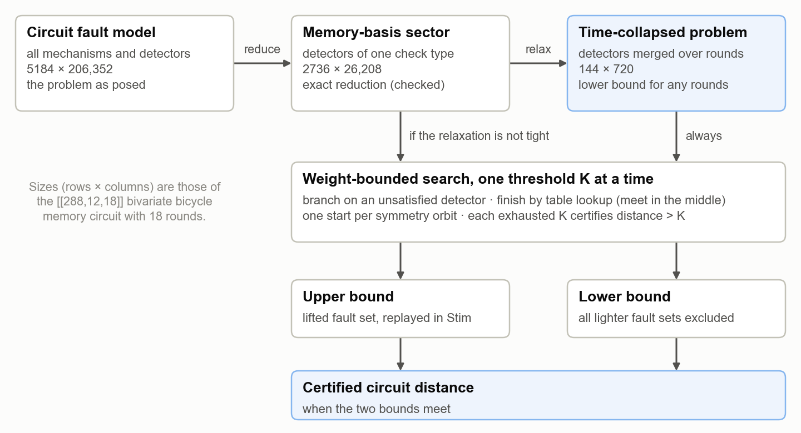
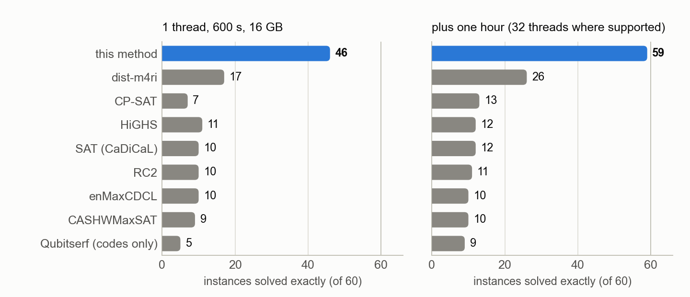
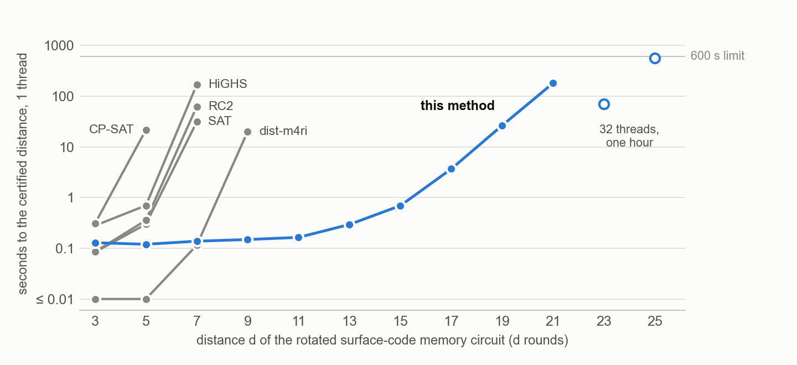
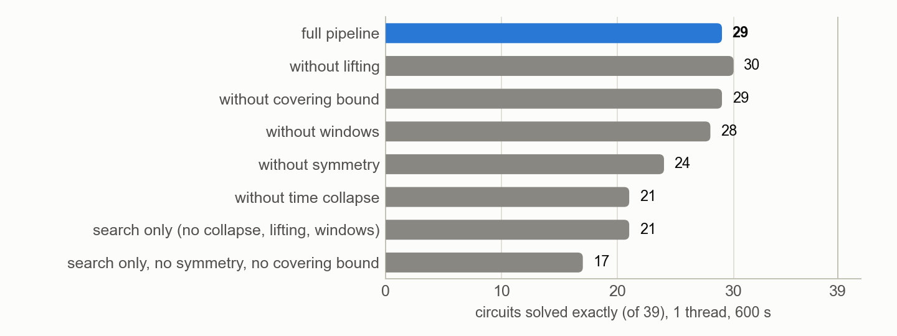
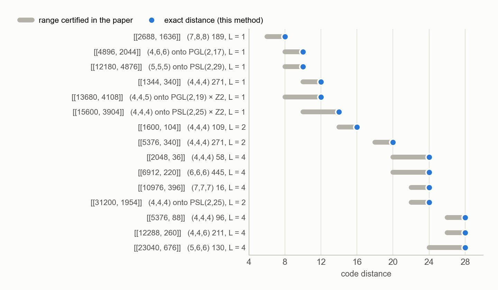
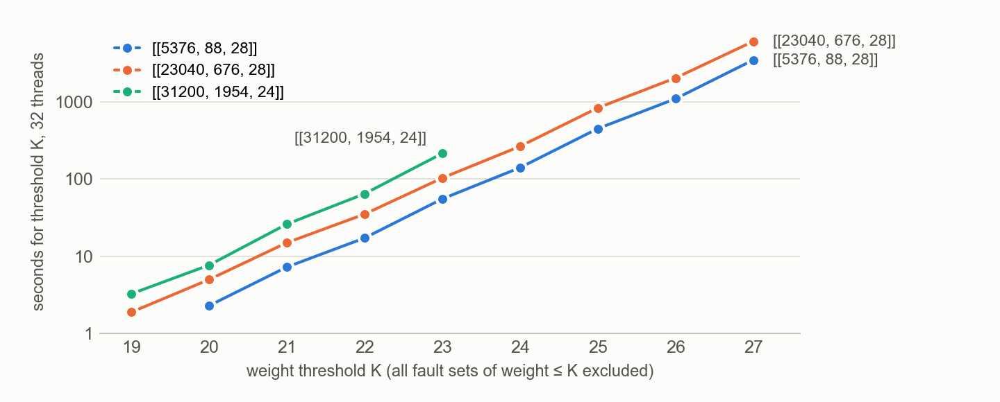

# Certified circuit distances by collapse, lift and weight-bounded search

Notes on the method and its numerical results, 7 October 2026. Working name of the method: **CLIMB**
(collapse, lift, meet in the middle, bound). Full tables are in [BENCHMARK.md](BENCHMARK.md) and
[PAPERS.md](PAPERS.md); the figures here are drawn from the result records by
`docs/make_figures.py`.

## 1. Summary

The circuit distance of a quantum memory is the smallest number of faults that no detector sees and
that flips a logical observable. It decides how well a syndrome-extraction circuit protects, and for
qLDPC codes it is usually reported only as an upper bound from a decoder or a heuristic search.

The method computes it exactly, as an interval that closes: a lower bound proved by excluding every
lighter fault set, and an upper bound given by an explicit fault set replayed in the simulator. Its
cost is governed by the distance and by a small relaxed problem, not by the size of the circuit.

- On a benchmark of 60 instances it solves 46 with one thread in 600 s and 59 with 32 threads in an
  hour. All other exact methods together solve 17 and 28, and none solves an instance it does not.
- Largest circuits closed: the [[288,12,18]] bivariate bicycle circuit (distance 16, 206,352 fault
  mechanisms) and a [[1044,526,12]] circuit (distance 10, 271,440 mechanisms).
- For a paper posted on 2 October 2026 it closed 15 code distances that the authors could only
  bracket, for codes of up to 31,200 qubits.

## 2. The problem

A circuit with its noise model defines a list of fault mechanisms. Mechanism j flips a set of
detectors, the column `h_j` of a binary matrix H, and a set of logical observables, the column
`l_j` of L. The circuit distance is

    d = min { |e| :  H e = 0,  L e ≠ 0 }      (arithmetic mod 2, |e| = number of faults).

With H a check matrix and L the logical operators, the same problem is the code distance. Circuits
make it large: a few hundred qubits measured for d rounds give 10⁴ to 10⁵ columns. H comes from
Stim's detector error model without decomposition, so a fault that flips three or more detectors
stays one fault.

"Certified" means: a lower bound K + 1 is proved by enumerating every candidate fault set of weight
at most K and finding none; an upper bound is a specific fault set, inserted into the circuit as
physical faults and simulated, which fires no detector and flips an observable.

## 3. The method

*Figure 1. The pipeline. Two problems derived from the circuit are searched by the same engine; the
relaxed one gives the lower bound cheaply, the exact one is needed only when the relaxation is not
tight.*

### 3.1 Exact reduction: the memory-basis sector

In a CSS memory experiment only one type of detector matters for one logical basis. Keeping those
rows of H shrinks the problem by an order of magnitude. The reduction is exact when every reduced
column is itself a mechanism of the full model that touches no other detector; this is checked for
each circuit, not assumed.

### 3.2 Certified relaxation: time collapse

A check is measured in every round, so it owns one detector per round. Add all detectors of the
same check together. A fault set that fires no detector still fires none after the addition, and it
flips the same observables. So the collapsed problem has a distance that is at most the true one: a
lower bound.

What makes this useful is its size. The collapsed problem no longer knows when a fault happened;
its columns are the single data errors and a few hook patterns per check. For the [[288,12,18]]
circuit, 26,208 columns become 720, whatever the number of rounds. The price is that the bound can
be loose: 0 to 4 below the true distance on the circuits studied, tight on surface codes.

The opposite restriction gives upper bounds: keep only the faults whose detection events lie in a
window of one or two rounds. Any solution of that sub-problem is a real fault set.

### 3.3 The search engine

One engine runs on every problem above. It is the partial-syndrome recursion of a trellis decoder,
kept sparse.

- **Weight thresholds.** For K = 1, 2, 3, … it looks for a solution of weight at most K. When a
  threshold is exhausted without a solution, d > K is proved.
- **Branching on detectors.** A partial fault set leaves some detectors fired. Any completion must
  contain a column that touches a given fired detector, so the search picks the fired detector with
  the fewest candidate columns and branches over them. Only connected, syndrome-driven fault sets
  are ever built.
- **Meet in the middle.** A table holds the syndrome of every set of at most k columns (k = 2 or 3).
  When k faults remain in the budget, one lookup replaces the last k levels of the tree.
- **Symmetry.** If a group of permutations maps the column set to itself, the solution can be
  assumed to contain a fixed representative of one orbit. For a bivariate bicycle code this divides
  the work by the number of translations (144 for [[288,12,18]]); for the hyperbolic codes of
  section 4.5 it leaves L² starting points whatever the size of the code.
- **Pruning by the relaxation.** The table of the collapsed problem is an admissible test on the
  exact one: if the collapsed remainder cannot be cancelled within the budget, the real one cannot
  either.
- **Many logical qubits.** States carry no logical label; the logical action is computed only for
  complete zero-syndrome sets. One pass serves any number of logical qubits (up to 4876 here).

The dense form of the same recursion, a min-plus dynamic program over all partial syndromes at a
cut ("Rank DP"), does not depend on the distance, but its table has 2^(cut rank) entries and the cut
rank grows with the code (97 for the collapsed [[288,12,18]] problem). It stops at about 90 qubits.
The sparse form keeps only the states reachable within the weight budget.

### 3.4 Closing the interval: lifting

The collapsed search returns its minimum-weight solutions, one per symmetry orbit. Each is a set of
column classes of the exact problem. A small search inside those classes, allowing a few extra
faults that are invisible after the collapse, either finds a real fault set of the same weight, which
closes the interval without searching the large problem, or shows that none exists. Then the bound
moves up by one and the engine continues, on the exact problem if necessary.

### 3.5 What the cost depends on

Roughly (number of symmetry orbits) × (branching factor)^(d − k), with the branching factor set by
how many columns touch a detector. Circuit size enters only through the orbit count and table sizes.
This is why a 31,200-qubit code of distance 24 takes minutes while a 720-qubit circuit whose
distance lies between 17 and 21 is still open: the exponent is the distance.

## 4. Numerical results

### 4.1 Benchmark against other exact methods

Sixty instances: 44 circuits (bivariate bicycle codes, circuits from recent papers, Stim's surface-
and color-code memories) and 16 code-distance problems, n up to 1044. Every method gets the same
matrices on the same machine (one socket of an AMD EPYC 9654): first 1 thread, 600 s and 16 GB, then
one hour, with 32 threads and 90 GB where the tool uses threads. Competing solvers are given the
sector problem, their best case. A harness checks every witness; no two records contradict.

*Figure 2. Instances solved exactly. Compared: connected-cluster enumeration (dist-m4ri, Qubitserf),
integer programming (HiGHS, CP-SAT), SAT and three MaxSAT solvers.*

| instance | columns | d | this method | best other exact method |
|---|---:|---:|---|---|
| [[72,12,6]] circuit | 2232 | 6 | 0.4 s | dist-m4ri, 5.0 s |
| [[90,8,10]] circuit | 4590 | 8 | 0.4 s | dist-m4ri, 2203 s on 32 threads |
| [[144,12,12]] circuit | 8784 | 10 | 1.4 s | none (dist-m4ri: 8 to 13 after an hour) |
| [[288,12,18]] circuit | 26,208 | 16 | 209 s on 32 threads | none |
| [[1044,526,12]] circuit | 35,496 | 10 | 881 s on 32 threads | none |
| [[288,12,18]] code | 288 | 18 | 3.1 s | Qubitserf, 2026 s on 32 threads |
| [[625,125,20]] code | 625 | 20 | 47 s on 32 threads | none |

Times without a thread count are single-thread. MaxSAT on Stim's own export of the whole circuit,
the recipe behind the exact values published so far, proves no qLDPC circuit distance within an
hour; its best lower bound is 3.

### 4.2 Scaling on surface-code circuits

The closest prior benchmark of exact solvers uses rotated surface-code memory circuits and reports
integer programming reaching d = 11, sometimes after more than eight hours.

*Figure 3. Time to the certified distance of Stim's surface-code memory circuit (sector problem, one
thread, 600 s limit). Each line ends at the last distance the method solved.*

The method stays near 0.2 s up to d = 11, because the collapsed problem is small and tight, and
reaches d = 25 in 564 s on 32 threads. One caveat: surface codes are graph-like, so a shortest-path
computation solves them at any size. The family is shown because others report on it.

### 4.3 Which ingredient matters

*Figure 4. The pipeline with one ingredient removed at a time, on the 39 circuits that have a sector
problem.*

The time collapse and the symmetry carry the method: without the collapse 21 circuits are solved in
place of 29, and the plain search without symmetry and covering bound solves 17. The windows contribute one case.
Lifting and the covering bound (a bound on the faults still needed for the fired detectors) do not
pay at this scale; several instances run faster without them.

The relaxation is a contribution on its own. Given the collapsed problems, dist-m4ri solves 20 of 39
where it solves 8 of the sector problems, and the search of section 3.3 solves 33 of them.

### 4.4 Published circuits

The same pipeline was applied to the circuits of 17 papers. Typical findings:

| code and circuit | code distance | circuit distance | published statement |
|---|---:|---:|---|
| [[288,12,18]], standard circuit | 18 | 16 | ≤ 18 |
| [[144,12,12]], standard circuit | 12 | 10 | ≤ 10 |
| [[144,12,12]], best of all 8496 depth-7 schedules | 12 | 11 | 11 conjectured |
| [[1044,526,12]] Cornucopia | 12 | 10 | ≤ 11 |
| [[300,60,14]] mitten, "hook-free" schedule | 14 | 12 | 14 |
| [[108,8,10]], depth-7 schedule found here | 10 | 10 | standard schedule: 8 |

Decoder upper bounds are often but not always tight, a claimed distance does not always survive at
circuit level, and the gate order matters as much as the code. Because one evaluation takes
seconds, whole families of schedules can be scored exactly.

### 4.5 A current test: modular hyperbolic codes (arXiv:2610.03682)

Higgott et al. construct color codes on fine-grained hyperbolic tilings and certify a distance only
when a graph lower bound and a string-operator upper bound coincide; otherwise they print a range.
Their exact tool, connected-cluster search, stops near 2000 qubits. No code or data is published, so
the tilings were rebuilt with GAP and identified by three independent checks (see PAPERS.md).

*Figure 5. The 15 ranges that could be reached. In every case the exact distance is the upper end:
the shortest logical operator is string-like.*

The 31,200-qubit code took 6.5 minutes on 32 threads; the three codes of distance 28 took between
two and three and a half hours each. Fifteen values that the paper does certify were reproduced as
checks.

*Figure 6. Time to exhaust one more weight threshold. The cost grows by a factor of about 3 per unit
of weight on these lattices, and depends only weakly on the size of the code.*

For the paper's modular surface-code circuits, whose circuit distance it gives only as Stim's
graph-like bound (6 to 8 for codes of distance 10), the circuits were rebuilt and tested against its
table. The exact circuit distance equals that bound in all 64 circuits computed. The schedule,
however, is not unique, and other valid choices do better: 8 where the paper reports 6, and 9 where
it reports 8.

## 5. Limits

- The exponent is the distance. Circuit distances up to about 16 are reachable for qLDPC codes, and
  code distances up to about 28 on two-dimensional lattices. The [[360,12,24]] circuit (17 to 21)
  and the mitten circuits of 500 qubits or more remain open.
- The reductions need structure: a CSS memory experiment, detectors that can be assigned to a check
  and a round, and symmetries supplied by the user. Without them the method is a plain search; on
  Stim's color-code circuits it is then comparable to dist-m4ri, which is faster up to d = 7.
- Not compared: Gurobi (no licence) and the codeDistance package. Every tool ran with default
  settings, the method included.
- A lower bound is as trustworthy as the enumeration code. It is checked against ground truth and
  against the bounds of ten other tools on 60 instances, and against 15 certified values of the
  hyperbolic-code paper, without a contradiction.
