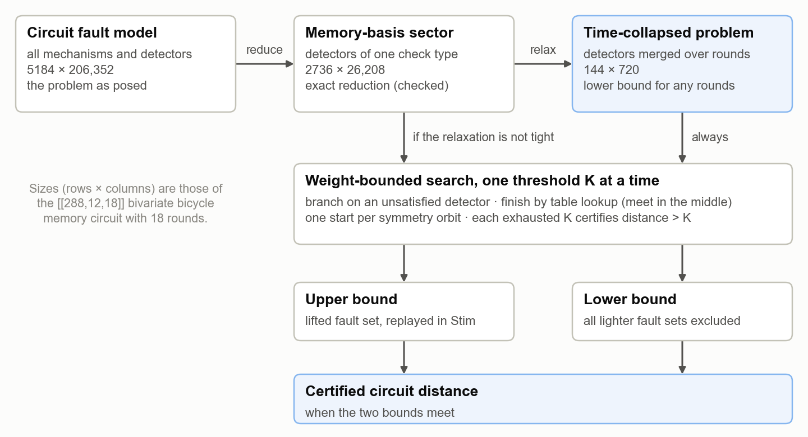
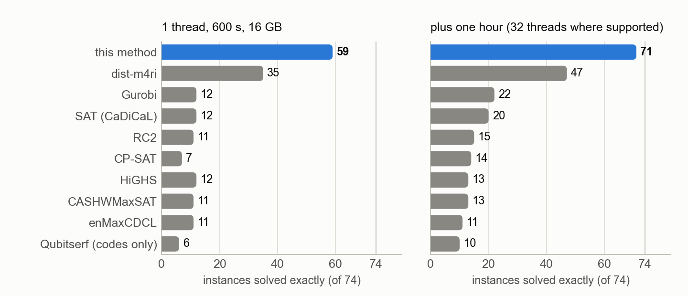
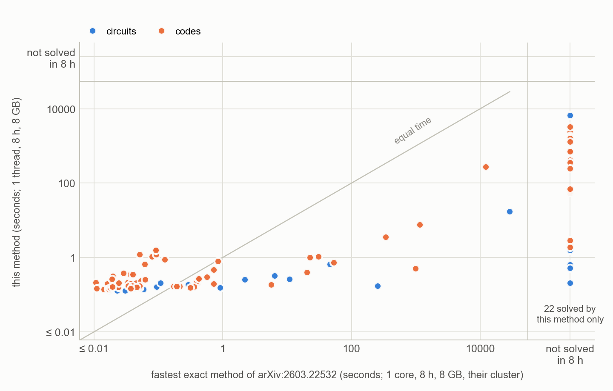
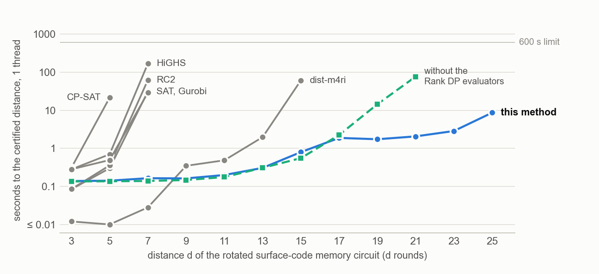
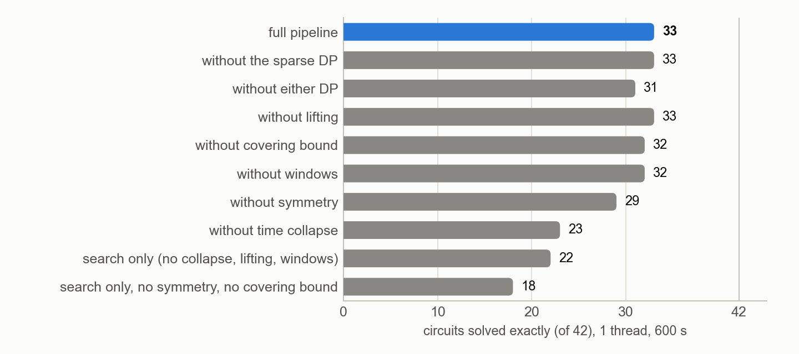
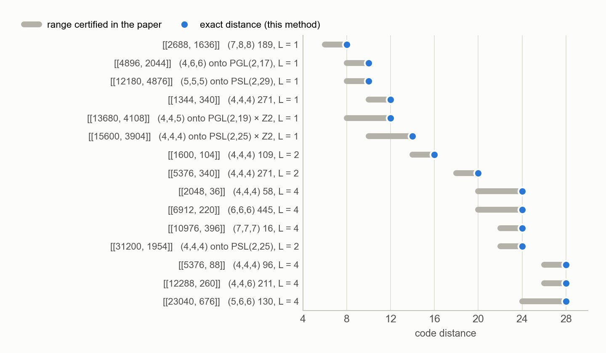
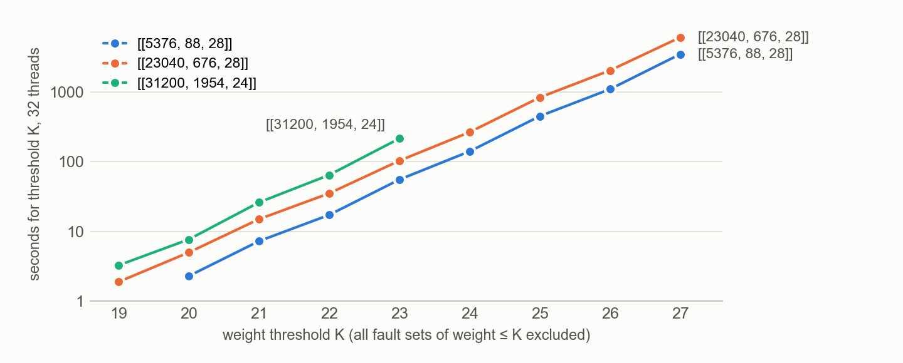

# Certified circuit distances by collapse, lift and weight-bounded search

Notes on the method and its numerical results, 7 October 2026, updated 19 October 2026 (Gurobi in
the benchmark; the instances of the prior benchmark, section 4.2; the October version of dist-m4ri; a
sparse logical basis for the code instances) and 25 October 2026 (the final configuration with two Rank DP
evaluators, section 3.6; 14 instances added to the benchmark; dist-m4ri with its model lower bound). Name of the method, provisional: the
**tropical partition function method**. The distance is a minimum of tropical partition functions; here it
is evaluated by a weight-bounded search with certified relaxations (collapse, lift, meet in the middle,
bound) and by two Rank DP evaluators of the same functions. Full tables are in
[BENCHMARK.md](../BENCHMARK.md) and [PAPERS.md](PAPERS.md); the figures here are drawn from the result
records by `docs/make_figures.py`.

## 1. Summary

The circuit distance of a quantum memory is the smallest number of faults that no detector sees and
that flips a logical observable. It decides how well a syndrome-extraction circuit protects, and for
qLDPC codes it is usually reported only as an upper bound from a decoder or a heuristic search.

The method computes it exactly, as an interval that closes: a lower bound proved by excluding every
lighter fault set, and an upper bound given by an explicit fault set replayed in the simulator. Its
cost is governed by the distance and by a small relaxed problem, not by the size of the circuit.

- On a benchmark of 74 instances it solves 59 with one thread in 600 s and 71 with 32 threads in an
  hour. All other exact methods together, among them Gurobi and the October version of dist-m4ri with
  its model lower bound, solve 38 and 53. One instance, a many-hypercube code with 256 logical qubits,
  is solved by another method (SAT, in 21 minutes) and not by this one.
- On the 126 CSS instances of the most recent benchmark of distance methods (arXiv:2603.22532), run
  from that study's own files and under its own limits (one core, 8 GB and eight hours per run), it
  solves 95; that study's five exact methods together solved 73, all of them among these. With one
  thread and 600 s it already solves 86 (the current dist-m4ri, run here: 76); with 32 threads and an
  hour, 97 (dist-m4ri: 80), among them the superdense color-code circuit of d = 11, whose distance (11)
  no method had certified.
- Largest circuits closed: the [[288,12,18]] bivariate bicycle circuit (distance 16, 206,352 fault
  mechanisms) and a [[1044,526,12]] circuit (distance 10, 271,440 mechanisms).
- For a paper posted on 2 October 2026 it closed 15 code distances that the authors could only
  bracket, for codes of up to 31,200 qubits.

## 2. The problem

A circuit with its noise model defines a list of fault mechanisms. Mechanism j flips a set of
detectors, the column `h_j` of a binary matrix H, and a set of logical observables, the column
`l_j` of L. The circuit distance is

    d = min { |e| :  H e = 0,  L e ≠ 0 }      (arithmetic mod 2, |e| = number of faults).

With H a check matrix and L the logical operators, the same problem is the code distance. Circuits
make it large: a few hundred qubits measured for d rounds give 10⁴ to 10⁵ columns. H comes from
Stim's detector error model without decomposition, so a fault that flips three or more detectors
stays one fault.

"Certified" means: a lower bound K + 1 is proved by enumerating every candidate fault set of weight
at most K and finding none; an upper bound is a specific fault set, inserted into the circuit as
physical faults and simulated, which fires no detector and flips an observable.

## 3. The method

*Figure 1. The pipeline. Two problems derived from the circuit are searched by the same engine; the
relaxed one gives the lower bound cheaply, the exact one is needed only when the relaxation is not
tight.*

### 3.1 Exact reduction: the memory-basis sector

In a CSS memory experiment only one type of detector matters for one logical basis. Keeping those
rows of H shrinks the problem by an order of magnitude. The reduction is exact when every reduced
column is itself a mechanism of the full model that touches no other detector; this is checked for
each circuit, not assumed.

### 3.2 Certified relaxation: time collapse

A check is measured in every round, so it owns one detector per round. Add all detectors of the
same check together. A fault set that fires no detector still fires none after the addition, and it
flips the same observables. So the collapsed problem has a distance that is at most the true one: a
lower bound.

What makes this useful is its size. The collapsed problem no longer knows when a fault happened;
its columns are the single data errors and a few hook patterns per check. For the [[288,12,18]]
circuit, 26,208 columns become 720, whatever the number of rounds. The price is that the bound can
be loose: 0 to 4 below the true distance on the circuits studied, tight on surface codes.

The opposite restriction gives upper bounds: keep only the faults whose detection events lie in a
window of one or two rounds. Any solution of that sub-problem is a real fault set.

### 3.3 The search engine

One engine runs on every problem above. It is the partial-syndrome recursion of a trellis decoder,
kept sparse.

- **Weight thresholds.** For K = 1, 2, 3, … it looks for a solution of weight at most K. When a
  threshold is exhausted without a solution, d > K is proved.
- **Branching on detectors.** A partial fault set leaves some detectors fired. Any completion must
  contain a column that touches a given fired detector, so the search picks the fired detector with
  the fewest candidate columns and branches over them. Only connected, syndrome-driven fault sets
  are ever built.
- **Meet in the middle.** A table holds the syndrome of every set of at most k columns (k = 2 or 3).
  When k faults remain in the budget, one lookup replaces the last k levels of the tree.
- **Symmetry.** If a group of permutations maps the column set to itself, the solution can be
  assumed to contain a fixed representative of one orbit. For a bivariate bicycle code this divides
  the work by the number of translations (144 for [[288,12,18]]); for the hyperbolic codes of
  section 4.6 it leaves L² starting points whatever the size of the code.
- **Pruning by the relaxation.** The table of the collapsed problem is an admissible test on the
  exact one: if the collapsed remainder cannot be cancelled within the budget, the real one cannot
  either.
- **Many logical qubits.** States carry no logical label; the logical action is computed only for
  complete zero-syndrome sets. One pass serves any number of logical qubits (up to 4876 here).

The dense form of the same recursion, a min-plus dynamic program over all partial syndromes at a
cut ("Rank DP"), does not depend on the distance, but its table has 2^(cut rank) entries and the cut
rank grows with the code (97 for the collapsed [[288,12,18]] problem). On expanding codes it stops at
about 90 qubits; where the cut rank stays small it is the faster evaluator (section 3.6).

### 3.4 Closing the interval: lifting

The collapsed search returns its minimum-weight solutions, one per symmetry orbit. Each is a set of
column classes of the exact problem. A small search inside those classes, allowing a few extra
faults that are invisible after the collapse, either finds a real fault set of the same weight, which
closes the interval without searching the large problem, or shows that none exists. Then the bound
moves up by one and the engine continues, on the exact problem if necessary.

### 3.5 What the cost depends on

Roughly (number of symmetry orbits) × (branching factor)^(d − k), with the branching factor set by
how many columns touch a detector. Circuit size enters only through the orbit count and table sizes.
This is why a 31,200-qubit code of distance 24 takes minutes while a 720-qubit circuit whose
distance lies between 17 and 21 is still open: the exponent is the distance.

### 3.6 Two Rank DP evaluators of the same quantity

The final configuration of the method uses three exact evaluators of the same minimum and chooses
between them by predicted cost, never by hand:

- the **dense Rank DP** sweeps the columns in one order and keeps, for every state of the boundary between
  processed and unprocessed columns, the least weight that reaches it. Its cost is computed exactly from
  its plan before it runs, about 2^w per column for a boundary of rank w, independent of the distance. It
  settles narrow problems of large distance (the color code of d = 31 in six minutes, the concatenated
  Steane code [[2401,1,81]] in 1.2 s, of which the DP takes 11 ms) and the time-collapsed problems of
  surface-code circuits (rank 13 to 16) in milliseconds;
- the **weight-truncated sparse Rank DP** keeps only states of weight at most K, split between a forward
  and a backward sweep that meet at every cut. It decides wider local problems whose partial fault sets
  merge: it certified the superdense color-code circuit of d = 11, whose sector problem has rank 54;
- the **weight-bounded search** above decides everything else, in particular expanding qLDPC codes, whose
  boundary rank is large.

## 4. Numerical results

### 4.1 Benchmark against other exact methods

74 instances: 47 circuits (bivariate bicycle codes, circuits from recent papers, Stim's surface-
and color-code memories, superdense color-code circuits) and 27 code-distance problems, n up to 2401.
14 of them were added on 23 October where the Rank DP evaluators decide: color codes of d = 19 to 31,
concatenated Steane codes, the thin tile codes of arXiv:2606.19482 (whose X distances that paper gives
only as upper bounds; [[259,2]] has 36, one below its bound), a many-hypercube code and the superdense
circuits of d = 7 to 11. Every method gets the same
matrices on the same machine (one socket of an AMD EPYC 9654): first 1 thread, 600 s and 16 GB, then
one hour, with 32 threads and 90 GB where the tool uses threads. Competing solvers are given the
sector problem, their best case. A harness checks every witness; no two records contradict.

*Figure 2. Instances solved exactly. Compared: connected-cluster enumeration (dist-m4ri in its version
of 15 October, with and without its model lower bound; Qubitserf), integer programming (HiGHS, CP-SAT, Gurobi), SAT and three MaxSAT solvers. A
tool counts an instance if any of its configurations solves it.*

| instance | columns | d | this method | best other exact method |
|---|---:|---:|---|---|
| [[72,12,6]] circuit | 2232 | 6 | 0.3 s | dist-m4ri, 0.1 s |
| [[90,8,10]] circuit | 4590 | 8 | 0.5 s | dist-m4ri, 51 s |
| [[144,12,12]] circuit | 8784 | 10 | 1.6 s | dist-m4ri, 348 s on 32 threads |
| [[288,12,18]] circuit | 26,208 | 16 | 220 s on 32 threads | none |
| [[1044,526,12]] circuit | 35,496 | 10 | 927 s on 32 threads | none |
| superdense color-code circuit, d = 11 | 5250 | 11 | 30 min on 32 threads | none |
| [[288,12,18]] code | 288 | 18 | 1.8 s | dist-m4ri, 115 s |
| [[625,125,20]] code | 625 | 20 | 59 s on 32 threads | none |
| color code, d = 31 | 721 | 31 | 351 s | none |
| concatenated Steane code [[2401,1,81]] | 2401 | 81 | 1.2 s | SAT, 16 min |
| many-hypercube code [[1296,256,16]] | 1296 | 16 | at least 14 | SAT, 21 min |

Times without a thread count are single-thread. MaxSAT on Stim's own export of the whole circuit,
the recipe behind the exact values published so far, proves no qLDPC circuit distance within an
hour; its best lower bound is 3. Gurobi, run when a licence became available, solves 12 instances in
the first tier and 22 over both, each of them also solved by another method; the [[72,12,6]]
circuit takes it 534 s on 32 threads. SAT, given an hour, solves several of the instances added for the
DP evaluators that this method solves in seconds, and the many-hypercube code that it does not.

The strongest competitor, dist-m4ri, improved a lot during this work: its version of 15 October (0.14.7)
solves 30 and 38 of the first 60 instances, where the September version solved 17 and 26 (BENCHMARK.md
compares the two). Its model lower bound (`--model-lb`, part of that version, run here on 25 October)
adds five circuits that before only this method solved: the surface code of d = 15 to 19 and two
gross-code circuits, one of them in 52 minutes on 32 threads (this method: 84 s on one). It is now faster
than this method on 18 instances: on 14 of them both need less than two seconds; the others are Stim's
color-code circuits of d = 9 and 11, to which none of the reductions applies, the Cornucopia circuit of
n = 252 (0.4 s against 2.4 s) and a shift circuit of n = 120 (2.3 s against 13 s, with the model
bound). It solves no instance that this method does not, and on the 20 instances where both need more
than a second and this method is faster, this method is 3 to 509 times faster (dist-m4ri's best run in
either tier against one thread of this method).

The logical operators of the code instances were first computed by a generic construction whose rows are,
on codes with many logical qubits, up to 5 times denser than the standard form that the prior benchmark
uses. Integer programs and SAT encodings turn every logical row into a parity constraint, so these tools
were run again on a sparse basis of the same logical space. On the 27 codes here this gains them
nothing, and some lose codes on it (Gurobi [[288,12,18]] and [[324,12,18]]); on the hyperbolic codes of
section 4.2, which have many logical qubits, it lets Gurobi solve 33 of 42 within 600 s instead of 30.
A tool is credited with an instance it solves on either basis.

### 4.2 The instances of the prior benchmark

Webster, Jacob and Higgott (arXiv:2603.22532) compare distance methods on instances they publish
with their results. All of their CSS instances were run here from their files: 103 codes
(hyperbolic surface and colour codes, lifted-product, bivariate bicycle and quantum Tanner codes) and
23 memory circuits (surface code; colour code with the midout and the superdense cycle; bivariate
bicycle codes). Their circuit problem, the error model filtered to the detectors of one basis, is
exactly the sector problem of section 3.1, column for column. For a code they compute the Z
distance, and so does this comparison. Their exact methods (Gurobi, SCIP, the MaxSAT solver CLISAT,
dist-m4ri's connected clusters, Magma's Brouwer-Zimmermann) ran once per instance with one CPU
core, 8 GB and eight hours each on their cluster; their own result sheets are used.

| family | instances | this method, 1 thread, 600 s | 1 thread, 8 h, 8 GB | 600 s + 32 threads, 1 h | any of their five (1 core, 8 h, 8 GB each) |
|---|---:|---:|---:|---:|---:|
| circuits (four families) | 23 | 19 | 20 | 21 | 15 |
| hyperbolic surface and colour codes | 42 | 42 | 42 | 42 | 42 |
| lifted-product codes | 19 | 14 | 19 | 19 | 6 |
| bivariate bicycle codes | 20 | 6 | 8 | 8 | 5 |
| quantum Tanner codes | 22 | 5 | 6 | 7 | 5 |
| **all** | 126 | **86** | **95** | **97** | **73** |

*Figure 3. One point per instance, both sides under the limits of the prior benchmark (one core,
8 GB, eight hours): time of this method with one thread against the fastest of its five exact
methods on their machine. Points on the right are instances only this method solves; no instance
that they solve is missing. Times near 0.1 s are mostly the start of the Python process.*

Where their exact methods certified a distance (73 instances), the values agree. Of the 24 values
certified only here, all but one confirm the best value their heuristics had found; the exception
is the [[288,12,18]] bivariate bicycle circuit, whose distance is 16 where the best value found there
is 24. The new values include the remaining bivariate bicycle circuits up to [[288,12,18]], the
surface-code circuit of d = 11, every lifted-product code from n = 714 to 3230 (distances 16 to 24),
the bivariate bicycle codes [[288,12,18]], [[360,12,24]] and [[576,8,24]], and the quantum Tanner
codes of n = 216 and 252 (distances 18 and 22). Its [[360,12,24]] circuit, with best value 88 there,
has distance at least 17 (17 to 21 after longer runs, see PAPERS.md). All but two of the new values
(the Tanner code of n = 252, 40 minutes on 32 threads, and the superdense colour-code circuit of d = 11,
30 minutes on 32 threads) were obtained within the paper's own limits;
the [[288,12,18]] circuit took 2.3 hours on one thread. For the 31 instances still open, the
eight-hour runs certify lower bounds: 21 to 28 for the codes, 10 to 17 for the circuits (10 for the
superdense colour-code circuit of d = 11, whose best value is 11). That circuit is settled outside these
limits: the Rank DP truncated at a weight threshold shows that its distance is 11 (13 minutes on one
thread, results/sparse_dp/README.md; 30 minutes in the benchmark's second tier), but its certificate needs
about 12 GB, more than the 8 GB of the paper's limits. Its seven bivariate bicycle
circuits turn out to be the files of this project's first study, five of which are in the benchmark
of section 4.1. Run here with first-tier limits, Gurobi solves 55 of the 126 instances (58 on the
sparse basis of the codes) and the current dist-m4ri 76 (its September version 68), against 70 and 71 in
the paper's eight-hour runs of the two tools.

### 4.3 Scaling on surface-code circuits

On its rotated surface-code circuits (d = 3 to 11), the exact methods of the prior benchmark certify
up to d = 9 with one thread and eight hours (dist-m4ri in 253 s); at d = 11 integer programming stops
at the time limit with the right value but without a proof. This method takes 0.2 s for each.

*Figure 4. Time to the certified distance of Stim's own surface-code memory circuit, generated here
up to d = 25 (sector problem, one thread, 600 s limit). Each line ends at the last distance the
method solved; dist-m4ri is its fastest configuration at each distance, with its model lower bound from
d = 9 on. Dashed: the same pipeline without its Rank DP evaluators (ablation of the final pass).*

The method stays near 0.2 s up to d = 11, because the collapsed problem is small and tight, and reaches
d = 25 in 8.6 s with one thread. Without the DP evaluators the cost is the exhaustive search of the
collapsed problem, and the search alone stops at d = 21 (77 s); that problem's Rank DP width is only
13 to 16, so the dense DP settles it in milliseconds. One caveat: surface codes are graph-like, so a
shortest-path computation solves them at any size. The family is shown because others report on it.

### 4.4 Which ingredient matters

*Figure 5. The final configuration with one ingredient removed at a time, on the 42 circuits that have a
sector problem (one thread, 600 s).*

The time collapse and the symmetry carry the method: without the collapse 23 circuits are solved in
place of 33, and the plain search without symmetry and covering bound solves 18. The dense DP adds the
surface code of d = 23 and 25 (31 without either DP evaluator); the sparse DP adds no circuit at this
limit but takes the superdense circuit of d = 9 from 458 s to 17 s, and decides the one of d = 11 in the
second tier. The windows and the covering bound contribute one case each. Lifting does not pay at this
scale; several instances run faster without it.

The relaxation is a contribution on its own. Given the collapsed problems, the current dist-m4ri solves
29 of 42 where it solves 18 of the sector problems, and the search of section 3.3 solves 36 of them.

### 4.5 Published circuits

The same pipeline was applied to the circuits of 17 papers. Typical findings:

| code and circuit | code distance | circuit distance | published statement |
|---|---:|---:|---|
| [[288,12,18]], standard circuit | 18 | 16 | ≤ 18 |
| [[144,12,12]], standard circuit | 12 | 10 | ≤ 10 |
| [[144,12,12]], best of all 8496 depth-7 schedules | 12 | 11 | 11 conjectured |
| [[1044,526,12]] Cornucopia | 12 | 10 | ≤ 11 |
| [[300,60,14]] mitten, "hook-free" schedule | 14 | 12 | 14 |
| [[108,8,10]], depth-7 schedule found here | 10 | 10 | standard schedule: 8 |

Decoder upper bounds are often but not always tight, a claimed distance does not always survive at
circuit level, and the gate order matters as much as the code. Because one evaluation takes
seconds, whole families of schedules can be scored exactly.

### 4.6 A current test: modular hyperbolic codes (arXiv:2610.03682)

Higgott et al. construct color codes on fine-grained hyperbolic tilings and certify a distance only
when a graph lower bound and a string-operator upper bound coincide; otherwise they print a range.
Their exact tool, connected-cluster search, stops near 2000 qubits. No code or data is published, so
the tilings were rebuilt with GAP and identified by three independent checks (see PAPERS.md).

*Figure 6. The 15 ranges that could be reached. In every case the exact distance is the upper end:
the shortest logical operator is string-like.*

The 31,200-qubit code took 6.5 minutes on 32 threads; the three codes of distance 28 took between
two and three and a half hours each. Fifteen values that the paper does certify were reproduced as
checks.

*Figure 7. Time to exhaust one more weight threshold. The cost grows by a factor of about 3 per unit
of weight on these lattices, and depends only weakly on the size of the code.*

For the paper's modular surface-code circuits, whose circuit distance it gives only as Stim's
graph-like bound (6 to 8 for codes of distance 10), the circuits were rebuilt and tested against its
table. The exact circuit distance equals that bound in all 64 circuits computed. The schedule,
however, is not unique, and other valid choices do better: 8 where the paper reports 6, and 9 where
it reports 8.

## 5. Limits

- The exponent is the distance. Circuit distances up to about 16 are reachable for qLDPC codes, and
  code distances up to about 28 on two-dimensional lattices. The [[360,12,24]] circuit (17 to 21)
  and the mitten circuits of 500 qubits or more remain open.
- The Rank DP evaluators need a narrow problem: their cost grows with the boundary rank, not with the
  distance. On the many-hypercube code [[1296,256,16]] (rank 85) neither applies, and SAT is the only
  method that solves it (21 minutes, one thread). The sparse DP's certificate for the superdense circuit
  of d = 11 needs about 12 GB, so under the prior benchmark's 8 GB limit that circuit stays open.
- The reductions need structure: a CSS memory experiment, detectors that can be assigned to a check
  and a round, and symmetries supplied by the user. Without them the method is a plain search; on
  Stim's color-code circuits the current dist-m4ri is faster at every distance tested (d = 11: 20 s
  against 280 s). On instances that take either tool a second or two, dist-m4ri is also faster; most of
  this method's time there is the start of Python.
- Of the prior benchmark's exact methods, SCIP, CLISAT and Magma were not run here; their published
  eight-hour runs are compared instead (section 4.2). Every tool ran with default settings, the
  method included.
- A lower bound is as trustworthy as the enumeration code. It is checked against ground truth and
  against the bounds of eleven other tools on 74 instances, against the published results of the
  prior benchmark on 126 instances, and against 15 certified values of the hyperbolic-code paper,
  without a contradiction.
